# 电商商城平台

> 一个围绕真实交易链路设计的前后端分离商城项目，覆盖商品、购物车、订单、库存、微信/支付宝支付、履约、退款、账单对账、用户与后台管理，并以 DDD、CAS、分布式锁、Transactional Outbox、RabbitMQ Failure DLQ / Parking Lot 等机制保证并发与最终一致性。

## 1. 项目概览

项目由 3 个工程组成：

- `backend/`：Spring Boot 3.5.16 + Java 21 后端。
- `user-ui/`：React 18 用户商城，开发端口 `3000`；仅面向手机端适配，宽屏浏览器中保持最大 480px 的手机画布，不提供桌面版布局。
- `admin-ui/`：React 18 管理后台，开发端口 `3002`。

服务治理使用 Nacos 做服务注册与配置中心；进程间内部调用统一走 Spring Cloud OpenFeign（直连地址可覆盖），网关按 `lb://` 服务名路由。

后端按 8 个限界上下文组织：

```text
shared / product / order / payment / refund / user / cart / bill
```

每个业务上下文采用统一四层：

```text
interfaces → application → domain ← infrastructure
```

完整架构和代码导览见 [15. 代码导览](#15-代码导览)。开发规范见 [AGENTS.md](AGENTS.md)。

## 2. 业务能力

### 2.1 用户商城

- 用户注册、登录、退出、Access/Refresh 双 Token 刷新。
- 会话治理：一次登录一个会话（`sid`），支持按设备查看、踢单设备、踢全部；退出只下线当前设备。
- 登录失败保护：同一用户名连续输错密码达到阈值后短时锁定。
- 商品列表（服务端分页）、商品库存展示。
- 购物车（DM8 `t_cart_item`，由购物车服务统一持久化）。
- 收货地址 CRUD、默认地址、三级行政区划级联。
- 多商品结算、订单快照价、订单查询。
- 微信支付 V3 Native 扫码支付、JSAPI 能力、回调、主动查单、退款、账单相关接口。
- 微信支付 V2 Native 兼容链路。
- 支付宝支付、通知、查单、关单、退款、账单下载地址。
- 发货/物流状态查看、送达后确认收货。
- 已付款未发货取消订单。
- 分项退款、仅退款、退货退款、退款申请编辑/撤销；已发货未收货退款由管理员确认商品丢失或已全部回收后再发起渠道退款。
- 支付成功页和退款申请列表。

### 2.2 管理后台

- 订单列表（服务端分页）、订单详情、状态筛选。
- 待发货订单、模拟发货。
- 强制关单、渠道查单、标记线下已付款。
- 支付尝试记录查看。
- 商品 CRUD、上下架、单个/批量库存调整，商品列表支持服务端分页。
- 库存流水分页与审计。
- Excel 库存导入、编辑、确认入库。
- Excel 文件支持本地磁盘或 MinIO 存储。
- 退款受理、拒绝、已发货商品去向判定（丢失/全部回收）、退货签收、渠道重试、状态同步、差价退款。
- 用户列表、启用/禁用、用户详情。
- 密码重置申请受理/拒绝、管理员直接重置密码。
- 支付渠道和支付应用配置维护、缓存刷新。
- 微信交易账单 XLSX 上传、同步对账、差异查看、重跑、人工标记处理。

## 3. 交易系统核心设计

### 3.1 库存四桶模型

`t_product` 使用四桶库存：

```text
available_stock  可用
locked_stock     锁定
sold_stock       已售
lost_stock       货损
```

核心恒等式：

```text
available + locked + sold + lost = 入库总量
```

典型流转：

```text
下单：       available → locked
支付成功：   预占状态 LOCKED → COMMITTED，库存数量不变
关单/取消：  locked → available
确认收货：   locked → sold
已发货退款： 管理员判定丢失 → locked → lost
             管理员确认全部回收 → locked → available
已收货仅退款：sold → lost
退货退款：   退货签收后 sold → available
```

防超卖由 `ProductMapper.reserveStock` 条件 UPDATE 作为根闸门：库存不足时整个下单事务回滚，不生成有效订单。

所有库存变化都写 `t_inventory_transaction`，并使用 `biz_no` + 数据库唯一约束保证幂等。

### 3.2 本地订单与支付单

业务订单与渠道支付尝试为 `1:N`：

```text
t_order_info
    └── 1:N t_payment_order
```

规则：

- 同渠道已有活跃支付单时优先复用。
- 跨渠道可以创建不同支付尝试。
- 一个业务订单最终只允许一笔有效成交，由 `t_payment_deal` 的 `order_no` / `payment_no` 双唯一键兜底。
- 首笔成交后关闭其它活跃支付尝试并对订单发 `PAYMENT_SUCCEEDED` 事件。
- 重复支付、关单后晚到支付以 `DUPLICATE_PAYMENT_DETECTED` / `PAYMENT_LATE_ARRIVED` 事件通知退款侧自动冲正，不回补库存。

### 3.3 并发与幂等

关键交易路径采用：

```text
通知去重（部分渠道回调）
        ↓
Redisson 分布式锁
        ↓
CAS 条件 UPDATE
        ↓
数据库唯一约束 / biz_no
```

项目不使用 `select ... for update` 作为关键并发控制方案。订单、支付、退款等状态推进以分布式锁 + CAS 为主。

### 3.4 退款

退款覆盖：

- 未发货取消。
- 退货退款。
- 仅退款。
- 差价退款。
- 重复支付自动冲正。
- 晚到支付自动冲正。

退款额度由服务端 `RefundPolicy` 最终核算，受理阶段冻结可退金额/数量，避免并发超退。

库存处理严格区分资金与货权：

- 未发货取消：可回补锁定库存。
- 已发货未收货 `REFUND_ONLY`：管理员受理时必须确认商品最终去向；`LOST` 执行 `locked → lost`，`RECOVERED` 执行 `locked → available`，判定完成后才发起渠道退款。
- 已收货 `REFUND_ONLY`：商品不退回，执行 `sold → lost`。
- `RETURN_AND_REFUND`：退货签收/质检后执行 `sold → available`，再发起渠道退款。
- 差价退款与系统资金冲正：不动库存。

## 4. RabbitMQ 与最终一致性

项目当前使用 `MANUAL ACK`：只有业务处理与本地消息状态回写成功后才显式确认消息。

```yaml
spring:
  rabbitmq:
    listener:
      simple:
        acknowledge-mode: manual
        default-requeue-rejected: false
        retry:
          enabled: true
          max-attempts: 4
          initial-interval: 2000
          multiplier: 3.0
          max-interval: 20000
```

消费语义：

```text
业务成功
→ markConsumed
→ Channel.basicAck(deliveryTag, false)

业务 / markConsumed / basicAck 异常
→ 异常向外抛出
→ Spring Retry
→ 重试耗尽 RejectAndDontRequeue
→ Release Queue DLX
→ Failure Queue
```

这是 **at-least-once** 语义：如果业务与 `markConsumed` 已成功，但 broker ACK 因连接故障失败，消息可能再次投递；现有订单/退款 CAS、分布式锁与 `biz_no` 幂等必须继续保留，用来安全承接重复消费。

订单超时关单和退款状态同步均采用独立失败拓扑：

```text
Event Exchange
    ↓
Delay Queue
    ↓ TTL
Dead Letter Exchange
    ↓
Release Queue
    ↓
Consumer
    ├─ success → MANUAL basicAck
    └─ retry exhausted
          ↓
     Failure Exchange
          ↓
     Failure Queue
          ↓
     人工排障 / 重放
          ↓
     Parking Lot Queue（可选人工隔离）
```

Parking Lot Queue 不配置自动消费者，不自动回灌，避免 poison message 形成失败循环。

此外还有两层保障：

- `t_local_message` Transactional Outbox：业务事务内先落 `PENDING`，事务提交后发消息，broker confirm 后置 `SENT`，消费完成后置 `CONSUMED`。
- 支付业务事件（`payment.succeeded` / `payment.duplicate` / `payment.late`）由 `payment.event.exchange` 投递，订单与退款侧用 `t_consumer_dedupe` 按 `event_id` 去重；失败进入独立的 `payment.event.failure.exchange` 与 Parking Lot。
- DB 最终一致性兜底：`TimeoutOrderCloseScheduler` 扫描超时 `NOTPAY` 订单并重新走渠道反查/关单链路，`RefundStatusSyncScheduler` 扫描 `APPROVED + PROCESSING` 退款并重新走 `queryRefundStatus`。两者均按“单条失败不阻塞整批”执行，即使 MQ 不可用、Retry 耗尽进入 Failure Queue 或消息未及时消费，数据库状态仍会持续收敛。

详细拓扑、迁移、Failure Queue 处理与回滚见 [backend/docs/RABBITMQ_OPERATIONS.md](backend/docs/RABBITMQ_OPERATIONS.md)。

### 4.1 RabbitMQ 升级注意

如果旧环境已存在以下 Release Queue：

```text
payment.order.close.release.queue
payment.refund.status-sync.release.queue
```

当前版本给它们新增了 `x-dead-letter-exchange` 和 `x-dead-letter-routing-key`。RabbitMQ Queue arguments 无法原地修改，首次升级必须按运维文档执行：

1. 停止对应消费者/应用。
2. 确认 Release Queue 内无需要保留的未处理消息，必要时先备份/转存。
3. 删除旧 Release Queue。
4. 启动应用，让 Spring AMQP 按新参数重新声明。
5. 检查 Failure Exchange / Failure Queue / Parking Lot Queue binding。

否则可能出现 `PRECONDITION_FAILED`。

## 5. 账账核对

管理员上传微信支付下载的交易账单 XLSX（`.xlsx`）后，系统同步执行“渠道交易账 vs 平台交易账”的双向账账核对，不走 MQ。前端和后端都只接受 `.xlsx`，后端使用 Apache POI 读取真实 Excel 工作簿，不把 CSV 改后缀伪装成 XLSX：

```text
渠道账：t_bill_record（微信交易账单）
              ↕
       双向逐笔 + 汇总平衡
              ↕
平台账：t_payment_order + t_refund_order
```

支付账以 `PaymentOrder` 为权威账本，保留“订单 1:N 支付尝试”语义；优先按 `channel_order_no ↔ 微信订单号` 逐笔匹配，`order_no` 仅作辅助定位，禁止按订单号聚合后核对。退款账以 `RefundOrder.refund_no` 为主匹配键。

日切口径统一为 `Asia/Shanghai`：支付按 `paid_time` 归账，退款按 `success_time` 归账，避免创建时间、申请时间或服务器默认时区造成跨日假差异。

支持账单类型：

| 类型 | 内容 | 对账范围 |
|---|---|---|
| `ALL` | 支付 + 退款 + 撤销 | 支付与退款 |
| `SUCCESS` | 支付成功 | 支付 |
| `REFUND` | 退款 | 退款 |

差异覆盖单边账、金额/状态、串单和重复流水：

```text
PAY_CHANNEL_ONLY
PAY_LOCAL_ONLY
PAY_AMOUNT_MISMATCH
PAY_STATUS_MISMATCH
PAY_SERIAL_MISMATCH
PAY_BIZ_NO_MISMATCH
PAY_CHANNEL_DUPLICATE
PAY_LOCAL_DUPLICATE

REFUND_CHANNEL_ONLY
REFUND_LOCAL_ONLY
REFUND_AMOUNT_MISMATCH
REFUND_STATUS_MISMATCH
REFUND_CHANNEL_DUPLICATE
```

批次汇总同时核对支付笔数/金额、退款笔数/金额与净交易额：

```text
渠道净交易额 = 渠道支付金额 - 渠道退款/冲减金额
平台净交易额 = PaymentOrder.SUCCESS.paidAmount - RefundOrder.SUCCESS.refundAmount
净差额       = 渠道净交易额 - 平台净交易额
```

只有“支付笔数/金额一致 + 退款笔数/金额一致 + 净额一致 + 无 OPEN 差异”才判定 `balanced=true`，避免多笔错误金额互相抵消后被误判平账。汇总接口：`GET /api/reconciliation/imports/{importNo}/summary`。

差异列表支持“核验下钻”：`GET /api/reconciliation/discrepancies/{id}/drilldown` 同时返回渠道账 XLSX 原始行快照、平台 `PaymentOrder/RefundOrder` 候选账本记录，以及业务单号、渠道流水号、金额、状态四个维度的逐项核验结果。普通账单流水接口不返回 `raw_line`，原始行仅在下钻接口中按需读取，避免大账单列表响应膨胀。

当前为**交易账账核对**，不把渠道手续费混入净交易额；手续费应在后续资金/结算账单核对中单独处理。幂等防线包括文件 SHA-256、账单日/种类互斥、Redisson 锁、数据库唯一约束、批次状态校验。

## 6. 技术栈

| 分类 | 技术 | 版本/说明 |
|---|---|---|
| Java | Java | 21 |
| 后端 | Spring Boot | 3.5.16 |
| 服务注册/配置 | Spring Cloud Alibaba Nacos | Spring Cloud Alibaba 2025.0.0.0（nacos-client 3.0.3） |
| 服务调用 | Spring Cloud OpenFeign + Spring Cloud LoadBalancer | Spring Cloud 2025.0.0 |
| ORM | MyBatis-Plus | 3.5.18 |
| 数据库 | 达梦 DM8 / DmJdbcDriver18 | 8.1.2.192 |
| Redis | Spring Data Redis + Redisson | Redisson 3.52.0 |
| MQ | RabbitMQ + Spring AMQP | Spring Boot Starter AMQP |
| 对象存储 | MinIO | 8.5.7，可选 |
| 微信 V3 | wechatpay-apache-httpclient | 0.3.0 |
| 微信 V2 | wxpay-sdk | 0.0.3 |
| 支付宝 | alipay-sdk-java | 4.22.57.ALL |
| API 文档 | springdoc-openapi（Swagger UI） | 2.10.0 |
| 调用追踪 | Micrometer Tracing（Brave）+ Zipkin | Spring Boot 3.5 官方链路，网关与 Feign 自动透传 trace |
| 日志采集 | logstash-logback-encoder + Logstash + Elasticsearch + Kibana | Logback 输出 JSON → Logstash TCP → ES 8.19 → Kibana 8.19 |
| 用户前端 | React + Vite + Ant Design | React 18 / Vite 5 / antd 5 |
| 管理前端 | React + Vite + Ant Design + xlsx + Luckysheet | React 18 |

## 7. 项目结构

```text
mall/
├── backend/                          # Maven 聚合父工程
│   ├── mall-common/                  # 共享 Web 响应、异常、认证上下文与基础配置
│   ├── mall-api-order/               # 订单契约、状态枚举与跨进程订单模型
│   ├── mall-api-payment/             # 支付应用契约、DTO/VO、支付事件拓扑与跨进程支付模型
│   ├── mall-api-user/                # 用户应用契约、DTO/VO 与跨进程领域模型
│   ├── mall-api-product/             # 商品与库存应用契约、DTO/VO 与跨进程领域模型
│   ├── mall-api-refund/              # 退款账查询契约、退款账模型与退款状态同步 MQ 拓扑
│   ├── mall-infra/                   # 分布式锁、Outbox、RabbitMQ 公共可靠性、Feign 公共配置等基础设施实现（纯 jar 库）
│   ├── mall-core/                    # BFF 远程适配器与共享配置（纯 jar 库）
│   │   ├── src/main/java/cc/ivera/
│   │   │   ├── shared/
│   │   │   ├── product/              # 商品/库存服务 OpenFeign 远程适配，无本地商品表访问
│   │   │   ├── payment/              # 仅支付服务 OpenFeign 远程适配，无支付表访问
│   │   │   ├── user/                 # 用户服务 OpenFeign 远程适配，无本地用户表访问
│   │   │   └── cart/                 # 购物车 OpenFeign 远程适配，无本地购物车表访问
│   │   ├── src/main/resources/
│   │   │   ├── application-core.yml  # 数据库/Redis/RabbitMQ/用户/商品/支付服务远程调用共享配置
│   │   │   └── mapper/
│   ├── mall-bill-service/            # 账单服务（8088）：微信账单上传、账账核对、差异查询与处理
│   ├── mall-payment-service/         # 支付服务（8086）：支付单/成交事实、微信 V2/V3、支付宝、渠道与应用配置
│   ├── mall-refund-service/          # 退款服务（8087）：退款申请/单/明细、渠道退款、状态同步与退款 MQ 消费
│   ├── mall-order-service/           # 订单服务（8085）：订单/明细/物流、下单 Saga（Seata）、请求幂等、订单关单与支付事件消费
│   ├── mall-product-service/         # 商品与库存服务（8084）：商品、库存四桶、预占、流水、Excel 导入
│   ├── mall-user-service/            # 用户领域服务（8083）：认证、会话、地址、区划、用户管理
│   ├── mall-cart-service/            # 购物车领域服务（8089）：购物车条目持久化与商品快照聚合
│   ├── mall-user-bff/                # 用户端 BFF（8081），承载用户/商品/购物车入口与 Outbox 中继
│   ├── mall-admin-bff/               # 管理端 BFF（8082），不启动 MQ/定时任务
│   ├── mall-gateway/                 # 网关（8080）：路由与 CORS
│   ├── docs/
│   │   ├── DAMENG_DM8_OPERATIONS.md
│   │   └── RABBITMQ_OPERATIONS.md
│   ├── env/
│   │   ├── docker-compose.yml
│   │   ├── scripts/dm8/              # start-dm8.sh / init-dm8-sql.sh
│   │   ├── nacos/
│   │   │   ├── plugins/              # Nacos 达梦 Mapper 插件 + DM8 JDBC 驱动（挂载到容器 /home/nacos/plugins）
│   │   │   └── schema/nacos-schema.sql  # Nacos 配置库表（DB 模式专用，与业务表同库）
│   │   └── sql/dm8/schema.sql        # 业务表（唯一权威脚本）
│   └── nacos/
│       ├── config/                   # Nacos 配置源文件（各进程 yaml），需发布到 Nacos
│       └── dm-plugin/                # Nacos 达梦数据源 Mapper 插件源码（独立 Maven 工程）
├── user-ui/
│   ├── src/
│   └── tests/refresh-single-flight.test.mjs
├── admin-ui/
│   └── src/
├── AGENTS.md
└── README.md
```

## 8. 数据库

统一建表脚本：

```text
backend/env/sql/dm8/schema.sql
```

当前脚本创建 25 张业务表：

```text
t_payment_channel
t_payment_app
t_order_info
t_payment_info
t_product
t_refund_info
t_user
t_password_reset_request
t_order_item
t_refund_order
t_refund_item
t_payment_order
t_payment_deal
t_inventory_reservation
t_inventory_transaction
t_stock_import
t_order_shipment
t_bill_import
t_bill_record
t_bill_reconcile_discrepancy
t_local_message
t_consumer_dedupe
t_region
t_shipping_address
t_cart_item
```

脚本是当前数据库结构的唯一权威版本，重复执行前会处理既有对象，效果接近清库重建。生产环境执行前务必备份数据并评估 DROP 行为。

## 9. 环境要求

建议：

- JDK 21（后端编译与运行；`maven-compiler-plugin` 使用 `release 21`）。
- Maven 3.6+，且 `JAVA_HOME` 指向 JDK 21（否则 `release 21` 编译失败）。
- Node.js 18+。
- Docker / Docker Compose（DM8、Seata 容器）。
- Nacos 3.x（服务注册与配置中心，默认 `127.0.0.1:8848`，需同时开放 gRPC 端口 `9848`）。
- Redis 5.0+。
- RabbitMQ 3.7+。
- Seata Server 2.6.0（TC，默认 `127.0.0.1:8091`）；以 DB 存储模式运行，配置中心与注册中心都用 Nacos（Data ID `seataServer.properties`，分组 `SEATA_GROUP`），元数据落在 DM8 的 `global_table` / `branch_table` / `lock_table` / `distributed_lock`；启动 `mall-order-service` 前需先启动。
- Zipkin 3（调用追踪收集与 UI，默认 `127.0.0.1:9411`）。
- Elasticsearch 8.x / Logstash 8.x / Kibana 8.x（日志采集与检索，默认 `9200` / `5000` / `5601`；三个容器合计约 2.5-3 GB 内存）。
- MinIO：仅当 `stock.import.storage=minio` 时需要。

## 10. 快速启动

### 10.1 启动基础设施（DM8 / Redis / RabbitMQ / Nacos / Seata TC / Zipkin / ELK）

首次启动前把 DM8 JDBC 驱动放进 Seata 配置目录（官方镜像不含该驱动，仓库不提交二进制 jar）：

```powershell
cd backend\env
New-Item -ItemType Directory -Force seata\lib | Out-Null
Copy-Item "$env:USERPROFILE\.m2\repository\com\dameng\DmJdbcDriver18\8.1.2.192\DmJdbcDriver18-8.1.2.192.jar" seata\lib\
```

然后启动全部容器：

```powershell
docker compose -f docker-compose.yml up -d
```

五个容器端口：DM8 `5236`、Redis `6379`、RabbitMQ `5672`（管理台 `15672`）、Nacos `8848`（gRPC `9848`、控制台 `8880`）、
Seata TC `8091`（该镜像不含 Web 控制台）。

可观测性容器端口：Zipkin `9411`、Elasticsearch `9200`、Logstash TCP `5000`（应用日志入口）、Kibana `5601`。

追踪与日志链路：

```text
调用追踪：浏览器/前端 → mall-gateway → BFF → 领域服务（Feign）
          Micrometer Tracing（Brave）自动埋点，span 上报 Zipkin http://localhost:9411

日志采集：各进程 Logback → JSON 行 → Logstash TCP 5000 → Elasticsearch 索引 mall-logs-YYYY.MM.DD → Kibana
```

各进程的追踪与日志配置都在各自 `application.yml`（见 10.2），默认指向本机 `127.0.0.1`：

| 环境变量 | 默认值 | 说明 |
|---|---|---|
| `ZIPKIN_ENDPOINT` | `http://127.0.0.1:9411/api/v2/spans` | Zipkin 上报地址；指向不可达地址不会阻塞业务请求 |
| `TRACING_SAMPLING_PROBABILITY` | `1.0` | 采样率，本地全量采集；生产按需调低 |
| `LOGSTASH_DESTINATION` | `127.0.0.1:5000` | Logstash TCP 地址；Logstash 未启动时应用只打印重连告警，不影响业务 |

Kibana（`http://localhost:5601`）已预置日志可视化：Data View `mall-logs-*`（名称「商城应用日志」，时间字段 `@timestamp`，
已设为默认）与仪表板 **商城日志概览**（`http://localhost:5601/app/dashboards#/view/mall-log-overview`），面板为
「日志级别分布」饼图、「应用日志量」表格、「日志时间趋势（按级别）」堆叠柱状图。Kibana 全局设置已调整为
`dateFormat:tz = Asia/Shanghai`（时间按东八区显示）与 `timepicker:timeDefaults = now-24h → now`（Discover 默认看最近 24 小时），
避免默认 15 分钟窗口看不到历史日志。进入 **Discover** 可直接按时间浏览日志。

这些对象存放在 ES 的 `.kibana` 索引中，随 `elasticsearch-data` 卷持久化；ES 数据卷被清空后，用仓库内的导出文件一次性恢复：

```powershell
curl.exe -s -X POST "http://127.0.0.1:5601/api/saved_objects/_import?overwrite=true" -H "kbn-xsrf: true" `
  --form file=@backend\env\kibana\mall-logs-dashboard.ndjson
```

每个日志文档都带 `app`（应用名）、`level`、`logger_name`、`message`、`thread_name` 与 `traceId` / `spanId`。
常见检索：`app: "mall-order-service"` 过滤单个应用，`level: "ERROR"` 只看错误，`traceId: "<traceId>"` 定位一次调用的全链路日志，
再到 Zipkin 用同一 traceId 看调用链。
ES/Kibana/Logstash 镜像、端口与 JVM 堆可用 `ELASTICSEARCH_IMAGE`、`ELASTICSEARCH_PORT`、`ES_JAVA_OPTS`、
`LOGSTASH_IMAGE`、`LOGSTASH_TCP_PORT`、`LS_JAVA_OPTS`、`KIBANA_IMAGE`、`KIBANA_PORT`、`ZIPKIN_IMAGE`、`ZIPKIN_PORT` 覆盖。
日志索引数据保存在 `elasticsearch-data` 卷中；ES 以单节点、关闭安全认证的方式运行，仅适用于本地开发。

Seata Server 以 **DB 存储模式**运行（`store.mode=db`），配置中心与注册中心都是 Nacos：`backend/env/seata/application.yml`
只保留引导配置（`config.type=nacos` / `registry.type=nacos`、Data ID `seataServer.properties`、分组 `SEATA_GROUP`、
集群 `default`），实际存储配置以 Nacos 中的 `seataServer.properties` 为准，仓库镜像为
`backend/nacos/config/seataServer.properties`（`store.db.dbType=dm`，连接 compose 内 DM8）。元数据落在 `global_table` /
`branch_table` / `lock_table` / `distributed_lock`，建表语句在 `backend/env/sql/dm8/schema.sql`。修改存储配置时在 Nacos
控制台（`http://localhost:8880`）编辑该 Data ID 后重启 TC 即可；`mall-order-service` 通过 Nacos 发现 `seata-server`
（集群 `default`），无需直连地址。驱动路径可用 `DM_JDBC_JAR` 覆盖，镜像与端口可用 `SEATA_IMAGE` / `SEATA_HOST_PORT`
覆盖。

> Docker Desktop for Windows 不路由宿主机到容器 IP：TC 在 Nacos 注册的是容器地址（如 `172.19.0.6:8091`），宿主机直接运行
> `mall-order-service` 时会出现 `can not connect to [172.x.x.x:8091]`。这是本地容器网络限制，不是 Seata 配置问题——Linux
> 宿主机或客户端与 TC 处于同一容器网络时正常；本地验证请改用已发布端口 `127.0.0.1:8091`。

> Nacos 3.x 的控制台已拆到独立端口：浏览器访问 `http://localhost:8880/`，默认账号 `nacos / nacos`。
> `8848` 只提供 HTTP API（上下文 `/nacos`）与 gRPC `9848`；直接打开 `http://localhost:8848/nacos/` 只会返回
> “Nacos Console default port is 8080” 的提示文本，这是 3.x 的预期行为，不是启动故障。
> 如需修改控制台映射端口，设置 `NACOS_CONSOLE_HOST_PORT` 后重新执行 `docker compose up -d nacos`。

RabbitMQ 管理台默认账号 `mall / Cpc2026#@Mq`；Redis 密码 `cpc!23#@`；Nacos 默认账号 `nacos / nacos`（与 `application.yml` 中 `NACOS_USERNAME` / `NACOS_PASSWORD` 一致）。

Nacos 镜像使用 `nacos/nacos-server:v3.0.3`，单机模式，配置以 **DB 模式**存储在 compose 内的 DM8（`SYSDBA` 库），已开启鉴权。
可用 `NACOS_IMAGE`、`NACOS_PORT`、`NACOS_GRPC_PORT`、`NACOS_AUTH_TOKEN`、`NACOS_AUTH_IDENTITY_KEY`、`NACOS_AUTH_IDENTITY_VALUE`
等环境变量覆盖。服务注册/配置中心默认地址为 `127.0.0.1:8848`，连接信息由 `NACOS_SERVER_ADDR` / `NACOS_USERNAME` /
`NACOS_PASSWORD` / `NACOS_NAMESPACE` / `NACOS_GROUP` 控制。

DB 模式依赖两项额外准备（缺一 Nacos 无法启动）：

1. **达梦 Mapper 插件**：官方镜像只内置 MySQL 方言，需构建 `backend/nacos/dm-plugin` 并把产物和 DM8 JDBC 驱动放进
   `backend/env/nacos/plugins/`（该目录挂载到容器 `/home/nacos/plugins`）：

   ```powershell
   mvn -f backend/nacos/dm-plugin/pom.xml package
   Copy-Item backend/nacos/dm-plugin/target/nacos-dm-mapper-1.0.0.jar backend/env/nacos/plugins/
   Copy-Item "$env:USERPROFILE\.m2\repository\com\dameng\DmJdbcDriver18\8.1.2.192\DmJdbcDriver18-8.1.2.192.jar" backend/env/nacos/plugins/
   ```

   compose 中通过 `SPRING_DATASOURCE_PLATFORM=dm`、`DB_URL_0=jdbc:dm://dm8:5236?schema=SYSDBA`、
   `DB_POOL_CONFIG_DRIVERCLASSNAME=dm.jdbc.driver.DmDriver` 指向达梦。构建用 JDK 21（与后端一致），
   但插件产物固定为 Java 17 字节码：`nacos/nacos-server:v3.0.3` 镜像自带 JDK 17.0.16，用 21 编译会在容器内报
   `UnsupportedClassVersionError`。

2. **Nacos 配置库表**：Nacos 不会自动建表，首次启动前执行 `backend/env/nacos/schema/nacos-schema.sql`（可重复执行，等同
   重置 Nacos 配置库）。它刻意不放在 `env/sql/dm8/` 下，避免被 `init-dm8-sql.sh` 的 `*.sql` 通配连带执行；
   `env/sql/dm8/schema.sql` 仍是业务表的唯一权威脚本。

配置本身仍需手动发布，首次启动后把 `backend/nacos/config/` 下的各进程 `<应用名>.yaml` 按同名
Data ID、`yaml` 格式发布到同一 namespace / group：

```text
backend/nacos/config/mall-gateway.yaml         # 网关路由、CORS 与 actuator
backend/nacos/config/mall-user-bff.yaml
backend/nacos/config/mall-admin-bff.yaml
backend/nacos/config/mall-user-service.yaml
backend/nacos/config/mall-cart-service.yaml
backend/nacos/config/mall-product-service.yaml
backend/nacos/config/mall-order-service.yaml
backend/nacos/config/mall-payment-service.yaml
backend/nacos/config/mall-refund-service.yaml
backend/nacos/config/mall-bill-service.yaml
backend/nacos/config/seataServer.properties    # Seata TC 存储配置：Data ID 同名、group=SEATA_GROUP、properties 格式
```

各进程通过 `spring.config.import: optional:nacos:...` 导入；`optional:` 保证 Nacos 不可达时仍能用本地
`application.yml` 中的同值配置启动。需要完全脱离 Nacos 时设置 `NACOS_ENABLED=false`，并为 Feign 指定
`USER_SERVICE_BASE_URL` / `PRODUCT_SERVICE_BASE_URL` / `ORDER_SERVICE_BASE_URL` / `PAYMENT_SERVICE_BASE_URL` /
`REFUND_SERVICE_BASE_URL`，同时用 `MALL_*_URI`（如 `MALL_USER_BFF_URI=http://127.0.0.1:8081`）覆盖网关的 `lb://` 路由。

容器健康后，执行初始化脚本：

```bash
cd backend
bash env/scripts/dm8/start-dm8.sh
```

脚本会等待 DM8 健康检查通过，并只在 6 张必需业务表缺失时才按文件名顺序执行 `env/sql/dm8/*.sql`
（表齐全时跳过，不触碰已有数据）。等价的手工入口是 `bash env/scripts/dm8/init-dm8-sql.sh`，加 `--if-missing` 即为
`start-dm8.sh` 的调用方式；不加参数则强制破坏性重建。Nacos 配置库表不在该脚本范围内，需单独执行
`env/nacos/schema/nacos-schema.sql`（见下文 Nacos 段落）。

开发脚本中包含初始化管理员种子账号，生产部署前必须替换默认凭据。

本版本包含退款商品去向与账账核对字段/索引升级。**存量数据库已有业务数据时不要重新执行完整 `schema.sql`（会清表）**。执行前先通过 `USER_TAB_COLUMNS` / `USER_INDEXES` 确认对象不存在，然后一次性补齐：

```sql
ALTER TABLE t_refund_order ADD goods_disposition VARCHAR(20);
COMMENT ON COLUMN t_refund_order.goods_disposition IS '已发货退款商品去向：LOST-商品丢失/无法回收，RECOVERED-商品已全部回收';

ALTER TABLE t_bill_reconcile_discrepancy ADD local_biz_no VARCHAR(50);
ALTER TABLE t_bill_reconcile_discrepancy ADD local_ledger_no VARCHAR(64);
ALTER TABLE t_bill_reconcile_discrepancy ADD local_serial_no VARCHAR(64);

COMMENT ON COLUMN t_bill_reconcile_discrepancy.local_biz_no IS '平台侧业务单号：支付为订单号，退款为退款单号';
COMMENT ON COLUMN t_bill_reconcile_discrepancy.local_ledger_no IS '平台账本单号：支付为payment_no，退款为refund_no';
COMMENT ON COLUMN t_bill_reconcile_discrepancy.local_serial_no IS '平台记录的渠道流水号：支付为channel_order_no；退款当前可为空';

CREATE INDEX idx_payment_order_channel_status_paid_time
ON t_payment_order(channel, status, paid_time);

CREATE INDEX idx_refund_order_status_success_time
ON t_refund_order(status, success_time);
```

这两个组合索引服务于按账单日扫描平台支付/退款成功账，避免数据量增大后对 `paid_time` / `success_time` 做大范围扫描。已经存在的字段或索引不要重复执行对应 DDL。

全新环境直接执行最新 `schema.sql` 即可。

### 10.2 配置后端

主要配置文件：

```text
backend/mall-core/src/main/resources/application-core.yml         # 两个 BFF 的共享配置与用户/商品/支付/退款远程客户端配置
backend/mall-user-service/src/main/resources/application.yml      # 端口 8083、用户服务自有 DM8/Redis/JWT 配置
backend/mall-product-service/src/main/resources/application.yml   # 端口 8084、商品服务自有 DM8 与库存导入存储配置
backend/mall-order-service/src/main/resources/application.yml     # 端口 8085、订单服务自有 DM8/Redis/RabbitMQ、用户/商品/支付远程地址、Seata Saga 客户端与下单幂等参数
backend/mall-payment-service/src/main/resources/application.yml   # 端口 8086、支付服务自有 DM8/Redis/RabbitMQ、支付渠道与订单服务远程地址配置
backend/mall-refund-service/src/main/resources/application.yml    # 端口 8087、退款服务自有 DM8/Redis/RabbitMQ、订单/支付/商品服务远程地址配置
backend/mall-bill-service/src/main/resources/application.yml      # 端口 8088、账单服务自有 DM8/Redis、用户/支付/退款服务远程地址配置
backend/mall-user-bff/src/main/resources/application.yml          # 端口 8081、应用名
backend/mall-admin-bff/src/main/resources/application.yml         # 端口 8082、应用名、关闭 MQ 监听
backend/mall-infra/src/main/resources/logback-spring.xml          # 公共日志配置（控制台 + Logstash JSON），依赖 mall-infra 的进程自动生效
backend/mall-product-service/src/main/resources/logback-spring.xml # 商品服务日志配置（不依赖 mall-infra，内容与上面一致）
backend/mall-gateway/src/main/resources/logback-spring.xml         # 网关日志配置（独立工程，内容与上面一致）
```

重点配置：

| 配置 | 说明 |
|---|---|
| `spring.datasource.*` | DM8 连接；支持 `DM_HOST/DM_PORT/DM_SCHEMA/DM_USERNAME/DM_PASSWORD` |
| `spring.data.redis.*` | Redis |
| `spring.cloud.nacos.discovery.*` / `spring.cloud.nacos.config.*` | 服务注册与配置中心连接，默认 `127.0.0.1:8848`；`NACOS_ENABLED=false` 时同时关闭注册与配置导入 |
| `spring.config.import` | `optional:nacos:<应用名>.yaml`；BFF 额外先导入 `classpath:application-core.yml` |
| `spring.cloud.openfeign.client.config.default.*` | 内部 Feign 调用默认连接/读取超时 3000/10000ms；`mall-product-service` 读超时覆盖为 30000ms |
| `user.service.base-url` / `product.service.base-url` / `payment.service.base-url` / `order.service.base-url` / `refund.service.base-url` | Feign 直连地址覆盖项，对应 `USER_SERVICE_BASE_URL` / `PRODUCT_SERVICE_BASE_URL` / `PAYMENT_SERVICE_BASE_URL` / `ORDER_SERVICE_BASE_URL` / `REFUND_SERVICE_BASE_URL`；默认留空，走 Nacos 服务发现 + LoadBalancer |
| JVM 时区 | 由 `cc.ivera.shared.infrastructure.config.TimeZoneConfig` 在各服务启动时统一设置为 `Asia/Shanghai`，与 DM8 会话时区、账务日切口径一致；不依赖宿主机时区，也无需额外启动参数 |
| `spring.rabbitmq.*` | RabbitMQ、publisher confirm/returns、listener retry/MANUAL ACK |
| `payment.auth.*` | Access/Refresh TTL、JWT Secret |
| `payment.order.expire-minutes` | 未支付订单超时与 Order Close 延迟队列 TTL |
| `payment.order.timeout-scan-ms` | 订单服务 `TimeoutOrderCloseScheduler` DB 兜底扫描周期，默认 60000ms |
| `payment.order.timeout-close-enabled` | 订单超时关单扫描总开关，默认 `true`；多实例部署时可只在一台开启 |
| `logistics.mock.enabled` | 模拟物流推进任务开关，默认 `true`；生产或接入真实物流时置为 `false` |
| `SEATA_ENABLED` | 是否启用 Seata 客户端，默认 `true` |
| `SEATA_TX_GROUP` | Seata 事务分组，默认 `mall_tx_group`；由 `seata.service.vgroup-mapping` 映射到集群 `default` |
| `seata.registry.nacos.*` | 订单服务通过 Nacos 发现 TC（服务名 `seata-server`、分组 `SEATA_GROUP`、集群 `default`），连接信息复用 `NACOS_SERVER_ADDR` / `NACOS_USERNAME` / `NACOS_PASSWORD` |
| `SEATA_SAGA_ENABLED` | 是否启用 Saga 状态机，默认 `true` |
| `order.request.clean-scan-ms` | 过期下单幂等记录清理周期，默认 `60000ms` |
| `order.request.ttl-hours` | 下单幂等记录 `t_order_request` 保留时长，默认 24 小时 |
| `payment.refund.status-sync-delay-ms` | Refund Sync MQ 延迟时间，默认 60000ms |
| `payment.refund.status-sync-scan-ms` | `RefundStatusSyncScheduler` DB 兜底扫描周期，默认 60000ms |
| `refund.status-sync-enabled` | 退款状态同步兜底扫描总开关，默认 `true`；多实例部署时可只在一台开启 |
| `stock.import.storage` | 商品服务 Excel 导入存储：`local` / `minio` |
| `stock.import.dir` | 商品服务本地 Excel 存储目录 |
| `stock.import.minio.*` | 商品服务 MinIO endpoint/凭据/bucket |
| `management.zipkin.tracing.endpoint` | Zipkin 上报地址，默认 `http://127.0.0.1:9411/api/v2/spans`，由 `ZIPKIN_ENDPOINT` 覆盖 |
| `management.tracing.sampling.probability` | 链路采样率，默认 `1.0`，由 `TRACING_SAMPLING_PROBABILITY` 覆盖 |
| `logging.logstash.destination` | Logstash TCP 地址，默认 `127.0.0.1:5000`，由 `LOGSTASH_DESTINATION` 覆盖；由 `logback-spring.xml` 读取 |
| `mybatis-plus.configuration.log-impl` | 统一为 `org.apache.ibatis.logging.slf4j.Slf4jImpl`，SQL 走应用日志体系而不再直写 stdout；默认 `info` 级别不输出 SQL，需要排查时把对应 Mapper 包日志级别调为 `debug` |

生产环境不要直接沿用仓库中的开发凭据、JWT Secret、数据库密码、Redis 密码、MinIO 凭据或支付密钥。凭据全部带同名环境变量占位符；当激活 `prod` profile 时，`ProductionSecretGuard` 会在启动阶段校验 DM / RabbitMQ / Redis 口令与 `payment.auth.jwt-secret`，为空或仍等于仓库默认值即启动失败（异常只输出配置键名，不输出口令明文）。

### 10.3 启动用户服务、商品服务、订单服务、支付服务、退款服务、账单服务、BFF 与网关

`backend` 是 Maven 聚合工程，`mall-core`、`mall-api-*`、`mall-infra` 是纯 jar 库，不单独启动；当前有九个可运行进程：

| 进程 | 端口 | 职责 |
|---|---|---|
| `mall-user-service` | 8083 | 用户注册登录、双 Token 会话、地址、区划、用户管理、密码重置；用户表和用户会话唯一写者 |
| `mall-cart-service` | 8089 | 购物车条目增删改查、勾选、已选清理与商品快照聚合；购物车表唯一写者 |
| `mall-product-service` | 8084 | 商品 CRUD、库存四桶、预占/提交/释放/结转已售、退款回补与货损核销、库存流水与 Excel 导入；商品与库存表唯一写者 |
| `mall-order-service` | 8085 | 订单/明细/物流、下单 Saga（Seata）与 `Idempotency-Key` 幂等、订单关单与支付事件消费、超时扫描与物流模拟；订单表与 `t_order_request` 唯一写者；`seata_state_machine_*` / `seata_state_inst` 由 Seata 状态机引擎维护 |
| `mall-payment-service` | 8086 | 支付单与成交事实、微信 V2/V3、支付宝、支付渠道/应用配置；支付表唯一写者，不消费 MQ、不扫描 Outbox |
| `mall-refund-service` | 8087 | 退款申请/单/明细、渠道退款编排、退款状态同步；退款表唯一写者，消费退款 MQ 并执行退款扫描 |
| `mall-bill-service` | 8088 | 微信交易账单导入、渠道账与平台支付/退款账逐笔核对、差异查询与人工处理；账单表唯一写者，不消费 MQ、不执行定时任务 |
| `mall-user-bff` | 8081 | 用户/商品/购物车等剩余 Controller；仅保留 Outbox 中继，不再承载订单与对账 |
| `mall-admin-bff` | 8082 | 管理侧剩余 Controller；`spring.rabbitmq.listener.simple.auto-startup=false`，不消费 MQ |
| `mall-gateway` | 8080 | 统一入口与 CORS；退款/取消 → refund-service；`/api/admin/order/**` 与订单前台路径 → order-service；`/api/reconciliation/**` → bill-service；`/api/admin/**` → admin-bff；支付回调/配置/收银台 → payment-service；其余 → user-bff；CORS 允许来源由 `CORS_ALLOWED_ORIGINS` 控制，默认 `http://localhost:3000,http://localhost:3002` |

```powershell
# 先安装多模块依赖，再分别启动九个进程（各开一个终端）
cd backend
mvn -DskipTests install

# Nacos 服务注册与配置中心（默认 127.0.0.1:8848）；完全脱离 Nacos 时改为 $env:NACOS_ENABLED='false'
$env:NACOS_SERVER_ADDR='127.0.0.1:8848'

# 1) 用户领域服务（8083）
mvn -pl mall-user-service spring-boot:run

# 2) 购物车领域服务（8089）
mvn -pl mall-cart-service spring-boot:run

# 3) 商品与库存服务（8084）
mvn -pl mall-product-service spring-boot:run

# 4) 订单服务（8085）
mvn -pl mall-order-service spring-boot:run

# 5) 支付服务（8086）
mvn -pl mall-payment-service spring-boot:run

# 6) 退款服务（8087）
mvn -pl mall-refund-service spring-boot:run

# 7) 账单服务（8088）
mvn -pl mall-bill-service spring-boot:run

# 8) 用户端 BFF（8081）
mvn -pl mall-user-bff spring-boot:run

# 9) 管理端 BFF（8082）
mvn -pl mall-admin-bff spring-boot:run

# 10) 网关（8080，统一入口与 CORS）
mvn -pl mall-gateway spring-boot:run
```

访问：

```text
API:          http://localhost:8080          （经网关按前缀转发）
Swagger:      http://localhost:8080/swagger-ui.html
OpenAPI:      http://localhost:8080/v3/api-docs
Zipkin:       http://localhost:9411          （调用链查询，按服务名/耗时筛选）
Kibana:       http://localhost:5601          （日志检索，默认 Data View：商城应用日志 mall-logs-*）
用户端 BFF:    http://localhost:8081          （仅供本地排障，前端不要直连）
管理端 BFF:    http://localhost:8082          （仅供本地排障，前端不要直连）
用户领域服务:  http://localhost:8083          （仅供服务间调用与本地排障）
购物车领域服务: http://localhost:8089          （仅供服务间调用与本地排障）
商品库存服务:  http://localhost:8084          （仅供服务间调用与本地排障）
订单服务:      http://localhost:8085          （仅供服务间调用与本地排障）
支付服务:      http://localhost:8086          （仅供服务间调用与本地排障）
退款服务:      http://localhost:8087          （仅供服务间调用与本地排障）
用户服务、购物车服务、商品服务、订单服务、支付服务、退款服务、账单服务与 BFF 端口可用 `SERVER_PORT` 覆盖。默认所有进程向 Nacos 注册并通过服务名互相发现：内部调用由 OpenFeign + LoadBalancer 完成，网关路由使用 `lb://`。需要直连时可显式设置 `USER_SERVICE_BASE_URL`、`CART_SERVICE_BASE_URL`、`PRODUCT_SERVICE_BASE_URL`、`ORDER_SERVICE_BASE_URL`、`PAYMENT_SERVICE_BASE_URL`、`REFUND_SERVICE_BASE_URL`；网关可用 `MALL_USER_BFF_URI`、`MALL_ADMIN_BFF_URI`、`MALL_BILL_SERVICE_URI`、`MALL_ORDER_SERVICE_URI`、`MALL_PAYMENT_SERVICE_URI`、`MALL_REFUND_SERVICE_URI` 覆盖 `lb://` 默认值。`NACOS_ENABLED=false` 时注册与配置导入同时关闭。`/internal/**` 不经过网关。各进程仍同库同 schema，无需执行增量 SQL。
```

用户服务、商品服务、订单服务、支付服务、退款服务、账单服务与 BFF 端口可用 `SERVER_PORT` 覆盖；BFF 用 `USER_SERVICE_BASE_URL`、`PRODUCT_SERVICE_BASE_URL`、`MALL_PAYMENT_SERVICE_URI`、`REFUND_SERVICE_BASE_URL` 分别指定用户、商品、支付与退款服务地址，订单服务用 `USER_SERVICE_BASE_URL`、`PRODUCT_SERVICE_BASE_URL`、`PAYMENT_SERVICE_BASE_URL` 指定用户、商品与支付服务地址，支付/退款服务用 `ORDER_SERVICE_BASE_URL` 指定订单服务地址，账单服务用 `USER_SERVICE_BASE_URL`、`PAYMENT_SERVICE_BASE_URL`、`REFUND_SERVICE_BASE_URL` 指定用户、支付与退款服务地址。网关分别用 `MALL_USER_BFF_URI`（默认 `http://127.0.0.1:8081`）、`MALL_ADMIN_BFF_URI`（默认 `http://127.0.0.1:8082`）、`MALL_BILL_SERVICE_URI`（默认 `http://127.0.0.1:8088`）、`MALL_ORDER_SERVICE_URI`（默认 `http://127.0.0.1:8085`）、`MALL_PAYMENT_SERVICE_URI`（默认 `http://127.0.0.1:8086`）、`MALL_REFUND_SERVICE_URI`（默认 `http://127.0.0.1:8087`）指定后端地址。`/internal/**` 不经过网关。各进程仍同库同 schema，无需执行增量 SQL。

### 10.4 启动用户商城

```powershell
cd user-ui
npm install
npm run dev
```

访问：

```text
http://localhost:3000
```

主要路由：

```text
/
/login
/cart
/orders
/refund-applications
/account
/addresses
/success
```

### 10.5 启动管理后台

```powershell
cd admin-ui
npm install
npm run dev
```

访问：

```text
http://localhost:3002
```

主要路由：

```text
/admin/orders
/admin/shipping
/admin/products
/admin/refunds
/admin/users
/admin/reset-requests
/admin/reset-password
/admin/stock-maintenance
/admin/stock-edit/:id
/admin/download
/admin/payment-config
/admin/reconciliation
```

## 11. 测试与构建

### 后端

后端已恢复最小测试基线：`mall-refund-service` 的 `RefundPolicyTest`（尾差、防超退不变量、库存回补时点）与 `RefundDomainArchitectureTest`（domain 不依赖 Spring / MyBatis-Plus / 上层或基础设施实现）。测试均为纯域单测，不启动 Spring 上下文、不依赖 DM8。其余模块仍无测试，编译通过是基础门槛：

```powershell
cd backend
mvn clean test
```

### 用户前端

```powershell
cd user-ui
npm run test:logic
npm run build
```

`test:logic` 当前验证并发 401 下 Refresh Token single-flight。

### 管理后台

```powershell
cd admin-ui
npm run build
```

当前 `admin-ui` 暂无独立自动化逻辑测试。

### CI

`.github/workflows/ci.yml` 在 push 到 `main` 与 PR 时执行：后端 `mvn -B clean test`（JDK 21），以及 `user-ui` / `admin-ui` 的 `npm ci`、`npm run build`，其中 `user-ui` 额外执行 `npm run test:logic`。流水线不启动 DM8 / Redis / RabbitMQ，因此只覆盖编译与纯域单测。

## 12. 重要接口分组

后端当前有 28 个对外 Controller（user-bff 5、admin-bff 6、order-service 4、payment-service 6、refund-service 7）与 6 个内部契约 Controller，主要前缀如下：

| 前缀 | 归属 | 功能 |
|---|---|---|
| `/api/auth` | user | 登录、注册、刷新、退出、密码 |
| `/api/product` | user | 商城商品 |
| `/api/cart` | user | 购物车 |
| `/api/checkout` | order | 结算、下单（需 `Idempotency-Key`）、支付入口 |
| `/api/order` / `/api/order-info` | order | 订单、履约、查询 |
| `/api/refund-applies` / `/api/refund-info` | refund | 退款申请/退款查询 |
| `/api/wx-pay/refunds/notify` / `/api/wx-pay/query-refund/**` | refund | 退款通知与退款查询 |
| `/api/ali-pay/trade/fastpay/refund/**` | refund | 支付宝退款查询 |
| `/api/order/{orderNo}/cancel` | refund | 已支付订单取消/退款编排 |
| `/api/wx-pay` | payment | 微信支付 V3 |
| `/api/wx-pay-v2` | payment | 微信支付 V2 |
| `/api/ali-pay` | payment | 支付宝 |
| `/api/payment-app` | payment | 支付应用 |
| `/api/payment-channel` | payment | 支付渠道配置 |
| `/api/payment-config` | payment | 支付配置缓存 |
| `/api/regions` | user | 行政区划 |
| `/api/user/address` | user | 用户地址 |
| `/api/admin/order` | order | 管理端订单/发货/线下收款 |
| `/api/admin/products` | admin | 管理端商品库存 |
| `/api/admin/stock` | admin | 库存流水/Excel 导入 |
| `/api/admin/refund` | refund | 管理端退款 |
| `/api/admin/users` | admin | 用户管理 |
| `/api/admin/users/{userId}/sessions` | admin | 在线会话查询/按设备下线 |
| `/api/admin/password-reset-requests` | admin | 密码重置申请 |
| `/api/reconciliation` | bill | 对账 |

非用户非商品领域实现仍由两个 BFF 共用 `mall-core`；用户领域与购物车实现独立在 `mall-user-service`，商品与库存领域实现独立在 `mall-product-service`，订单与物流实现独立在 `mall-order-service`，支付实现独立在 `mall-payment-service`，退款实现独立在 `mall-refund-service`，账单核对实现独立在 `mall-bill-service`。BFF/订单通过 `mall-core` 中的远程适配器调用，退款侧通过 `mall-api-order` / `mall-api-payment` / `mall-api-product` 契约远程访问，账单侧通过 `mall-api-payment` / `mall-api-refund` 契约读取平台账本；公开 `/api/**` 路由不变。退款通知、退款查询与订单取消经网关直连退款服务，其余支付路由直连支付服务。BFF 不持有独立写权限。

详细路由和代码位置见 [15. 代码导览](#15-代码导览)。

## 13. 文档索引

- [AGENTS.md](AGENTS.md)：编码规范、领域不变量、测试与 DoD。
- 本 README 第 15 章 [代码导览](#15-代码导览)：系统架构、领域模型、数据表、交易链路、MQ、接口与前端导览（架构文档已并入本 README）。
- [backend/docs/DAMENG_DM8_OPERATIONS.md](backend/docs/DAMENG_DM8_OPERATIONS.md)：DM8 部署和初始化。
- [backend/docs/RABBITMQ_OPERATIONS.md](backend/docs/RABBITMQ_OPERATIONS.md)：RabbitMQ 拓扑、Failure Queue、Parking Lot、迁移和回滚。

## 14. 当前设计原则

这个项目将资金、库存、订单状态和消息可靠性分开治理：

```text
资金正确性：渠道查询 + 支付/退款状态机 + 冲正
库存正确性：四桶模型 + 条件 UPDATE + biz_no
并发正确性：Redisson 锁 + CAS + 唯一约束
消息可靠性：Outbox + publisher confirm + MANUAL ACK + Retry + Failure DLQ
最终一致性：DB Scheduler 独立兜底
```

修改核心交易代码前，请先阅读 [AGENTS.md](AGENTS.md) 和第 15 章 [代码导览](#15-代码导览)。

## 15. 代码导览

本章覆盖后端架构与部署拓扑、DDD 包结构、核心数据模型、订单/支付/库存/退款交易链路、RabbitMQ 与最终一致性、定时任务、账账核对、用户与认证、Controller 与前端导览、关键配置及测试基线。启动方式、环境要求和常用命令见第 10、11 章；修改规则见 [AGENTS.md](AGENTS.md)。

### 15.1 系统定位

本项目是一个强调交易正确性的电商商城系统，完整覆盖：

```text
商品
→ 购物车
→ 结算下单
→ 库存预占
→ 微信/支付宝支付
→ 发货与物流
→ 确认收货
→ 退款/退货
→ 账单对账
```

后端：

```text
Spring Boot 3.5.16
Java 21
MyBatis-Plus 3.5.18
达梦 DM8
Redis + Redisson
RabbitMQ
Spring Cloud Alibaba Nacos（服务注册 + 配置中心）
Spring Cloud OpenFeign + LoadBalancer
MinIO（可选）
```

部署拓扑（BFF + 用户域 / 商品域 / 订单域 / 支付域 / 退款域 / 账单域微服务拆分）：

```text
user-ui / admin-ui
        │  仍请求 http://localhost:8080
   mall-gateway :8080            Spring Cloud Gateway，路由 + 统一 CORS
        │
        ├── 退款申请/通知/查询、订单取消                  ──→ mall-refund-service :8087
        ├── /api/admin/order/**                    ──→ mall-order-service  :8085
        ├── /api/reconciliation/**                 ──→ mall-bill-service   :8088
        ├── /api/admin/**                          ──→ mall-admin-bff :8082 ─┐
        ├── 支付回调/配置/收银台                         ──→ mall-payment-service :8086
        ├── /api/checkout/**、/api/order-info/**、/api/order/** ──→ mall-order-service :8085
        └── 其余 /api/**                          ──→ mall-user-bff  :8081 ─┤
                                                                             │
                                                  mall-core（jar 库，无独立进程）
                                                  BFF 远程适配器 + 共享配置
                                                                             │
                                     OpenFeign /internal/**（Nacos 服务发现）
        ┌──────────────┬─────────────────┬─────────────────┬──────────────────────┬──────────────────────┬──────────────────────┬──────────────────┐
mall-user-service :8083  mall-cart-service :8089  mall-product-service :8084  mall-order-service :8085  mall-payment-service :8086  mall-refund-service :8087  mall-bill-service :8088
用户领域实现 + 用户表/会话唯一写者  购物车领域实现 + 购物车表唯一写者  商品/库存领域实现 + 商品/库存表唯一写者  订单/物流领域实现 + 订单表唯一写者  支付领域实现 + 支付表唯一写者  退款领域实现 + 退款表唯一写者  账单核对实现 + 账单表唯一写者
```

#### 15.1.1 整体架构图

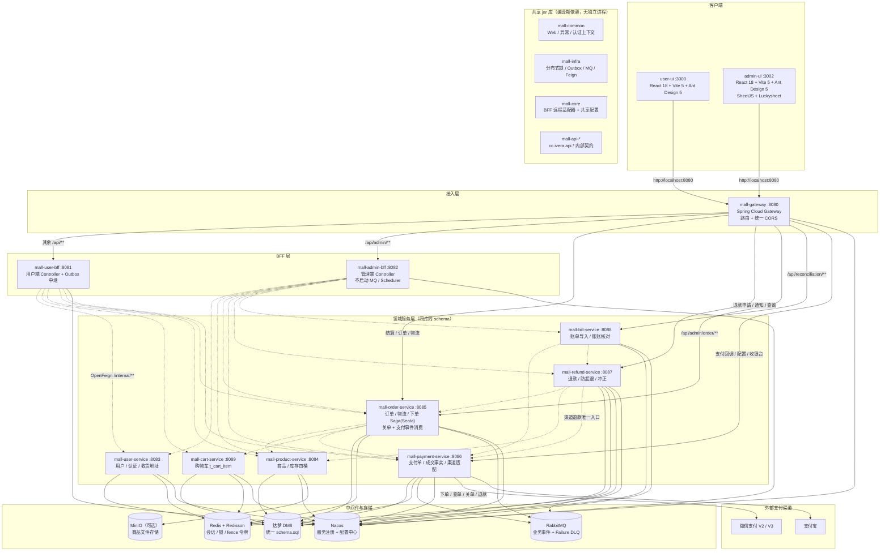

读图要点：

- 实线是外部 HTTP 入口（客户端 → 网关 → BFF / 领域服务），虚线是进程间 `OpenFeign /internal/**` 调用，全部经 Nacos 服务发现。
- 网关是唯一公网入口，按前缀分流到 BFF 或领域服务，不转发 `/internal/**`；BFF 不持有独立写权限，只做入口聚合与远程适配。
- 每张表只有一个写者：用户/购物车/商品库存/订单/支付/退款/账单分别只由对应领域服务写入。
- `mall-common`、`mall-infra`、`mall-core`、`mall-api-*` 是编译期 jar 依赖，运行时不产生独立进程，因此图中不与运行节点连线。
- 外部渠道只在支付服务适配；退款服务的渠道退款统一经 `PaymentChannelRefundApi` 交给支付服务执行。

网关只做入口收敛，不承载业务写权限，也不转发 `/internal/**`。两个 BFF 只承载各自侧 Controller；用户领域实现独立在
`mall-user-service`（`UserServiceRemoteAdapter`），购物车领域实现独立在 `mall-cart-service`
（`CartServiceRemoteAdapter`），商品与库存领域实现独立在 `mall-product-service`
（`ProductServiceRemoteAdapter`），订单与物流领域实现独立在 `mall-order-service`（`CartRemoteAdapter`、
`ProductRemoteAdapter`、`PaymentOrderRemoteAdapter` 等远程适配器），支付领域实现独立在 `mall-payment-service`
（`PaymentOrderRemoteAdapter` 等），退款领域实现独立在 `mall-refund-service`（`OrderRefundRemoteAdapter` 等），
账单核对独立在 `mall-bill-service`（`PaymentLedgerRemoteAdapter`、`RefundLedgerRemoteAdapter` 读取平台账本）。
后台任务（`@Scheduled` / `@RabbitListener`）按领域归属执行：订单关单消费、支付事件消费、超时扫描、物流模拟与下单幂等记录清理在
`mall-order-service`，Outbox 中继只在 `mall-user-bff`，退款冲正与退款状态同步在 `mall-refund-service`；用户服务、商品服务、
账单服务不引入 AMQP、不开启 Scheduling，支付服务配置 `spring.rabbitmq.listener.simple.auto-startup=false` 与
`local-message.relay-enabled=false`，退款服务与订单服务消费各自队列但不执行 Outbox 扫描。P3–P7 阶段同库同 schema，
公开 `/api/**` 契约不变；回滚时部署拆分前制品并停止对应领域服务即可，数据库无需回滚。

前端：

```text
user-ui   React 18 + Vite 5 + Ant Design 5
admin-ui  React 18 + Vite 5 + Ant Design 5 + SheetJS + Luckysheet
```

核心设计目标不是“所有操作强行放进一个大事务”，而是按一致性边界拆分：

- 数据库内关键状态：本地事务 + CAS（含 fence_token 围栏 CAS）。
- 并发串行化：Redisson 分布式锁（watchdog 自动续期，leaseTime=-1；加锁生成单调递增 fence 围栏令牌）。
- 库存：四桶模型 + 条件 UPDATE + 流水 + `biz_no`。
- 跨事务消息：Transactional Outbox + publisher confirm。
- MQ 消费：MANUAL ACK + Spring Retry + Failure DLQ。
- MQ 故障后的业务收敛：DB Scheduler。
- 支付异常：渠道查询 + 重复/晚到支付冲正。

### 15.2 仓库结构

```text
mall/
├── backend/                      # Maven 聚合父工程
│   ├── mall-common/              # 共享 Web、异常、认证上下文与基础配置
│   ├── mall-api-order/           # 订单契约、状态枚举与跨进程订单模型
│   ├── mall-api-payment/         # 支付应用契约、DTO/VO、支付事件拓扑与跨进程支付模型
│   ├── mall-api-user/            # 用户应用服务接口、DTO/VO、跨进程领域模型
│   ├── mall-api-product/         # 商品/库存应用服务接口、DTO/VO、跨进程领域模型
│   ├── mall-api-refund/          # 退款账查询契约、退款账模型、退款状态同步 MQ 拓扑
│   ├── mall-infra/               # 分布式锁、Outbox、RabbitMQ 公共可靠性实现（jar 库）
│   ├── mall-core/                # BFF 远程适配器与共享配置（jar 库）
│   │   ├── src/main/java/cc/ivera/
│   │   │   ├── shared/
│   │   │   ├── product/          # 仅 infrastructure.remote，无商品表 Mapper/RepositoryImpl
│   │   │   ├── payment/          # 仅 infrastructure.remote，无支付表 Mapper/RepositoryImpl
│   │   │   ├── user/             # 仅 infrastructure.remote，无用户表 Mapper/RepositoryImpl
│   │   │   └── cart/             # 仅购物车 OpenFeign 远程适配，无本地购物车表访问
│   │   ├── src/main/resources/
│   │   │   ├── application-core.yml
│   │   │   └── mapper/
│   ├── mall-bill-service/        # 账单领域服务（8088），账单导入、账账核对、差异处理与数据访问
│   ├── mall-payment-service/     # 支付领域服务（8086），独立支付实现、渠道适配与数据访问
│   ├── mall-refund-service/      # 退款领域服务（8087），独立退款实现、渠道退款编排与数据访问
│   ├── mall-order-service/       # 订单领域服务（8085），订单/物流实现、Seata 下单 Saga、请求幂等与订单 MQ 消费
│   ├── mall-product-service/     # 商品/库存领域服务（8084），独立商品实现与数据访问
│   ├── mall-user-service/        # 用户领域服务（8083），独立用户实现及数据访问
│   ├── mall-cart-service/        # 购物车领域服务（8089），独立购物车实现及数据访问
│   ├── mall-user-bff/            # 用户端 BFF（8081），承载用户/商品/购物车入口与 Outbox 中继
│   ├── mall-admin-bff/           # 管理端 BFF（8082），不启动 MQ/定时任务
│   ├── mall-gateway/             # 网关（8080）
│   ├── docs/
│   ├── env/
│   │   ├── docker-compose.yml
│   │   ├── nacos/plugins/        # Nacos 达梦 Mapper 插件 + DM8 JDBC 驱动（容器 /home/nacos/plugins）
│   │   ├── nacos/schema/nacos-schema.sql  # Nacos 配置库表（DB 模式，不参与业务初始化）
│   │   └── sql/dm8/schema.sql    # 业务表唯一权威脚本
│   └── nacos/
│       ├── config/               # 需发布到 Nacos 的 Data ID 源文件
│       └── dm-plugin/            # Nacos 达梦数据源 Mapper 插件（独立 Maven 工程）
├── user-ui/
├── admin-ui/
├── AGENTS.md
└── README.md
```

### 15.3 DDD 包结构

后端按 8 个限界上下文拆分，每个上下文统一使用：

```text
cc.ivera.<context>/
├── interfaces/
│   ├── Controller          # 物理位置在所属 BFF 或领域服务模块，包名保持 cc.ivera.<context>.interfaces
│   ├── mq/Consumer
│   └── job/Scheduler
├── application/
│   ├── dto / vo          # 请求/响应契约与跨上下文 DTO，禁止放回 interfaces
│   ├── 应用服务接口
│   └── impl/
├── domain/
│   ├── model
│   ├── enums
│   ├── policy
│   ├── repository
│   └── gateway
└── infrastructure/
    ├── persistence/
    │   ├── po
    │   ├── mapper
    │   ├── converter
    │   └── repository
    ├── mq / config
    ├── redis
    ├── gateway
    └── 外部渠道/存储适配
```

各可运行进程的启动类统一放在 `cc.ivera` 根包（如 `cc.ivera.OrderServiceApplication`、`cc.ivera.UserBffApplication`），不再占用独立子包；上下文专属的 Token/密码/登录守卫等适配器落在对应上下文的 `infrastructure.security`，微信支付 HTTP 客户端与通知解密落在 `payment.infrastructure.gateway`。

#### 15.3.1 上下文职责

| 上下文 | 主要职责 |
|---|---|
| `shared` | 公共响应/异常、认证基础设施、分布式锁、Outbox、RabbitMQ 公共可靠性配置 |
| `product` | 商品、库存四桶、库存预占、库存流水、Excel 库存导入、文件存储；实现在 `mall-product-service` |
| `order` | 结算、订单、订单明细、关单、发货、物流、确认收货 |
| `payment` | 支付单、支付记录、成交事实、微信 V2/V3、支付宝、支付渠道/应用配置；实现在 `mall-payment-service` |
| `refund` | 退款申请、退款单/明细、RefundPolicy、防超退、渠道退款与退款状态同步；实现在 `mall-refund-service` |
| `user` | 用户、认证、登录保护、密码重置、收货地址、行政区划 |
| `cart` | 购物车（`t_cart_item`，由 `mall-cart-service` 持久化，userId + productId 唯一） |
| `bill` | 微信交易账单 XLSX 解析、导入、支付/退款对账、差异处理；实现在 `mall-bill-service` |

#### 15.3.2 依赖方向

约束：

```text
interfaces → application → domain
                    ↑
infrastructure ─────┘
```

跨上下文协作只允许：

- 调用 `cc.ivera.api.<context>` 下的内部契约（如 `ProductQueryApi`、`OrderRefundQuotaApi`、`PaymentOrderQueryApi`）；或
- 引用对方 application 服务接口；或
- 引用对方 domain model / gateway 端口。

内部契约约定：

- 契约接口放 `cc.ivera.api.<context>`，返回值沿用对方 domain model，不做二次转换。
- 进程内实现放提供方 `infrastructure.gateway.*InternalApiAdapter`，只委托本上下文仓储，不附加业务规则；跨进程时代替为 BFF 侧 `infrastructure.remote.*RemoteAdapter`，契约与包名不变。
- 禁止跨上下文依赖对方 `domain.repository`：表的写入权限只属于拥有方。
- 跨上下文 DTO 放提供方 `application.dto`，不得放 `interfaces` 层。

以上规则由人工与代码评审保证；`mall-refund-service` 已恢复 ArchUnit 边界校验 `RefundDomainArchitectureTest`（domain 不依赖 Spring / MyBatis-Plus / infrastructure / interfaces / application），其余上下文仍依赖代码评审，后续可按同一模板补充。

禁止：

```text
order → product.infrastructure.mapper
bill  → payment.infrastructure.po
refund → order.infrastructure.*
payment → refund.*
```

PO 属于数据库适配层，不是跨领域数据契约。

### 15.4 核心数据模型

统一脚本 `backend/env/sql/dm8/schema.sql` 当前创建 25 张表。

| 表 | 说明 |
|---|---|
| `t_product` | 商品、价格、四桶库存 |
| `t_order_info` | 主订单、legacy 状态与多维状态 |
| `t_order_item` | 订单明细和商品快照 |
| `t_payment_order` | 本地支付尝试单 |
| `t_payment_deal` | 支付成交事实，`order_no` / `payment_no` 双唯一，订单 1 笔有效成交的最终权威 |
| `t_payment_info` | 渠道成交支付记录 |
| `t_payment_channel` | 微信/支付宝渠道配置 |
| `t_payment_app` | 渠道下应用配置 |
| `t_inventory_reservation` | 订单库存预占记录 |
| `t_inventory_transaction` | 库存四桶变化流水 |
| `t_order_shipment` | 发货与物流记录 |
| `t_refund_order` | 退款业务单 |
| `t_refund_item` | 退款明细 |
| `t_refund_info` | 渠道退款记录 |
| `t_stock_import` | Excel 库存导入记录 |
| `t_bill_import` | 对账导入批次 |
| `t_bill_record` | 渠道账单流水 |
| `t_bill_reconcile_discrepancy` | 对账差异 |
| `t_local_message` | Transactional Outbox |
| `t_consumer_dedupe` | 跨上下文消费去重，`consumer + event_id` 唯一 |
| `t_user` | 用户 |
| `t_password_reset_request` | 密码重置申请 |
| `t_region` | 三级行政区划 |
| `t_shipping_address` | 用户收货地址 |
| `t_cart_item` | 购物车条目，`user_id + product_id` 唯一 |

### 15.5 订单与支付模型

#### 15.5.1 单据关系

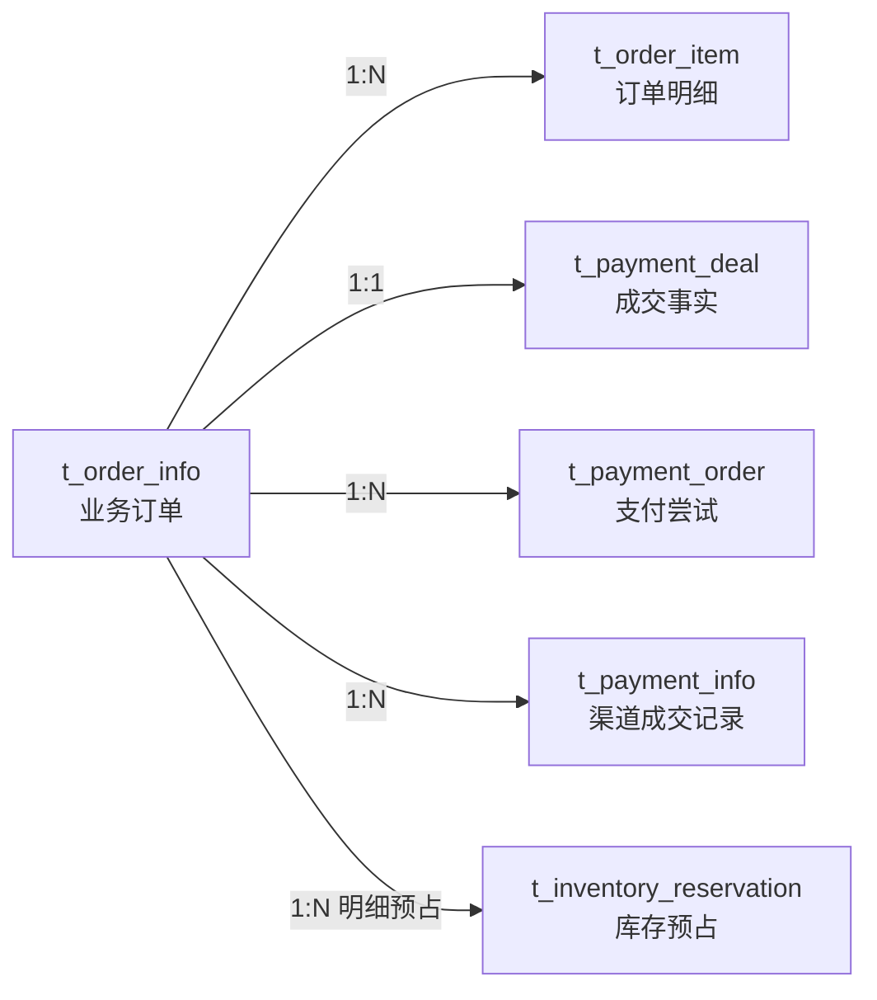

一个业务订单允许多个支付尝试，但 `t_payment_deal` 只允许一笔有效成交，由 `order_no` 与 `payment_no` 双唯一键兜底。

#### 15.5.2 支付尝试规则

`t_payment_order` 用于描述“尝试支付”，和最终 `t_payment_info` 区分：

```text
CREATED → PAYING → SUCCESS
                  ↘ CLOSED
```

规则：

- 同订单可有多次支付尝试。
- 同渠道优先复用活跃支付单。
- 跨渠道可各自存在支付尝试。
- 支付单 CAS `SUCCESS` 仍是渠道成交的第一道幂等，随后写入 `t_payment_deal` 作为订单级成交事实。
- 渠道交易号在 `(channel, channel_order_no)` 上唯一且只在成交时写入：统一支付成功入口先按渠道交易号判重，命中即幂等返回，避免后续活跃支付尝试重复写入同一交易号触发唯一约束。
- `t_payment_deal.order_no` 唯一：同一订单只有首笔写入成交事实的支付尝试获胜。
- 首笔成功后关闭其它活跃支付尝试。
- 已成交订单再次收到另一笔真实支付：写入成交事实冲突 → 发 `DUPLICATE_PAYMENT_DETECTED` 事件，由退款侧冲正。
- 已关闭/取消订单收到晚到支付：订单侧不推进，发 `PAYMENT_LATE_ARRIVED` 事件，由退款侧冲正。

支付发起与成交全流程：

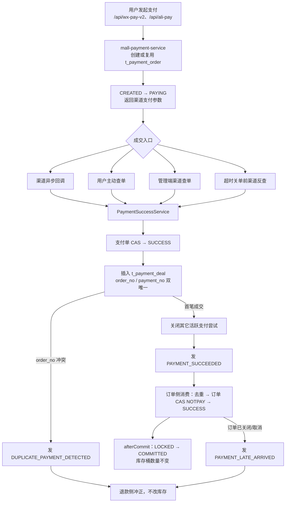

#### 15.5.3 支付成功统一入口

关键组件：

```text
payment.application.PaymentSuccessService
```

多种触发源最终汇入统一支付成功逻辑：

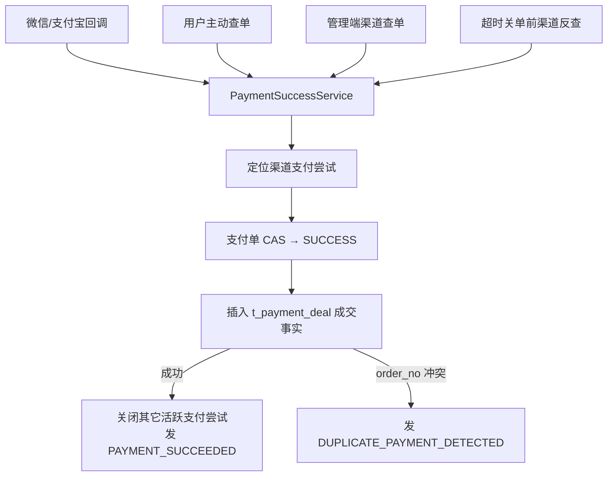

支付服务只负责“渠道成交 + 成交事实 + 发事件”，**不再直接改订单状态**。订单状态由订单侧消费 `PAYMENT_SUCCEEDED` 后 CAS `NOTPAY → SUCCESS` 推进；订单已关闭则转为 `PAYMENT_LATE_ARRIVED` 交退款侧冲正。关单路径在关闭前必须先查 `t_payment_deal`，已成交则改为标记支付，避免“已收款却本地关单”。

### 15.6 库存模型

#### 15.6.1 四桶恒等式

```text
available_stock + locked_stock + sold_stock + lost_stock = 入库总量
```

| 桶 | 含义 |
|---|---|
| `available_stock` | 可售库存 |
| `locked_stock` | 已被订单占用但尚未最终结转 |
| `sold_stock` | 用户已确认收货的已售库存 |
| `lost_stock` | 不回仓、不可再次销售的货损库存 |

#### 15.6.2 订单库存流转

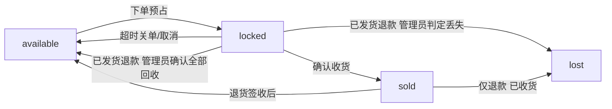

支付成功本身不做 `locked → sold`：

```text
InventoryReservation: LOCKED → COMMITTED
库存桶数量：不变
```

这样在“已支付但未收货”阶段仍可清晰区分货权状态。

#### 15.6.3 防超卖

核心 SQL 思路：

```sql
UPDATE t_product
SET available_stock = available_stock - ?,
    locked_stock = locked_stock + ?
WHERE id = ?
  AND available_stock >= ?
```

受影响行数为 0 即库存不足，整个下单事务失败。

#### 15.6.4 库存幂等

库存业务动作同时依赖：

```text
业务状态闸门
→ reservation 状态 CAS
→ 数量条件 UPDATE
→ t_inventory_transaction.biz_no 唯一约束
```

典型 `biz_no`：

```text
ORDER_RESERVE:<orderNo>:<itemId>
ORDER_COMMIT:<orderNo>:<itemId>
ORDER_RELEASE:<orderNo>:<itemId>
ORDER_SOLD:<orderNo>:<itemId>
REFUND_RESTOCK:<refundNo>:<itemId>
REFUND_LOST:<refundNo>:<itemId>
```

库存动作全流程（预占 → 结转 → 回补/货损）：

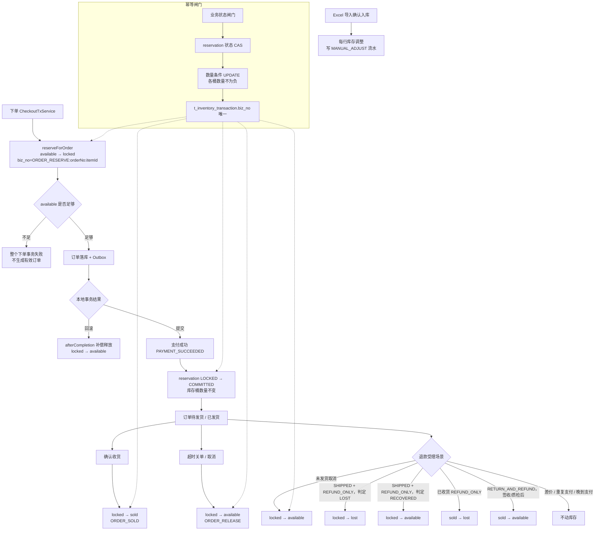

任何一次库存变更都必须同时满足四桶恒等式（`available + locked + sold + lost = 入库总量`）与 `biz_no` 幂等；
库存不足时下单整体失败，不允许先生成有效订单再补偿扣库存。退款成功不等于库存回补，是否回补由货物是否实际回仓决定。

#### 15.6.5 商品服务远程边界（P3）

商品与库存实现位于 `mall-product-service`，BFF 与订单通过 `mall-core` 的
`ProductServiceRemoteAdapter`，退款服务通过自有 `RefundInventoryRemoteAdapter`，统一调用 `/internal/product/**`；购物车位于
`mall-cart-service`，通过其自有的 `ProductQueryRemoteAdapter` 只读调用 `/internal/product/query/**`：

- 商品表、库存预占表与库存流水表只由商品服务写入；`mall-core` 不再持有 `ProductMapper` / `Inventory*Mapper`。
- `InventoryService` 不依赖订单实体：确认收货结转由调用方传入 `OrderItemStockLine` 明细快照。
- 退款回补/货损核销的前置 `order_item.restocked_qty` 守卫在退款调用方执行
  （`OrderRefundQuotaApi.addRestockedQty`），与退款本地事务同库提交；商品服务只执行库存条件 UPDATE 与流水幂等。
- 下单远程预占成功后，若本地事务回滚，`CheckoutServiceImpl` 通过 `TransactionSynchronization.afterCompletion`
  补偿释放预占，避免库存长期滞留 locked 桶。

#### 15.6.6 支付服务远程边界（P4b）

支付实现（支付单、成交事实、微信/支付宝渠道、渠道与应用配置）独立在 `mall-payment-service`，BFF 通过
`mall-core` 的 `cc.ivera.payment.infrastructure.remote.*RemoteAdapter`，账单服务通过自有
`cc.ivera.bill.infrastructure.remote.PaymentLedgerRemoteAdapter`，订单服务通过自有
`cc.ivera.order.infrastructure.remote.Payment*RemoteAdapter`，退款服务通过自有
`PaymentOrderRemoteAdapter` / `PaymentChannelRefundRemoteAdapter`，统一调用 `/internal/payment/**`；支付服务反向通过
`OrderServiceRemoteAdapter` 调用 `/internal/order/**`：

- `t_payment_order`、`t_payment_info`、`t_payment_deal`、`t_payment_app`、`t_payment_channel` 只由支付服务写入。
- 支付回调、支付配置、收银台渠道下单路由经网关直连支付服务；退款申请、退款通知与退款查询由退款服务提供，避免 payment → refund 反向依赖。
- 支付服务不依赖 `mall-core`，也不引入退款上下文；渠道退款唯一入口仍是 `PaymentChannelRefundApi`，只是由本地适配器换为远程适配器。
- 支付服务不消费 MQ、不扫描 `t_local_message`；支付事件 Outbox 投递仍只在 `mall-user-bff` 进程执行。

#### 15.6.7 服务注册与 Feign 远程调用

九个可运行进程全部接入 Nacos：`spring.cloud.nacos.discovery` 注册自身，`spring.config.import: optional:nacos:<应用名>.yaml` 拉取集中配置。进程间内部调用统一由 `cc.ivera.infra.feign.InternalFeignConfiguration` 提供公共能力：

- `ErrorDecoder` 把非 2xx 的 `R` 信封解析为 `BizException`，保留原 `ErrorCode`；无法解析时回落 `SYSTEM_ERROR`。
- 客户端声明为 `@FeignClient(name = "mall-xxx-service", url = "${x.service.base-url:}")`：`url` 默认空，走 Nacos 服务发现 + LoadBalancer；需要离线直连时用 `USER_SERVICE_BASE_URL` 等环境变量填入 base-url。
- 超时统一走 `spring.cloud.openfeign.client.config.default`（3000/10000ms），并按服务名覆盖商品服务读超时 30000ms。
- 网关路由统一为 `lb://mall-xxx-service`，可用 `MALL_*_URI` 覆盖；`NACOS_ENABLED=false` 时注册与配置导入同时关闭，此时必须提供 Feign base-url 与网关直连 URI。
- 微信 / 支付宝渠道客户端仍使用各自 SDK 或独立 HTTP 客户端，不经过 Feign。

### 15.7 事务边界说明

这一点对理解代码很重要。

#### 15.7.1 下单

`CheckoutServiceImpl` 只做幂等编排：校验 `Idempotency-Key` → Redis 锁 + `t_order_request` 状态机 → 调用 `CheckoutSagaService`。
`CheckoutSagaService` 生成 `orderNo` 并以它作为业务键驱动 Seata Saga 状态机 `order-checkout`
（定义见 `mall-order-service/src/main/resources/statelang/order-checkout.json`）：

```text
CreateOrder       本地事务：写 t_order_info / t_order_item + 延迟关单 Outbox   ──补偿──▶ CancelOrder
ReserveInventory  商品服务 reserveForOrder：available → locked               ──补偿──▶ ReleaseInventory
ClearCart         清理购物车已选项
```

任一步失败由状态机反向补偿；补偿完成后接口返回业务失败，幂等记录置 `FAILED` 可重试。三个正向动作都可重放：
同 `orderNo` 已落单时 `prepare` 直接返回既有上下文，库存预占以 `uk_reservation_order_item(order_item_id)` 为幂等闸门，
关单为条件 UPDATE（只关闭 `WAIT_PAY + UNPAID` 订单），因此重复执行不会产生第二张订单、第二份预占或误关已支付订单。

下单主流程：

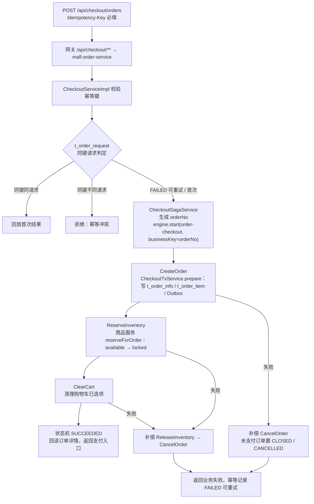

#### 15.7.2 下单 Saga（Seata）

```text
POST /api/checkout/orders（Idempotency-Key 必填）
  → OrderIdempotencyService：同键同请求回放 / 同键不同请求拒绝 / FAILED 可重试
  → CheckoutSagaService：生成 orderNo，作为 Saga businessKey
  → StateMachineEngine.startWithBusinessKey("order-checkout", null, orderNo, {"checkout": ...})
      CreateOrder      [本地事务：落单 + 明细 + 延迟关单 Outbox]   ──补偿──▶ CancelOrder
      ReserveInventory [远程：商品服务 reserveForOrder]             ──补偿──▶ ReleaseInventory
      ClearCart        [远程：购物车清空已选项]
  → SUCCEEDED：回读订单详情返回；失败：反向补偿完成后抛 BizException
```

状态机定义持久化在 `seata_state_machine_def`，实例与状态明细持久化在 `seata_state_machine_inst` / `seata_state_inst`；
引擎复用订单服务主数据源（DM8），`enableAsync=false` 表示接口在状态机返回后同步读取结果。Seata Server（TC）的配置中心与注册中心
都是 Nacos：TC 通过 `config.type=nacos` 读取 Data ID `seataServer.properties`（group `SEATA_GROUP`，仓库镜像
`backend/nacos/config/seataServer.properties`），通过 `registry.type=nacos` 以服务名 `seata-server`、集群 `default`
注册；订单服务用 `seata.registry.type=nacos` 发现 TC，并用 `seata.service.vgroup-mapping.mall_tx_group=default` 映射集群，
不再使用 `SEATA_SERVER_ADDR` 直连地址（2.6.0 镜像不含 Web 控制台，端口 `8091`）。TC 以 **DB 存储模式**运行
（`store.mode=db`，`store.db.dbType=dm`；键名必须是 Seata 2.x 的 camelCase），元数据落在 DM8 的
`global_table` / `branch_table` / `lock_table` / `distributed_lock`；由于 `sagaBranchRegisterEnable=false`，
下单 Saga 只做客户端补偿、不向 TC 注册分支，这四张表主要用于满足 TC 启动与全局事务存储要求。`t_order_request` 的过期记录由
`OrderRequestCleanupScheduler` 按 `order.request.clean-scan-ms` 清理，与交易状态推进无关。

#### 15.7.3 订单状态成功/关闭后的库存终态

`OrderInfoServiceImpl.updateStatusByOrderNoIfStatus` 在订单 CAS 成功后注册：

```text
SUCCESS → commitReservationAfterCommit(orderNo)
CLOSED/CANCEL → releaseReservationAfterCommit(orderNo)
```

即：

```text
订单状态事务先提交
→ TransactionSynchronization.afterCommit
→ 调用 InventoryService 完成库存 reservation 终态
```

因此这里是**提交后衔接的幂等最终一致性动作，不是同一个数据库事务**。文档和新代码都不应把它描述成“订单状态与库存终态原子提交”。

如果后续修改这段逻辑，需要同时考虑 afterCommit 失败后的恢复策略，不能只依靠事务回滚幻想跨事务原子性。

#### 15.7.4 Redis 分布式锁与 fence 围栏

统一入口是 `mall-infra` 的 `DistributedLockTemplate.execute(lockKey, waitTimeMillis, supplier)`，实现为
`cc.ivera.shared.infrastructure.lock.RedissonDistributedLockTemplate`。锁只负责把临界区串行化，最终一致性仍由
fence 围栏 CAS、`biz_no` 幂等与数据库唯一键兜底。

同时提供声明式用法：在方法上标注 `@cc.ivera.shared.domain.lock.DistributedLock(key = "'payment:wx:notify:pay:' + #orderNo")`，
由 `cc.ivera.shared.infrastructure.lock.DistributedLockConfiguration` 注册的 `DistributedLockInterceptor` 复用同一模板加锁
（使用 `StaticMethodMatcherPointcut` 直接匹配方法注解，不经过 AspectJ 表达式解析）。`key` 支持 SpEL（参数名与 `#p0/#a0`），
`waitTimeMillis` 默认 3000，`holdWarnMillis` 默认 5000（持有超过该值记录 WARN，`<= 0` 关闭）；拦截器优先级高于事务通知，
保证事务在锁持有期间开始并提交。注解方式与编程式入口共享 watchdog 与围栏令牌语义。
启动期由 `DistributedLockAnnotationValidator` 校验每个注解方法确实会被代理，出现「当前进程无 `DistributedLockTemplate`、
方法为 static/private/final、所在 Bean 未被 AOP 代理」任一情况直接启动失败，避免注解在、锁不在。

锁上下文由 `cc.ivera.shared.domain.lock.LockContext` 的线程栈承载：记录 `lockKey`、围栏令牌、加锁时刻与状态，
`FenceTokenHolder` 退化为门面（`get()` 语义不变）。嵌套加锁时取栈顶令牌——围栏令牌由 Redis 全局自增生成，
内层一定更大，因此栈顶即嵌套期间最大值且单调不减；仅最外层释放时清理 ThreadLocal，内层退出不会让外层丢令牌或回退。
不同锁键交叉嵌套仍有争锁等待超时风险，应尽量保持单一入口加锁。

锁审计由 `LockAuditRecorder` 端口 + `RedisLockAuditRecorder` 实现：每次 `ACQUIRED` / `RELEASED` / `ACQUIRE_FAILED`
追加到 Redis Stream `lock:audit`（字段 `ts/event/lockKey/fenceToken/heldMs/thread`），用近似 `MAXLEN ~ 1000`
加 7 天 TTL 限制体积，不落库、不参与业务判断；审计写入异常只记 WARN，不影响临界区与锁释放。
锁不建持久化实例表、不做后台强放锁：锁是瞬态互斥资源，崩溃后由 Redisson 租约到期释放，强制释放会破坏互斥。

以下场景仍保留编程式 `execute`：锁键依赖方法体内解析结果（微信/支付宝异步通知、账单文件解析）、锁只覆盖方法内某个分支
（渠道查单后的状态同步）、锁外必须保留远程渠道调用（退款创建、关单查单）、以及被同类方法内部调用的共享加锁入口
（`OrderRefundStatusService`、`OrderIdempotencyService`、多重重载互调）。这些位置若改为方法级注解会改变锁边界或丢锁。

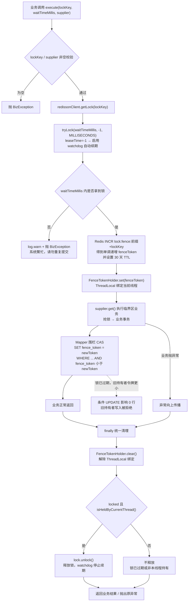

要点：

- `tryLock` 使用 `leaseTime = -1`，持有期间由 Redisson watchdog 自动续期（默认 `lockWatchdogTimeout` 30s，每 1/3 周期续期），调用方不指定过期时间。
- 加锁成功后才 `INCR lock:fence:seq` 生成**全局**围栏令牌，`EXPIRE` 30 天（首次使用以当前毫秒时间初始化）；令牌全局单调递增，保证后拿锁者一定拥有更大令牌。同一聚合会被不同业务键的锁先后推进（支付→发货→收货→退款受理），令牌必须跨键可比，否则新锁拿到的令牌可能小于行上已有令牌，合法 CAS 会被静默丢弃。
- 业务事务内的 Repository 从 `FenceTokenHolder.get()` 读取令牌并传给 Mapper，由 Mapper 追加 `SET fence_token = newToken` 与 `WHERE ... AND fence_token <= newToken`。用 `<=` 是因为同一把锁内会连续推进多次状态（如退款单创建后立即定价、受理后立即发起渠道退款），首次 UPDATE 已将行令牌写成当前令牌；陈旧持有者的令牌更小，仍会被拒绝。
- 未持锁时 `FenceTokenHolder.get()` 返回 `null`，围栏条件自动跳过，不影响无锁场景的正常更新。
- 含 `fence_token` 列的核心聚合表：`t_order_info`、`t_payment_order`、`t_refund_order`、`t_refund_info`、`t_bill_import`。
- 拿不到锁是快速失败（抛 `BizException`），不进入自旋重试；重试与结果回放由上层幂等键、状态机负责。
- `InterruptedException` 先 `Thread.currentThread().interrupt()` 再包装抛出，避免中断信号丢失。
- 本项目禁止用 `select ... for update` 作为并发主方案：远程渠道调用期间不得长时间持有数据库行锁。

### 15.8 订单关单

#### 15.8.1 原则

超时消息不能直接把本地订单关掉。必须：

```text
订单超时
→ 查询渠道真实状态
    ├─ 已支付 → 走支付成功统一逻辑
    ├─ 未支付 → 必要时关渠道单
    └─ 渠道无单/已关 → 本地 CAS 关闭
```

这样避免：

```text
本地已经释放库存
但渠道实际上已经收款
```

#### 15.8.2 两条触发路径

```text
RabbitMQ 延迟消息
        +
TimeoutOrderCloseScheduler DB 扫描
```

两者最终调用同一渠道查单/关单逻辑，依赖 CAS 和幂等实现并发安全。

### 15.9 退款模型

退款全流程：

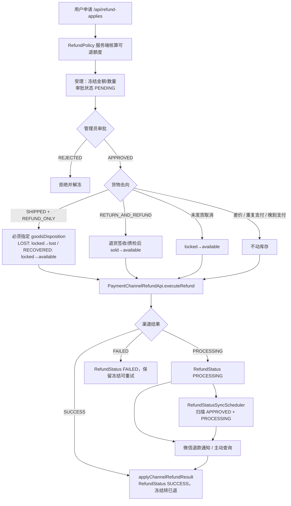

#### 15.9.1 退款类型

业务退款覆盖 6 类语义：

```text
CANCEL_BEFORE_SHIP
RETURN_AND_REFUND
REFUND_ONLY
PRICE_ADJUSTMENT
DUPLICATE_PAYMENT
LATE_PAYMENT
```

其中后两类主要用于系统自动冲正。

#### 15.9.2 防超退

核心策略：

```text
用户申请
→ 服务端 RefundPolicy 计算可退额度
→ 受理时冻结金额/数量
→ 渠道退款/退货流程
→ 成功后冻结转已退
```

前端额度计算仅是 UI 提示，服务端永远是最终权威。

#### 15.9.3 退款与库存

| 场景 | 库存动作 |
|---|---|
| 未发货取消 | `locked → available` |
| 已发货未收货 `REFUND_ONLY`，管理员判定 `LOST` | `locked → lost` |
| 已发货未收货 `REFUND_ONLY`，管理员确认 `RECOVERED` | `locked → available` |
| 已收货 `REFUND_ONLY` | `sold → lost` |
| `RETURN_AND_REFUND` | 退货签收/质检后 `sold → available` |
| 差价退款 | 不动库存 |
| 重复支付冲正 | 不动库存 |
| 晚到支付冲正 | 不动库存 |

原则：**退款成功不等于库存回补。** 是否回补由货物是否实际回仓决定。对于 `SHIPPED + REFUND_ONLY`，管理员受理前必须通过 `goodsDisposition=LOST/RECOVERED` 明确商品去向；后端先完成对应库存结转，再进入渠道退款。`t_refund_order.goods_disposition` 持久化该人工判定，供管理端展示与审计。

#### 15.9.4 渠道退款契约（P4a）

退款域不再直接依赖支付域内部的渠道实现，统一经：

```text
cc.ivera.api.payment.PaymentChannelRefundApi
```

| 方法 | 用途 |
|---|---|
| `executeRefund(ChannelRefundCommand)` | 发起渠道退款，返回 `SUCCESS / PROCESSING / FAILED` |
| `queryRefund(ChannelRefundQuery)` | 渠道退款单查询，返回原始报文供排障 |
| `queryRefundStatusForSync(ChannelRefundQuery)` | 单笔退款状态同步 |
| `queryOrderRefundsForSync(orderNo, channel)` | 订单维度渠道退款对账 |
| `processRefundNotify(bodyMap)` | 微信退款通知验签解密，返回解析结果 |

约束：

- 渠道密钥与渠道实现只存在于 payment 上下文；`payment` 包内不引用 `RefundInfoService`、不写 `t_refund_*`。
- 退款成功/处理中/失败的状态回写由退款域 `RefundInfoService.applyChannelRefundResult` 完成。
- P5 物理拆分后退款服务通过 `PaymentChannelRefundRemoteAdapter` 调用同一契约；微信退款通知链路为
  `WxPayRefundNotifyController → PaymentChannelRefundApi.processRefundNotify → RefundApplicationService.applyRefundSync`，
  锁键保持 `payment:wx:notify:refund:<refundNo>`。
- 发起渠道退款必须与退款状态推进处于同一把分布式锁内：管理端受理/签收/重试在 `refund:accept|confirm-return|retry:<refundNo>` 锁内执行，
  未发货取消的自动受理在 `refund:create:<orderNo>` 锁内完成事务提交与渠道调用，避免事务提交后锁已释放导致同一退款单被并发重复提交渠道。
- `t_refund_info` 持有 `fence_token`，状态推进 UPDATE 同样带 `fence_token <= newToken` 围栏 CAS。

### 15.10 RabbitMQ 设计

#### 15.10.1 发布可靠性

`RabbitReliabilityConfig` 配合 `application-core.yml`：

```text
publisher-confirm-type = correlated
publisher-returns = true
template.mandatory = true
```

`LocalMessageServiceImpl` 使用 `CorrelationData` 等待 broker confirm；成功后 Outbox 由 `PENDING → SENT`，失败则排期重试。

#### 15.10.2 Transactional Outbox

`t_local_message` 状态：

```text
PENDING → SENT → CONSUMED
   └────────────→ FAILED（发送重试超限）
```

流程：

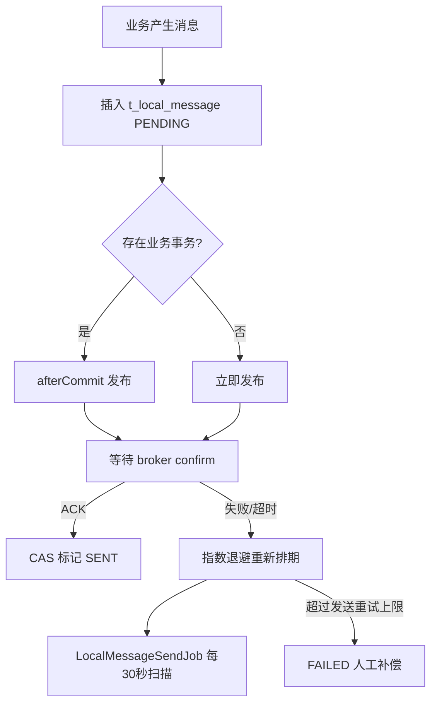

消费者业务成功后调用 `markConsumed`。

#### 15.10.3 消费 ACK 策略

当前使用：

```yaml
acknowledge-mode: manual
```

正确语义：

```text
业务处理成功
→ markConsumed
→ Channel.basicAck(deliveryTag, false)
```

异常：

```text
业务方法 / markConsumed / basicAck 抛异常
→ Listener 异常退出
→ Spring Retry
→ 4 次仍失败
→ RejectAndDontRequeue
→ release queue DLX
→ failure queue
```

MANUAL 模式下不在第一次业务异常时手工 `basicNack`，否则会提前结束当前 broker delivery 并破坏既有 Spring Retry；异常必须继续向外抛。对于明确选择忽略的空/无效消息，则显式 `basicAck`，避免长期停留在 unacked。

该链路属于 **at-least-once**：如果业务处理与 `markConsumed` 已成功，但 `basicAck` 因连接异常失败，broker 可能再次投递同一消息；因此消费者侧的分布式锁、状态 CAS、唯一键与 `biz_no` 幂等是 MANUAL ACK 可靠性的必要组成部分。

#### 15.10.4 订单关单 MQ 拓扑

```text
payment.order.close.event.exchange
    ↓ routing: payment.order.close.delay
payment.order.close.delay.queue
    ↓ TTL
payment.order.close.dead-letter.exchange
    ↓ routing: payment.order.close.release
payment.order.close.release.queue
    ↓ OrderCloseConsumer
    └─ retry exhausted / reject
         ↓
payment.order.close.failure.exchange
         ↓ routing: payment.order.close.failure
payment.order.close.failure.queue

人工确认 poison message 后，可按运维流程转入：
payment.order.close.parking-lot.queue
```

#### 15.10.5 支付业务事件拓扑

```text
payment.event.exchange
    ├─ routing: payment.succeeded
    │     → payment.succeeded.order.queue（Order：推进订单支付成功）
    ├─ routing: payment.duplicate
    │     → payment.duplicate.refund.queue（Refund：重复支付冲正，mall-refund-service 消费）
    └─ routing: payment.late
          → payment.late.refund.queue（Refund：晚到支付冲正，mall-refund-service 消费）

任意业务队列重试耗尽
    ↓ x-dead-letter-exchange: payment.event.failure.exchange
    ↓ x-dead-letter-routing-key: <原 routingKey>.failure
payment.event.failure.exchange
    ├─ payment.succeeded.failure.queue
    ├─ payment.duplicate.failure.queue
    ├─ payment.late.failure.queue
    └─ payment.event.parking.queue
```

事件消息经 `t_local_message` Outbox 在支付成交本地事务提交后投递。跨上下文消费使用 `t_consumer_dedupe(consumer, event_id)` 去重，消费顺序仍为“业务 → 去重回写 → `basicAck`”。

#### 15.10.6 退款状态同步 MQ 拓扑

```text
payment.refund.status-sync.event.exchange
    ↓
payment.refund.status-sync.delay.queue
    ↓ TTL
payment.refund.status-sync.dead-letter.exchange
    ↓
payment.refund.status-sync.release.queue
    ↓ RefundStatusSyncConsumer（mall-refund-service）
    └─ retry exhausted
         ↓
payment.refund.status-sync.failure.exchange
         ↓
payment.refund.status-sync.failure.queue

人工长期隔离：
payment.refund.status-sync.parking-lot.queue
```

两个业务失败域完全隔离，不共用 Failure Queue。

#### 15.10.7 Failure Queue 与 Parking Lot

职责区别：

```text
Failure Queue
= 自动进入的最终消费失败队列
= 排障、审计、人工决定是否重放

Parking Lot Queue
= 人工认定暂不应重放的 poison message
= 长期隔离
= 不配置自动回灌
```

DB Scheduler 继续独立保证业务最终一致性，不因为新增 Failure Queue 而删除。

#### 15.10.8 RabbitMQ Queue 参数迁移

`release.queue` 当前已配置：

```text
x-dead-letter-exchange
x-dead-letter-routing-key
```

RabbitMQ 不允许用不同 arguments 重新声明同名已有队列。因此旧环境升级时需要删除旧 Release Queue 后由应用重新声明。具体操作必须遵循 `backend/docs/RABBITMQ_OPERATIONS.md`。

### 15.11 定时任务

| 类 | 所在进程 | 作用 |
|---|---|---|
| `TimeoutOrderCloseScheduler` | `mall-order-service` | DB 最终一致性兜底：按 `payment.order.timeout-scan-ms` 周期扫描超时 `NOTPAY` 订单，重新走渠道反查/必要时关单/CAS 本地状态；单笔失败不阻塞同批其它订单 |
| `RefundStatusSyncScheduler` | `mall-refund-service` | DB 最终一致性兜底：按 `payment.refund.status-sync-scan-ms` 周期扫描 `APPROVED + PROCESSING` 退款，复用 `queryRefundStatus`；单笔失败不阻塞同批其它退款 |
| `LocalMessageSendJob` | `mall-user-bff` | 每 30 秒扫描 PENDING Outbox 并重投 |
| `MockLogisticsSimulationJob` | `mall-order-service` | 模拟物流状态推进 |
| `OrderRequestCleanupScheduler` | `mall-order-service` | 按 `order.request.clean-scan-ms` 周期清理过期 `t_order_request` 幂等记录（每批最多 500 条）；单批失败只记录日志 |

注意：

```text
MQ = 快速异步触发
DB Scheduler = 最终一致性兜底
```

两者不是互相替代。

这些后台任务按领域归属启用：`mall-order-service` 带 `@EnableScheduling` / `@EnableRabbit`，执行订单关单消费、支付事件消费、
超时关单扫描、物流模拟与下单幂等记录清理；`mall-user-bff` 只保留 `LocalMessageSendJob` 执行 Outbox 中继；
`mall-refund-service` 同样开启 Scheduling 与 Rabbit 监听，执行退款冲正消费、退款状态同步消费与
`RefundStatusSyncScheduler`，但配置 `local-message.relay-enabled=false`，退款状态同步消息仍由 `mall-user-bff` 中继发布。
`mall-admin-bff` 刻意不开启这两个注解，并通过 `spring.rabbitmq.listener.simple.auto-startup=false` 关闭 MQ 监听，
避免重复消费或重复执行定时扫描（`@RabbitListener` 由 Spring Boot 自动注册，仅去掉 `@EnableRabbit` 不足以阻止消费）。
`mall-payment-service` 同样关闭 `spring.rabbitmq.listener.simple.auto-startup`，并配置
`local-message.relay-enabled=false`，只提供支付 HTTP 能力与 `PaymentEventRabbitConfig` 拓扑声明，不执行 Outbox 扫描。

### 15.12 支付渠道配置

主要表：

```text
t_payment_channel
t_payment_app
```

`PaymentConfigLoader` 负责加载/缓存支付配置；管理后台可以维护渠道与应用，`/api/payment-config/reload` 用于刷新缓存。
支付配置的持久化、缓存与渠道密钥只归属 `mall-payment-service`；BFF 通过 `PaymentConfigGateway` 远程契约读取。

支付商户参数不应再散落成新的本地 properties 文件。敏感配置不得在新增代码或文档中硬编码真实生产值。

支付渠道实现与渠道密钥只归属 payment 上下文；订单域与退款域只能经 `api.payment` 契约（如 `PaymentChannelRefundApi`）触达渠道。`/api/wx-pay/**`、`/api/ali-pay/**`、`/api/payment-*/**` 属于支付应用接口，P4b 物理拆分后由网关直连 `mall-payment-service`；P5 后退款申请、退款通知、退款查询与订单取消前缀由网关直连 `mall-refund-service`。

### 15.13 Excel 库存导入

流程：

```text
上传 xlsx
→ 创建 t_stock_import
→ 存储文件（local / minio）
→ 管理端 Luckysheet 编辑/核对
→ 确认入库
→ 每行库存调整
→ 写 MANUAL_ADJUST 库存流水
```

存储抽象支持：

```text
LocalStockImportFileStore
MinioStockImportFileStore
StockImportFileStorage
```

`t_stock_import.storage_type` 记录每个历史文件实际使用的存储后端，切换全局配置后仍可按记录读取旧文件。

### 15.14 账账核对

对账全流程：

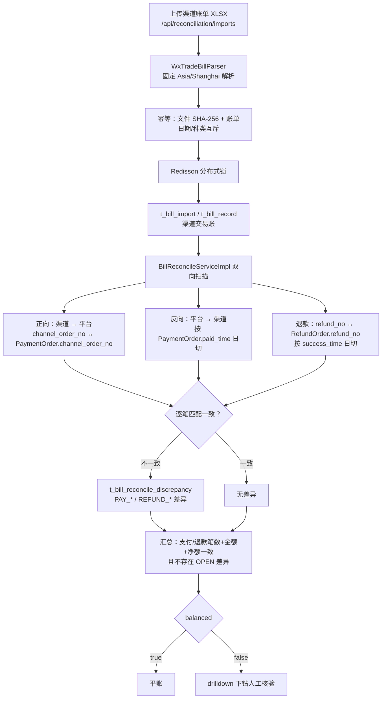

#### 15.14.1 双账本模型

```text
渠道交易账
  t_bill_import
      └── t_bill_record
              ↕
        BillReconcileServiceImpl
        正向渠道→平台 + 反向平台→渠道
              ↕
平台交易账
  ├── t_payment_order
  └── t_refund_order

差异审计
  └── t_bill_reconcile_discrepancy
```

`t_payment_info` / `t_refund_info` 仍承担渠道通知与渠道退款同步记录职责，但账账核对的平台权威账本分别是 `PaymentOrder` 与 `RefundOrder`。这样可以完整保留“一个订单 1:N 支付尝试”的逐笔语义，避免按 `order_no` 聚合后掩盖重复支付。

#### 15.14.2 匹配键与日切口径

支付逐笔匹配优先级：

```text
channel Bill 微信订单号
    ↕
PaymentOrder.channel_order_no

order_no 仅用于精确流水缺失时辅助定位，不作为聚合键
```

退款使用：

```text
渠道商户退款单号 ↔ RefundOrder.refund_no
```

统一以 `Asia/Shanghai` 切账：支付按 `paid_time`，退款按 `success_time`，时间范围为 `[当天00:00, 次日00:00)`。`WxTradeBillParser` 同样固定使用该时区解析渠道账单时间。

#### 15.14.3 账单类型与差异

支持 `ALL / SUCCESS / REFUND`。`ALL` 中 `REFUND/REVOKED` 行属于已发生的渠道退款/冲减流水，不要求状态字段一定为 `SUCCESS`。

支付差异：

```text
PAY_CHANNEL_ONLY
PAY_LOCAL_ONLY
PAY_AMOUNT_MISMATCH
PAY_STATUS_MISMATCH
PAY_SERIAL_MISMATCH
PAY_BIZ_NO_MISMATCH
PAY_CHANNEL_DUPLICATE
PAY_LOCAL_DUPLICATE
```

退款差异：

```text
REFUND_CHANNEL_ONLY
REFUND_LOCAL_ONLY
REFUND_AMOUNT_MISMATCH
REFUND_STATUS_MISMATCH
REFUND_CHANNEL_DUPLICATE
```

差异单同时记录渠道侧 `biz_no/channel_serial_no` 与平台侧 `local_biz_no/local_ledger_no/local_serial_no`，使人工核账能直接定位平台支付单/退款单和渠道流水。

#### 15.14.4 汇总平衡

除逐笔核对外，`GET /api/reconciliation/imports/{importNo}/summary` 计算：

```text
渠道净交易额 = 渠道支付金额 - 渠道退款/冲减金额
平台净交易额 = PaymentOrder.SUCCESS.paidAmount - RefundOrder.SUCCESS.refundAmount
净差额       = 渠道净交易额 - 平台净交易额
```

只有支付笔数/金额、退款笔数/金额、净额全部一致且不存在 `OPEN` 差异时才 `balanced=true`，防止差错金额互相抵消形成伪平账。当前口径为交易账，不包含渠道手续费；手续费应进入资金/结算账核对。

#### 15.14.5 幂等与性能

```text
文件 SHA-256
→ 账单日期/种类互斥
→ Redisson 分布式锁
→ 差异落库前去重
→ DB 唯一约束
→ 批次状态
```

平台日切查询使用组合索引：

```text
idx_payment_order_channel_status_paid_time(channel, status, paid_time)
idx_refund_order_status_success_time(status, success_time)
```

退款来源支付渠道通过 `payment_no` 集合批量查询，避免逐退款 N+1。对账在上传后同步执行，不经过 RabbitMQ。

#### 15.14.6 核验下钻

差异列表支持单条数据下钻：

```text
差异单 t_bill_reconcile_discrepancy
        ↓
GET /api/reconciliation/discrepancies/{id}/drilldown
        ↓
渠道账原始行 t_bill_record.raw_line
        +
平台账本候选记录 PaymentOrder / RefundOrder
        +
业务单号 / 渠道流水号 / 金额 / 状态逐字段核验
```

下钻按差异单已有 `biz_no/channel_serial_no/local_biz_no/local_ledger_no/local_serial_no` 定位双方记录。支付侧保留同订单多个 PaymentOrder 候选，不能为了展示方便按 `order_no` 折叠；退款侧通过 `refund_no` 定位，并补充来源 `payment_no` 与支付渠道。普通账单流水 VO 不返回 `raw_line`，避免批量列表携带大文本；只有下钻专用 VO 返回 XLSX 原始行快照用于审计。

### 15.15 用户与认证

主要组件位于 `user`（认证编排在 `user.application`，Token/密码/登录守卫在 `user.infrastructure.security`）与 `shared.security`（跨服务共享的 `AuthPrincipal` / `AccessTokenVerifier` 契约）。

能力：

- 注册/登录。
- Access Token + Refresh Token；Access Token 携带会话 `sid`。
- Redis 会话注册表：一次登录一个 `sid`，记录设备 IP / UA / 最近活跃时间；Refresh Token 只存 SHA-256 并一次性轮换。
- Refresh Token 重放检测：已使用的 Refresh Token 再次出现时吊销整个会话。
- 401 single-flight Refresh。
- 退出登录只下线当前设备；修改密码 / 管理员重置密码会清空该用户全部会话。
- 管理员会话治理：查询某用户在线设备、踢单设备、踢全部。
- 登录失败按用户名计数。
- 密码重置申请。
- 管理员处理重置申请。
- 收货地址管理。
- 三级行政区划。

登录与会话流程：

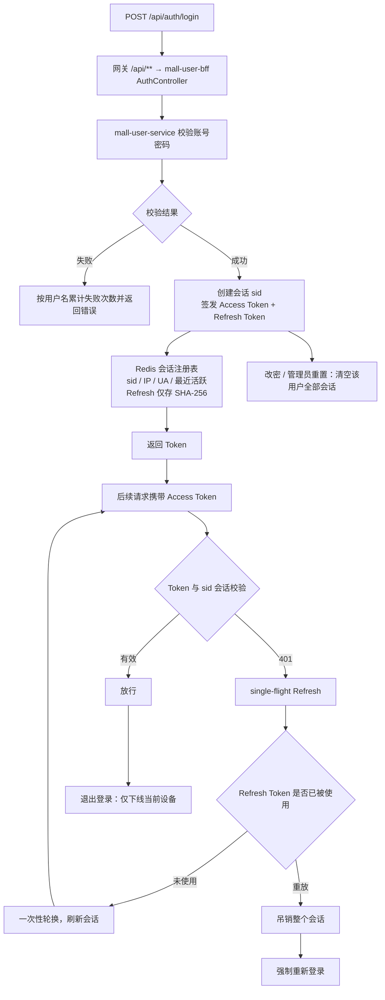

管理员角色禁止进入购物车和用户结算下单链路。

### 15.16 Controller 导览

当前对外共 24 个 Controller，按归属进程拆分：admin-bff 5 个（`/api/admin/**`），
user-bff 5 个（用户与购物车路由），payment-service 6 个（`/api/wx-pay*`、`/api/ali-pay`、`/api/payment-*`），
refund-service 7 个（退款申请、退款通知/查询、管理端退款与订单取消），bill-service 1 个（`/api/reconciliation/**`）。
Controller 保留原包名 `cc.ivera.<context>.interfaces`，仅物理位置在所属 BFF 或领域服务模块中；
用户领域实现位于 `mall-user-service`，商品与库存领域实现位于
`mall-product-service`，订单与物流实现位于 `mall-order-service`，支付领域实现位于 `mall-payment-service`，
退款领域实现位于 `mall-refund-service`，账单核对实现位于 `mall-bill-service`。领域服务分别以
`UserInternalController`（`/internal/user/**`）、`CartInternalController`（`/internal/cart/**`）、`ProductInternalController`
（`/internal/product/**`）、`OrderInternalController`（`/internal/order/**`）、`PaymentInternalController`
（`/internal/payment/**`）、`RefundInternalController`（`/internal/refund/**`）提供服务间契约，不经过网关；
账单服务只作为内部契约调用方，不暴露 `/internal/**`。BFF 不持有独立写逻辑，`mall-core` 只保留两个 BFF 使用的远程适配器与共享配置。

#### 15.16.1 用户与公共能力（user-bff）

| Controller | 前缀 | 主要职责 |
|---|---|---|
| `AuthController` | `/api/auth` | 注册、登录、刷新、退出、密码 |
| `RegionController` | `/api/regions` | 行政区划 |
| `UserAddressController` | `/api/user/address` | 地址 CRUD |
| `ProductController` | `/api/product` | 商城商品；`/page` 提供 `page`/`size` 服务端分页 |
| `CartController` | `/api/cart` | 购物车 |

#### 15.16.2 订单（order-service）

| Controller | 前缀 | 主要职责 |
|---|---|---|
| `CheckoutController` | `/api/checkout` | 下单（必填 `Idempotency-Key`）、订单详情/列表（`page`/`size` 服务端分页）、支付入口、用户查单 |
| `OrderInfoController` | `/api/order-info` | 订单列表/渠道状态查询 |
| `OrderShipmentController` | `/api/order` | 物流、确认收货 |
| `AdminOrderShipmentController` | `/api/admin/order` | 管理端全部订单（`page`/`size` 服务端分页，返回 `total`）、待发货、发货、线下收款、强制关单、渠道查单、订单物流信息（`/{orderNo}/shipment`，管理端订单详情按需加载） |

`OrderInternalController` 暴露 `/internal/order/**`，供支付/退款服务读取订单、冻结/释放退款额度、补库存守卫与关单。

#### 15.16.3 退款（refund-service）

| Controller | 前缀 | 主要职责 |
|---|---|---|
| `RefundApplyController` | `/api/refund-applies` | 用户退款申请 |
| `RefundApplicationController` | 方法级兼容路由 | 兼容退款入口、`/api/wx-pay/refunds`、`/api/ali-pay/trade/refund` |
| `RefundInfoController` | `/api/refund-info` | 退款查询（仅管理员可访问） |
| `WxPayRefundNotifyController` | `/api/wx-pay/refunds/notify` | 微信退款结果通知 |
| `PaymentRefundQueryController` | `/api/wx-pay/query-refund/**`、`/api/ali-pay/trade/fastpay/refund/**` | 退款查询 |
| `AdminRefundOrderController` | `/api/admin/refund` | 管理端退款 |
| `RefundOrderCancelController` | `/api/order/{orderNo}/cancel` | 已支付订单取消/退款编排 |

`RefundInternalController` 暴露 `/internal/refund/ledger`、`/internal/refund/ledger/success`，供 `mall-bill-service` 账单对账远程读取退款账。

#### 15.16.4 支付（payment-service）

| Controller | 前缀 |
|---|---|
| `WxPayController` | `/api/wx-pay` |
| `WxPayV2Controller` | `/api/wx-pay-v2` |
| `AliPayController` | `/api/ali-pay` |
| `PaymentAppController` | `/api/payment-app` |
| `PaymentChannelController` | `/api/payment-channel` |
| `PaymentConfigController` | `/api/payment-config` |

退款通知与退款查询不在支付服务内：`/api/wx-pay/refunds/notify`、`/api/wx-pay/query-refund/**`、
`/api/ali-pay/trade/fastpay/refund/**` 由 refund-service 的 `WxPayRefundNotifyController` 与
`PaymentRefundQueryController` 承载，再经 `PaymentChannelRefundApi` 远程触达支付服务。

#### 15.16.5 管理能力（admin-bff）

| Controller | 前缀 |
|---|---|
| `AdminProductController` | `/api/admin/products` | 商品管理；`/page` 提供 `page`/`size` 服务端分页，原列表接口保留给库存导入/Excel 编辑 |
| `StockAdminController` | `/api/admin/stock` |
| `AdminUserController` | `/api/admin/users` |
| `AdminUserSessionController` | `/api/admin/users/{userId}/sessions` |
| `AdminPasswordResetRequestController` | `/api/admin/password-reset-requests` |

#### 15.16.6 账单能力（bill-service）

| Controller | 前缀 |
|---|---|
| `ReconciliationController` | `/api/reconciliation` |

### 15.17 前端导览

#### 15.17.1 user-ui

开发端口：`3000`。界面仅面向手机端适配：应用画布最大宽度 480px，手机维持双列商品卡片、单列地址/支付/个人中心与底部导航；宽屏浏览器中仅居中展示手机界面，不扩展桌面/平板布局。Header、搜索、商品卡、列表卡、表单、登录页和底部导航共享统一设计 token。UI 重构只调整展示层，不改变 API、路由、支付、订单、退款或购物车业务逻辑。

| 路由 | 页面 |
|---|---|
| `/` | 商品首页（服务端分页） |
| `/login` | 登录/注册/找回密码 |
| `/cart` | 购物车与结算 |
| `/orders` | 订单、支付、查单、物流、退款入口 |
| `/refund-applications` | 退款申请 |
| `/account` | 用户中心 |
| `/addresses` | 地址管理 |
| `/success` | 支付成功 |

`/orders-v2` 当前只是重定向到 `/orders` 的兼容路由。

#### 15.17.2 admin-ui

开发端口：`3002`。

| 路由 | 功能 |
|---|---|
| `/admin/orders` | 订单管理 |
| `/admin/shipping` | 发货管理 |
| `/admin/products` | 商品/库存（服务端分页） |
| `/admin/refunds` | 退款管理 |
| `/admin/users` | 用户管理 |
| `/admin/reset-requests` | 密码重置申请 |
| `/admin/reset-password` | 直接重置密码 |
| `/admin/stock-maintenance` | Excel 库存维护 |
| `/admin/stock-edit/:id` | Luckysheet 全屏编辑 |
| `/admin/download` | 账单下载 |
| `/admin/payment-config` | 支付配置 |
| `/admin/reconciliation` | 对账 |

### 15.18 application.yml 关键配置

共享配置位于 `mall-core/src/main/resources/application-core.yml`，两个 BFF 通过 `spring.config.import: classpath:application-core.yml`
引入；各自的 `server.port`、`spring.application.name` 与进程级开关留在 BFF 自己的 `application.yml`。
`mall-user-service` 使用独立的 `application.yml` 配置 DM8、Redis、Jackson、MyBatis、JWT 与商品服务远程地址；
`mall-product-service` 使用独立的 `application.yml` 配置 DM8、Jackson、MyBatis 与库存导入存储；
`mall-payment-service` 使用独立的 `application.yml` 配置 DM8、Redis、RabbitMQ、支付渠道/认证与订单服务远程地址；
`mall-refund-service` 使用独立的 `application.yml` 配置 DM8、Redis、RabbitMQ、退款 MQ/扫描周期与订单/支付/商品服务远程地址。
这些领域服务都不导入 `application-core.yml`。

| 配置 | 作用 |
|---|---|
| `server.port` | `mall-user-service` 默认 8083、`mall-cart-service` 默认 8089、`mall-product-service` 默认 8084、`mall-order-service` 默认 8085、`mall-payment-service` 默认 8086、`mall-refund-service` 默认 8087、`mall-bill-service` 默认 8088、`mall-user-bff` 默认 8081、`mall-admin-bff` 默认 8082（均可用 `SERVER_PORT` 覆盖）；`mall-gateway` 占用 8080 |
| `spring.cloud.nacos.discovery.*` / `spring.cloud.nacos.config.*` | 服务注册与配置中心连接（默认 `127.0.0.1:8848`）；`NACOS_ENABLED=false` 时同时关闭注册与配置导入 |
| Nacos 配置存储 | DB 模式落在 DM8（`SPRING_DATASOURCE_PLATFORM=dm`）：官方镜像只内置 MySQL 方言，达梦方言由 `backend/nacos/dm-plugin` 编译出的 Mapper 插件提供（挂载到 `/home/nacos/plugins`），表由 `env/nacos/schema/nacos-schema.sql` 创建；Nacos 3.x 会把 `tenant_id=''` 与 `'public'` 各写一份做兼容，属预期 |
| `spring.config.import` | `optional:nacos:<应用名>.yaml`；`optional:` 保证 Nacos 不可达时回落到本地同值配置 |
| `spring.cloud.openfeign.client.config.default.*` | 内部 Feign 调用默认连接/读取超时 3000/10000ms |
| `user.service.base-url` / `product.service.base-url` / `payment.service.base-url` / `order.service.base-url` / `refund.service.base-url` | Feign 直连地址覆盖项（`USER_SERVICE_BASE_URL` 等）；默认留空，走 Nacos 服务发现 + LoadBalancer |
| `spring.cloud.openfeign.client.config.mall-product-service.*` | 商品服务按服务名覆盖超时：连接 3000ms、读取 30000ms（库存导入请求体较大） |
| `spring.application.name` | 决定 Nacos 注册服务名（`mall-user-service`、`mall-order-service` 等）与配置 Data ID 前缀 |
| `spring.cloud.nacos.discovery.namespace` / `group` | 注册与配置使用的 namespace / group，默认空 / `DEFAULT_GROUP` |
| `spring.rabbitmq.listener.simple.auto-startup` | `mall-admin-bff`、`mall-payment-service` 与 `mall-bill-service` 设为 `false`，关闭该进程的 MQ 监听；退款服务保持开启以消费退款队列；用户服务、商品服务与账单服务不消费 MQ |
| `local-message.relay-enabled` | `mall-payment-service`、`mall-refund-service` 与 `mall-bill-service` 设为 `false`，关闭各自进程的 Outbox 扫描；默认 `true`，投递任务只在 user-bff 实际执行 |
| `spring.datasource.*` | DM8 |
| `spring.data.redis.*` | Redis |
| `spring.rabbitmq.*` | RabbitMQ 连接、confirm、returns、MANUAL ACK、Retry |
| `payment.auth.access-ttl-seconds` | Access Token TTL |
| `payment.auth.refresh-ttl-seconds` | Refresh Token TTL |
| `payment.auth.jwt-secret` | JWT 签名密钥 |
| `payment.order.expire-minutes` | 订单业务超时 / Order Close delay TTL |
| `payment.order.timeout-scan-ms` | TimeoutOrderCloseScheduler DB 兜底扫描周期，默认 60000ms |
| `payment.order.timeout-close-enabled` | 超时关单扫描开关，默认 `true`，由 `@ConditionalOnProperty` 控制 |
| `logistics.mock.enabled` | 模拟物流推进开关，默认 `true`，由 `@ConditionalOnProperty` 控制 |
| `payment.refund.status-sync-delay-ms` | Refund Sync MQ 延迟时间，默认 60000ms |
| `payment.refund.status-sync-scan-ms` | RefundStatusSyncScheduler DB 兜底扫描周期，默认 60000ms |
| `refund.status-sync-enabled` | 退款状态同步兜底扫描开关，默认 `true`，由 `@ConditionalOnProperty` 控制 |
| `CORS_ALLOWED_ORIGINS` | 网关 CORS 允许来源，默认 `http://localhost:3000,http://localhost:3002`（`"*"` 不再作为默认值） |
| `prod` profile | 激活后 `ProductionSecretGuard` 校验 DM / RabbitMQ / Redis 口令与 JWT 密钥，命中仓库默认值或为空即启动失败 |
| `stock.import.storage` | 商品服务 Excel 导入存储：local / minio |
| `stock.import.dir` | 商品服务本地文件目录 |
| `stock.import.minio.*` | 商品服务 MinIO 配置 |
| `management.zipkin.tracing.endpoint` | Zipkin 上报地址，默认 `http://127.0.0.1:9411/api/v2/spans`（`ZIPKIN_ENDPOINT` 覆盖） |
| `management.tracing.sampling.probability` | 链路采样率，默认 `1.0`（`TRACING_SAMPLING_PROBABILITY` 覆盖） |
| `logging.logstash.destination` | Logstash TCP 地址，默认 `127.0.0.1:5000`（`LOGSTASH_DESTINATION` 覆盖），由 `logback-spring.xml` 的 `springProperty` 读取 |
| `mybatis-plus.configuration.log-impl` | `Slf4jImpl`：SQL 经 slf4j 输出，默认 `info` 级别不打印；排查时临时把 Mapper 包调为 `debug` |

#### 15.18.1 可观测性：Zipkin 调用追踪与 ELK 日志采集

追踪与日志都只是旁路观测，不参与任何业务事务，也不改变领域行为：

```text
调用追踪：前端 → mall-gateway(WebFlux) → BFF → 领域服务（Feign / LoadBalancer）
          Micrometer Tracing(Brave) 自动埋点，span 上报 Zipkin

日志采集：各进程 Logback → LogstashTcpSocketAppender（JSON 行）→ Logstash TCP 5000
          → Elasticsearch 索引 mall-logs-YYYY.MM.DD → Kibana Data View mall-logs-*（时间字段 @timestamp，已设为默认）
          → 仪表板「商城日志概览」：日志级别分布（饼图）、应用日志量（表格）、日志时间趋势（按级别堆叠柱状图）
```

依赖落点：`mall-infra` 统一引入 `spring-boot-starter-actuator`、`micrometer-tracing-bridge-brave`、
`zipkin-reporter-brave`、`feign-micrometer` 与 `logstash-logback-encoder`，依赖它的进程自动具备追踪与 JSON 日志能力；
`mall-product-service`（不依赖 `mall-infra`）与 `mall-gateway`（独立工程、WebFlux 栈）各自声明同样的依赖。

日志配置：公共 `logback-spring.xml` 位于 `mall-infra/src/main/resources/`，classpath 中存在即被 Spring Boot 加载；
控制台保留可读文本（含 `traceId/spanId`），同时通过 `LogstashTcpSocketAppender` 输出 JSON（`app` 字段取
`spring.application.name`）。`mall-product-service` 与 `mall-gateway` 各保留一份内容一致的文件。

Logstash 管道：`backend/env/logstash/pipeline/mall-logstash.conf`（`json_lines` 输入 → Elasticsearch 输出），
容器编排在 `backend/env/docker-compose.yml`（zipkin / elasticsearch / logstash / kibana）。
Elasticsearch 以单节点、关闭安全认证运行，仅用于本地开发。

### 15.19 测试基线

后端已恢复最小测试基线：`mall-refund-service` 包含 `RefundPolicyTest`（8 个用例，覆盖尾差、防超退不变量与库存回补时点）和 `RefundDomainArchitectureTest`（ArchUnit 校验 domain 层依赖方向）。两者均为纯域单测，不启动 Spring、不依赖 DM8；其余模块仍以编译通过为准。

命令：

```powershell
cd backend
mvn clean test
```

用户前端：

```powershell
cd user-ui
npm run test:logic
```

当前验证 Refresh Token single-flight。`admin-ui` 暂无独立自动化逻辑测试。

### 15.20 修改核心链路前必须掌握的规则

#### 15.20.1 订单

```text
NOTPAY 不能被无条件更新
超时关单前必须查渠道
关单（超时/取消/强制）必须同步回收 V2 状态：order_status=CLOSED、pay_status=UNPAID、fulfillment_status=CANCELLED
```

#### 15.20.2 支付

```text
业务订单允许多个支付尝试
但只允许一个有效成交（t_payment_deal）
支付成功只写成交事实并发事件，不直接改订单状态
关单前必须先查是否已成交
重复/晚到支付由退款侧消费事件冲正
```

#### 15.20.3 库存

```text
库存不足时下单整体失败
支付成功不立即 locked→sold
退款成功不自动等于回补库存
```

#### 15.20.4 退款

```text
服务端 RefundPolicy 是金额权威
受理阶段冻结额度
渠道退款只能经 PaymentChannelRefundApi
渠道退款调用不脱离状态推进的分布式锁
```

#### 15.20.5 MQ

```text
MANUAL ACK：业务 + CONSUMED 成功后才 basicAck
消费者异常必须抛出，不提前 basicNack
Retry 耗尽进入 Failure Queue
Parking Lot 不自动回灌
DB Scheduler 继续兜底
```

#### 15.20.6 DB

```text
schema.sql 是唯一结构权威
不要新建另一套最终增量脚本
```

### 15.21 文档关系

```text
README.md
  ├─ 第 1–14 章：我怎么启动、配置、使用项目？
  └─ 第 15 章：代码为什么这样组织？交易和一致性怎么实现？

AGENTS.md
  └─ 我修改代码时必须遵守什么规则？

backend/docs/*.md
  ├─ DM8 / RabbitMQ 如何部署、迁移、排障？
  ├─ SECKILL_DESIGN.md：秒杀如何设计（Redis 预扣 + MQ 异步落单，设计稿未落地）
  └─ SECKILL_SPEC.md：秒杀实施规格（需求、契约、状态机、验收用例）
```

当代码、测试和文档冲突时，以当前经过验证的实现为事实基线，并同步修正文档。
