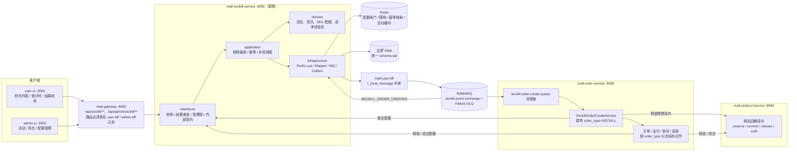
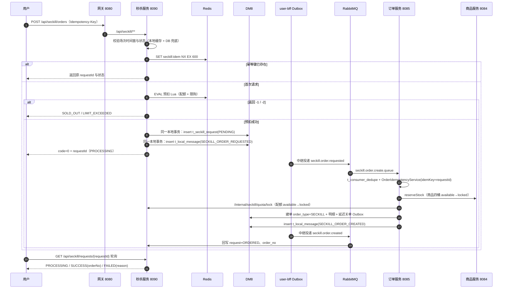
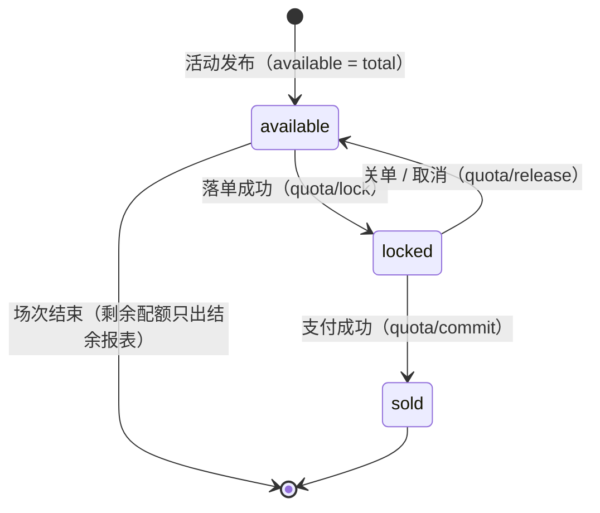

# 秒杀设计（SECKILL_DESIGN）

> 状态：设计稿，用于评审，尚未落地代码。
> 约束来源：[AGENTS.md](../../AGENTS.md)、[README.md 第 15 章](../../README.md#15-代码导览)。

## 1. 目标与非目标

目标：

- 独立秒杀活动：活动 → 场次 → 秒杀商品（秒杀价、每人限购、开始/结束时间）。
- 独立秒杀配额账本，与常规销售配额隔离，不占用同一活动的可售名额。
- 峰值链路只做「校验 + Redis 原子预扣」，抢购接口不直接建单。
- 抢购成功后经 RabbitMQ 异步落单，订单、支付、物流、退款复用现有交易链路。
- 任何成功结果都必须能由数据库条件更新、唯一键、业务幂等号兜底，Redis 只是流量闸门，不是库存权威。

非目标（一期不做）：

- 预约提醒、定金预售、拼团、抽奖。
- 多商品合并秒杀订单；一期一个请求只对应一个秒杀 SKU。
- 独立秒杀物理仓库；秒杀不改变商品四桶库存模型。
- 全国多机房、跨地域单元化。

## 2. 现状约束（设计必须遵守）

| 约束 | 来源 | 对秒杀的影响 |
|---|---|---|
| 库存四桶恒等式 `available + locked + sold + lost = 入库总量` | AGENTS 5.1 | 秒杀不得新增第五个物理库存桶，也不得把商品库存「划走」到秒杀池 |
| 禁止 `select ... for update` | AGENTS 5.6 | 配额与库存全部用条件 UPDATE + CAS |
| 并发权威是 Redis 锁 + fence 围栏 | AGENTS 5.6 | 秒杀不额外造锁体系；Redis 预扣是闸门，不是锁 |
| 只有拥有方写表 | AGENTS 1 | 活动/场次/配额/请求表只由 `mall-seckill-service` 写；商品库存仍只由 `mall-product-service` 写 |
| MQ = MANUAL ACK + Spring Retry + Failure DLQ | AGENTS 6 | 秒杀异步落单复用同一套可靠性语义 |
| Outbox 中继只由 `mall-user-bff` 执行 | AGENTS 6 | 秒杀服务只写 `t_local_message`，不开启 relay |
| `schema.sql` 是唯一结构权威 | AGENTS 7 | 新表只加到 `backend/env/sql/dm8/schema.sql` |
| 同库同 schema、服务化拆分但未分库 | README 第 15 章 | 跨服务调用走 `/internal/**` + Feign，本地事务不跨服务 |

## 3. 方案选择

### 3.1 库存隔离方式

| 方案 | 做法 | 优点 | 代价 |
|---|---|---|---|
| A（推荐）配额账本 + 商品四桶兜底 | 秒杀配额独立记账；落单时同时预占商品物理库存 | 不破坏四桶；复用支付/关单/收货/退款 | 两本账需对账；落单事务多一次远程预占 |
| B 物理库存划拨 | 发布活动时把商品 available 划到秒杀池 | 物理隔离最彻底 | 商品库存必然出现第五个桶或跨账本不变量，违反 AGENTS 5.1，需改库存模型 |
| C 秒杀独立商品行 | 每个秒杀 SKU 建一条独立商品 | 实现最简单 | 没有活动/场次模型，商品数据重复 |

结论：一期采用 A。秒杀配额独立，物理库存仍由商品服务四桶唯一权威；发布活动时校验
`配额总量 ≤ 当前商品可用库存 - 其它进行中场次占用`，同一商品在同一时间段只允许一个进行中场次。

### 3.2 抢购链路

采用 **Redis Lua 原子预扣 + MQ 异步落单**：

- 抢购接口只做活动校验、幂等判断、Redis Lua 预扣，返回 `requestId`，不建订单。
- 异步消费者在订单服务本地事务内完成「建单 + 商品库存预占 + 配额锁定 + 延迟关单 Outbox」。
- Redis 预扣成功不等于下单成功；最终结果以数据库订单为准，客户端按 `requestId` 轮询。

## 4. 系统架构



读图要点：

- 秒杀服务只写自己的活动/场次/配额/请求表；物理库存动作仍由商品服务执行。
- 订单服务是唯一建单方；秒杀服务不直接写 `t_order_info`。
- 抢购接口与落单链路通过 MQ 解耦，削掉数据库写峰值。

## 5. 领域模型与表设计

新增限界上下文 `cc.ivera.seckill`，四层结构与其他上下文一致：`interfaces / application / domain / infrastructure`。
新增模块 `mall-api-seckill`（跨进程契约与 MQ 消息体）与 `mall-seckill-service :8090`。

### 5.1 表清单（只加到 `schema.sql`）

| 表 | 归属 | 说明 |
|---|---|---|
| `t_seckill_activity` | 秒杀服务 | 活动壳：名称、总体起止、状态 |
| `t_seckill_session` | 秒杀服务 | 场次：具体开抢时间窗 |
| `t_seckill_sku` | 秒杀服务 | 场次内商品：秒杀价、限购、配额三态 |
| `t_seckill_request` | 秒杀服务 | 抢购请求幂等与结果回放，一请求一单 |
| `t_seckill_quota_transaction` | 秒杀服务 | 配额流水，`biz_no` 唯一保证幂等 |
| `t_order_info.order_type` | 订单服务 | 新增列，`NORMAL / SECKILL`，默认 `NORMAL` |

### 5.2 关键结构（DM8）

```sql
CREATE TABLE t_seckill_activity
(
    id          BIGINT IDENTITY(1, 1) NOT NULL,
    activity_no VARCHAR(50)                  NOT NULL,
    title       VARCHAR(256)                 NOT NULL,
    start_time  TIMESTAMP                    NOT NULL,
    end_time    TIMESTAMP                    NOT NULL,
    status      VARCHAR(16) DEFAULT 'DRAFT'  NOT NULL, -- DRAFT/PUBLISHED/ONLINE/OFFLINE/ENDED
    version     INT         DEFAULT 0        NOT NULL,
    fence_token BIGINT      DEFAULT 0        NOT NULL,
    create_time TIMESTAMP   DEFAULT CURRENT_TIMESTAMP,
    update_time TIMESTAMP   DEFAULT CURRENT_TIMESTAMP,
    CONSTRAINT pk_seckill_activity PRIMARY KEY (id),
    CONSTRAINT uk_seckill_activity_no UNIQUE (activity_no)
);

CREATE TABLE t_seckill_session
(
    id          BIGINT IDENTITY(1, 1) NOT NULL,
    activity_id BIGINT                       NOT NULL,
    session_no  VARCHAR(32)                  NOT NULL,
    start_time  TIMESTAMP                    NOT NULL,
    end_time    TIMESTAMP                    NOT NULL,
    status      VARCHAR(16) DEFAULT 'DRAFT'  NOT NULL, -- DRAFT/WARMING/ONLINE/OFFLINE/ENDED
    version     INT         DEFAULT 0        NOT NULL,
    fence_token BIGINT      DEFAULT 0        NOT NULL,
    create_time TIMESTAMP   DEFAULT CURRENT_TIMESTAMP,
    update_time TIMESTAMP   DEFAULT CURRENT_TIMESTAMP,
    CONSTRAINT pk_seckill_session PRIMARY KEY (id),
    CONSTRAINT uk_seckill_session_no UNIQUE (activity_id, session_no)
);

CREATE TABLE t_seckill_sku
(
    id              BIGINT IDENTITY(1, 1) NOT NULL,
    session_id      BIGINT                       NOT NULL,
    product_id      BIGINT                       NOT NULL,
    seckill_price   INT                          NOT NULL,
    per_user_limit  INT         DEFAULT 1        NOT NULL,
    total_quota     INT                          NOT NULL,
    available_quota INT                          NOT NULL,
    locked_quota    INT         DEFAULT 0        NOT NULL,
    sold_quota      INT         DEFAULT 0        NOT NULL,
    status          VARCHAR(16) DEFAULT 'ENABLED' NOT NULL,
    version         INT         DEFAULT 0        NOT NULL,
    fence_token     BIGINT      DEFAULT 0        NOT NULL,
    create_time     TIMESTAMP   DEFAULT CURRENT_TIMESTAMP,
    update_time     TIMESTAMP   DEFAULT CURRENT_TIMESTAMP,
    CONSTRAINT pk_seckill_sku PRIMARY KEY (id),
    CONSTRAINT uk_seckill_sku UNIQUE (session_id, product_id)
);

CREATE TABLE t_seckill_request
(
    id            BIGINT IDENTITY(1, 1) NOT NULL,
    request_id    VARCHAR(64)                   NOT NULL,
    idem_key      VARCHAR(128)                  NOT NULL,
    user_id       BIGINT                        NOT NULL,
    activity_id   BIGINT                        NOT NULL,
    session_id    BIGINT                        NOT NULL,
    sku_id        BIGINT                        NOT NULL,
    product_id    BIGINT                        NOT NULL,
    quantity      INT                           NOT NULL,
    seckill_price INT                           NOT NULL,
    status        VARCHAR(16) DEFAULT 'PENDING' NOT NULL, -- PENDING/ORDERED/FAILED/CANCELLED
    order_no      VARCHAR(50),
    reject_reason VARCHAR(200),
    request_hash  VARCHAR(64)                   NOT NULL,
    retry_count   INT         DEFAULT 0         NOT NULL,
    expire_at     TIMESTAMP                     NOT NULL,
    version       INT         DEFAULT 0         NOT NULL,
    fence_token   BIGINT      DEFAULT 0         NOT NULL,
    create_time   TIMESTAMP   DEFAULT CURRENT_TIMESTAMP,
    update_time   TIMESTAMP   DEFAULT CURRENT_TIMESTAMP,
    CONSTRAINT pk_seckill_request PRIMARY KEY (id),
    CONSTRAINT uk_seckill_request_id UNIQUE (request_id),
    CONSTRAINT uk_seckill_request_idem UNIQUE (user_id, idem_key)
);

CREATE TABLE t_seckill_quota_transaction
(
    id              BIGINT IDENTITY(1, 1) NOT NULL,
    biz_no          VARCHAR(128)                  NOT NULL,
    biz_type        VARCHAR(32)                   NOT NULL,
    session_id      BIGINT                        NOT NULL,
    sku_id          BIGINT                        NOT NULL,
    request_id      VARCHAR(64),
    order_no        VARCHAR(50),
    available_delta INT                           NOT NULL,
    locked_delta    INT                           NOT NULL,
    sold_delta      INT         DEFAULT 0         NOT NULL,
    create_time     TIMESTAMP   DEFAULT CURRENT_TIMESTAMP,
    CONSTRAINT pk_seckill_quota_tx PRIMARY KEY (id),
    CONSTRAINT uk_seckill_quota_biz_no UNIQUE (biz_no)
);
```

配额不参与商品四桶恒等式，自身满足：

```text
available_quota + locked_quota + sold_quota = total_quota
```

所有配额变更必须满足：

- 条件 UPDATE 保证 `available_quota >= qty`、`locked_quota >= qty`；
- 写 `t_seckill_quota_transaction`；
- `biz_no` 幂等锚：`SECKILL_LOCK:requestId`、`SECKILL_COMMIT:orderNo`、`SECKILL_RELEASE:orderNo`；
- 唯一键兜底。

### 5.3 订单表扩展

```sql
ALTER TABLE t_order_info ADD order_type VARCHAR(16) DEFAULT 'NORMAL' NOT NULL;
CREATE INDEX idx_order_type_time ON t_order_info (order_type, create_time);
```

- 存量订单默认 `NORMAL`，历史行为不变。
- 秒杀订单 `order_type = 'SECKILL'`，`t_order_item.unit_price` 记录秒杀价快照，`discount_amount = 0`。
- 退款政策不改：金额上限仍取 `t_order_item.pay_amount`，服务端 `RefundPolicy` 为权威。

## 6. Redis 设计

### 6.1 Key 规划

| Key | 类型 | 含义 | TTL |
|---|---|---|---|
| `seckill:stock:{skuId}` | String | 剩余可抢配额 | 场次结束 + 1 天 |
| `seckill:user:{skuId}` | Hash（field = userId） | 用户已抢数量 | 场次结束 + 1 天 |
| `seckill:idem:{userId}:{idemKey}` | String（value = requestId） | 客户端幂等映射 | 10 分钟 |
| `seckill:session:{sessionId}` | String（JSON） | 场次状态与时间窗缓存 | 60 秒 |
| `seckill:rate:{userId}` | String | 用户抢购频率计数 | 1 秒 |

### 6.2 原子预扣 Lua

```lua
-- KEYS[1] seckill:stock:{skuId}
-- KEYS[2] seckill:user:{skuId}
-- ARGV[1] quantity  ARGV[2] userId  ARGV[3] perUserLimit
local stock = tonumber(redis.call('GET', KEYS[1]) or '-1')
if stock < tonumber(ARGV[1]) then
    return -1                       -- 配额不足
end
local bought = tonumber(redis.call('HGET', KEYS[2], ARGV[2]) or '0')
if bought + tonumber(ARGV[1]) > tonumber(ARGV[3]) then
    return -2                       -- 超过限购
end
redis.call('DECRBY', KEYS[1], ARGV[1])
redis.call('HINCRBY', KEYS[2], ARGV[2], ARGV[1])
return stock - tonumber(ARGV[1])    -- 剩余配额
```

- 库存、限购、扣减必须在同一个 Lua 中完成，禁止拆成多次 Redis 调用。
- 返回负数只作为快速失败信号，不写任何业务表。
- 频率限制在 Lua 之前独立执行，超限直接拒绝，不进入预扣。

### 6.3 预热与重建

- 场次 ONLINE 前由管理端或定时任务预热：`seckill:stock:{skuId} = available_quota`，
  用户已抢数量按 `t_seckill_request` 中 `PENDING / ORDERED` 的 `SUM(quantity)` 回填。
- 服务重启或 Redis 丢失后重建，公式必须扣除「已预扣但尚未锁定配额」的在途请求
  （是否已锁配额以 `t_seckill_quota_transaction` 中是否存在 `SECKILL_LOCK:requestId` 判定）：

```text
Redis 库存 = sku.available_quota - SUM(未锁配额的 PENDING 请求 quantity)
Redis 用户已抢 = SUM(PENDING / ORDERED 的 quantity) 按 user_id 分组
```

- 重建期间场次入口短暂置为 `WARMING`，避免边重建边抢购。
- 重建只做「Redis 追赶 DB」，绝不反向用 Redis 覆盖 DB。

### 6.4 幂等

- 第一层：客户端 `Idempotency-Key`，服务端 `SET seckill:idem:{userId}:{idemKey} requestId NX EX 600`；
  已存在时直接返回原 `requestId` 与当前状态。
- 第二层：`t_seckill_request` 唯一键 `(user_id, idem_key)`，并发重复插入只有一个成功。
- 第三层：MQ 消费以 `requestId` 作为 `t_consumer_dedupe.event_id`，订单侧以 `requestId` 作为
  `t_order_request.idem_key`，保证一请求一单。

## 7. 核心流程



失败分支：

- 订单服务建单失败且重试耗尽 → 消息进入 Failure Queue，`t_seckill_request` 停留 `PENDING`。
- 秒杀服务 `SeckillRequestRecoveryScheduler` 扫描超时 `PENDING`：按 `requestId` 查询订单服务，
  已建单则回写 `ORDERED`；未建单则重新投递（`requestId` 不变，消费侧幂等），超过次数置 `FAILED`
  并释放 Redis 配额与用户已抢数量。
- 释放同样必须幂等：Redis `INCRBY` + `HINCRBY -qty` 之前先以 `SECKILL_RELEASE:requestId` 写配额流水，
  插入成功才执行；Redis 侧操作失败由对账任务告警，不自动覆盖。

## 8. MQ 拓扑与可靠性

```text
seckill.event.exchange（direct，durable）
  ├─ seckill.order.requested → seckill.order.create.queue      （mall-order-service 消费）
  ├─ seckill.order.created   → seckill.order.created.queue     （mall-seckill-service 消费）
  └─ seckill.order.failed    → seckill.order.failed.queue      （预留，人工/补偿事件）

seckill.event.failure.exchange
  ├─ seckill.order.create.failure.queue
  └─ seckill.event.parking-lot.queue
```

约束：

- 两个消费者都遵循 `MANUAL ACK + Spring Retry + Failure DLQ`：业务成功 → 去重回写 → `basicAck`；
  异常继续抛出，不提前 `basicNack`，不吞异常。
- 去重表：`t_consumer_dedupe('order.seckill-requested', requestId)`；
  `t_consumer_dedupe('seckill.order-created', orderNo)`。
- Outbox 业务类型新增到 `cc.ivera.shared.domain.mq.LocalMessageBizType`：
  `SECKILL_ORDER_REQUESTED`、`SECKILL_ORDER_CREATED`；消息体放 `mall-api-seckill`，由 `mall-infra` 引用；
  中继仍只由 `mall-user-bff` 执行，`mall-seckill-service` 配置 `local-message.relay-enabled=false`。
- 失败队列只排障，不自动回灌；Parking Lot 人工隔离，不配置消费者。
- DB 调度器是最终兜底，与 Failure Queue 并存，不互相替代。

## 9. 库存与配额生命周期

### 9.1 配额三态



说明：

- 配额 `locked → sold` 发生在支付成功事件被订单服务消费并推进订单状态之后，与商品库存语义保持一致。
- 配额 `sold` 不因退款回退：秒杀让利已核销，退款只回补商品物理库存，不回补秒杀名额。
- 活动结束后 `available_quota` 不自动转移，仅做结余报表；下一场次重新配置配额。

### 9.2 与商品库存的联动

| 业务动作 | 商品四桶（商品服务） | 秒杀配额（秒杀服务） |
|---|---|---|
| 活动发布 | 不变 | `available_quota` 初始化为 `total_quota` |
| 抢购预扣 | 不变 | Redis 预扣（不落库） |
| 异步落单 | `available → locked`（条件 UPDATE） | `available → locked` |
| 支付成功 | `locked` 不变（`LOCKED → COMMITTED`） | `locked → sold` |
| 超时关单 / 取消 | `locked → available` | `locked → available` |
| 确认收货 | `locked → sold` | 不变（已 sold） |
| 仅退款 / 退货退款 | 按现有退款规则回补或核销 | 不变 |
| 活动结束 | 不变 | 结余报表，Redis key 过期 |

一致性要求：

- 落单事务内先商品预占、再配额锁定；任一步失败整体回滚，并释放已预占资源。
- 两本账通过每日对账任务比对：`sku.total_quota - sold_quota` 与订单侧秒杀订单数量、商品库存流水交叉校验；
  差异只告警，不自动改写。

## 10. 订单与金额

- 一请求一单：订单服务以 `requestId` 作为 `t_order_request.idem_key`，`api = MQ:/seckill/order`。
- `order_no` 前缀 `SK`，与普通订单区分，便于检索。
- 金额口径：
  - `t_order_item.unit_price = seckill_price`，`deal_unit_amount = seckill_price`；
  - `original_total_amount = seckill_price × quantity`，`discount_amount = 0`；
  - `t_order_info.total_fee` 与明细合计一致。
- 秒杀价不可变更：场次 ONLINE 后禁止修改 `seckill_price`；订单服务落单时回查秒杀服务 SKU 快照，
  与事件携带价格比对，不一致则拒绝建单，避免使用过期价格。
- 秒杀订单与其他订单共用支付、发货、物流、退款链路，不单独维护状态机。
- 未支付订单沿用 `payment.order.expire-minutes` 超时关单；关单前仍需先查渠道成交事实。

## 11. 失败与补偿

| 场景 | 处理 |
|---|---|
| Redis 预扣成功、请求表写入失败 | 请求返回失败；Redis 计数由重建/对账任务修正，必要时人工回补 |
| 请求表写入成功、Outbox 投递失败 | `t_local_message` 指数退避重试，超限置 `FAILED` 告警 |
| 订单消费失败、重试耗尽 | Failure Queue 保留；调度器扫描超时 `PENDING`，查单后回写或释放 |
| 订单已建、回写 `ORDERED` 失败 | 调度器按 `requestId` 查单补偿，重复回写幂等 |
| 商品库存预占失败 | 落单事务回滚；释放配额与 Redis 预扣，请求置 `FAILED` |
| 配额锁定失败 | 落单事务回滚；释放商品预占与 Redis 预扣，请求置 `FAILED` |
| 用户重复提交 | 幂等键返回原 `requestId` 与状态，不重复预扣 |
| 服务重启 / Redis 丢失 | 按第 6.3 节公式重建；重建窗口暂停入口 |
| 超卖（Redis 与 DB 漂移） | 以商品库存条件 UPDATE 为最终闸门，订单失败即释放；告警并人工对账 |

调度器：

- `SeckillRequestRecoveryScheduler`（秒杀服务）：扫描超时 `PENDING`，查单补偿、重投或释放。
- `SeckillQuotaReconcileScheduler`（秒杀服务）：定时比对 Redis 与 DB 配额，只告警不自动改写。
- 场次状态推进：`SeckillSessionScheduler` 按时间窗把场次置 `ONLINE / ENDED`，并触发预热与清理。
- 所有调度单条失败只记录日志，不中断同批次。

## 12. 接口清单

用户端（网关 → `mall-seckill-service`）：

- `GET /api/seckill/activities`：进行中与即将开始的活动/场次列表。
- `GET /api/seckill/activities/{activityId}`：活动详情、场次、SKU、倒计时。
- `POST /api/seckill/orders`：抢购，必须带 `Idempotency-Key`，返回 `requestId`。
- `GET /api/seckill/requests/{requestId}`：结果轮询，返回 `PROCESSING / SUCCESS / FAILED`。

管理端（网关 → `mall-seckill-service`，必须排在 `/api/admin/**` 之前）：

- `POST/PUT /api/admin/seckill/activities`
- `POST /api/admin/seckill/activities/{id}/publish|online|offline`
- `POST/PUT /api/admin/seckill/sessions`
- `POST/PUT /api/admin/seckill/skus`
- `POST /api/admin/seckill/sessions/{id}/warmup`

内部契约（不经过网关，仅供服务间调用）：

- `GET /internal/seckill/skus/{skuId}`：SKU 快照（价格、限购、状态）。
- `POST /internal/seckill/quota/lock`：落单锁配额。
- `POST /internal/seckill/quota/commit`：支付成功消耗配额。
- `POST /internal/seckill/quota/release`：关单/取消释放配额。
- `GET /internal/seckill/requests/{requestId}`：补偿查询。

网关新增路由必须放在 `/api/**` 与 `/api/admin/**` 之前：

```text
/api/admin/seckill/**  → lb://mall-seckill-service
/api/seckill/**        → lb://mall-seckill-service
```

## 13. 配置项

```yaml
server:
  port: 8090

spring:
  application:
    name: mall-seckill-service

seckill:
  enabled: true
  request-expire-seconds: 300
  result-poll-timeout-seconds: 30
  rate-limit-per-second: 5
  warmup-ahead-seconds: 300
  session-scan-ms: 5000
  request-recovery-scan-ms: 10000
  quota-reconcile-scan-ms: 60000
  order-create-max-retry: 3

local-message:
  relay-enabled: false   # 中继统一由 mall-user-bff 执行
```

- 增加 `backend/nacos/config/mall-seckill-service.yaml`，与其它服务一致的 Nacos 导入方式。
- 秒杀服务开启 `@EnableScheduling` 与 `@EnableRabbit`（自有用例的调度与消费），不开启 Outbox 中继。
- `seckill.enabled=false` 时接口直接返回「活动未开放」，用于紧急回滚。

## 14. 前端改造

`user-ui`：

- 秒杀频道：活动/场次列表、倒计时、进度条、售罄置灰。
- 抢购按钮：点击后禁用并轮询结果，成功跳转支付，失败展示原因。
- 订单列表增加「秒杀」标签与秒杀价展示。

`admin-ui`：

- 活动、场次、SKU 配额维护；发布前校验配额不超过商品可用库存。
- 场次监控：配额、订单数、支付数、失败数、热点商品。
- 预热、下线、导出结余报表。

## 15. 可观测性与压测

指标：

- 抢购接口 QPS、P50/P99 延迟、成功率、`SOLD_OUT`/`LIMIT` 比例。
- Lua 脚本执行耗时与失败数。
- MQ 投递延迟、消费积压、Failure Queue / Parking Lot 数量。
- `PENDING` 请求年龄分布、补偿次数、Redis 与 DB 配额差值。

压测验收：

- 超卖数为 0；少卖率不超过配置阈值。
- 抢购接口 P99 在目标 RT 内，数据库写 QPS 与异步消费能力匹配。
- Redis 预扣与 DB 请求数误差可解释、可对账。
- 压测脚本与结果不提交到仓库，仅记录结论到本文档附录。

## 16. 实施计划

| 阶段 | 内容 | 验证 |
|---|---|---|
| P1 | `mall-api-seckill`、`mall-seckill-service` 骨架、5 张表、活动/场次/SKU 管理接口 | `mvn clean test` 编译通过；`admin-ui` 构建 |
| P2 | Redis 预热、Lua 预扣、幂等、请求落库与轮询接口 | 手工并发验证无超卖、重复提交返回同一 requestId |
| P3 | MQ 拓扑、Outbox 类型、订单消费建单、`SECKILL_ORDER_CREATED` 回写 | 端到端抢购成功出单 |
| P4 | 关单/取消/支付/收货/退款联动，补偿调度与配额对账 | 各状态回归，异常注入验证补偿 |
| P5 | 前端页面、限流防刷、监控告警 | `user-ui` 构建 + 手工回归 |
| P6 | 压测、灰度、容量结论 | 达到验收指标 |

每阶段完成后同步：

- `README.md` 第 15 章：新增上下文、路由、MQ 拓扑、库存联动说明。
- `README.md`：启动方式、端口、配置项、功能说明。
- `AGENTS.md`：限界上下文从 8 个变为 9 个，模块/端口清单，后台任务归属，
  MQ 拓扑与 `LocalMessageBizType` 新增类型。
- `backend/docs/RABBITMQ_OPERATIONS.md`：新增交换机/队列声明、迁移与回滚步骤。

## 17. 兼容性、灰度与回滚

兼容性：

- 表结构只新增，`t_order_info.order_type` 有默认值，存量数据与普通下单不受影响。
- 新接口独立前缀 `/api/seckill/**`，不改动现有 API 契约。
- 新 MQ 拓扑独立交换机与队列，不修改既有队列参数。
- 前端新增页面，不改动现有结算入口。

灰度：

1. 部署服务与拓扑，保持 `seckill.enabled=false`，验证健康检查与 Nacos 注册。
2. 开启管理端，配置内部测试活动，小范围放量。
3. 开启用户端入口，按场次逐步放量。
4. 观察指标与对账结果，再扩大场次规模。

回滚：

- `seckill.enabled=false` 立即关闭入口；网关移除 `/api/seckill/**` 路由兜底。
- 停用消费者与调度器不影响正常交易。
- 表与新列保留，不做破坏性回滚；已建秒杀订单继续走普通交易链路。
- 已预扣未落单的请求由补偿调度释放或人工处理。

## 18. 待确认问题

1. 物理库存隔离是否必须（本设计选择配额账本；若必须隔离，需要评审是否接受新增库存桶并修改 AGENTS 5.1）。
2. 秒杀退款是否允许重新获得秒杀资格（本设计默认不允许）。
3. 是否需要预约、验证码、排队令牌、黑名单（建议二期）。
4. 同一商品是否允许同时参加多个场次（本设计默认禁止时间重叠）。
5. 少卖容忍阈值与超卖告警阈值。
6. 是否需要独立的秒杀订单列表与运营看板（一期先复用订单列表 + 标签）。
