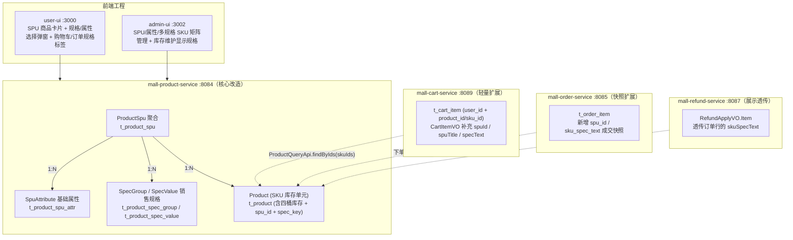
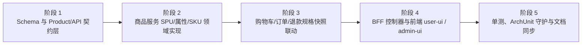

# SPU / SKU 与商品属性体系扩展实施计划（PLAN）

> **状态**：实施计划（Plan），待评审确认后进入开发。  
> **配套规格**：[spec.md](spec.md)（数据字典、接口契约、状态机与验收用例）。  
> **约束基线**：[AGENTS.md](../../AGENTS.md)、[README.md 第 15 章](../../README.md#15-代码导览)。

---

## 1. 背景与目标

### 1.1 现状痛点

当前系统中，`t_product` 是扁平的单层商品表（`id, title, price, available_stock, locked_stock, sold_stock, lost_stock, product_status`），[schema.sql](../../backend/env/sql/dm8/schema.sql#L401-L402) 明确标注：

```text
商品表：库存单元（本系统无独立 SKU 维度，product_id 兼作文档模型中的 sku_id）
```

单层模型存在以下业务局限：

1. **缺乏 SPU（标准商品单元）聚合能力**：同一款商品的不同规格（如「iPhone 16 Pro 沙漠钛金属 256G」与「iPhone 16 Pro 原色钛金属 512G」）只能拆成多条毫无关联的独立商品，商城首页列表重复堆砌，用户无法在同一商品详情内切换规格。
2. **缺乏商品属性（Product Attributes）体系**：
   - 无法维护**基础展示属性（SPU 参数）**（如品牌、产地、材质、保修期、出版社等客观参数）；
   - 无法维护**销售规格属性（SKU 规格维度与规格值）**（如颜色、尺码、内存容量、版本等决定价格与库存的组合维度）。
3. **交易链路缺少规格快照**：购物车、结算单、订单明细（`t_order_item`）、退款单与 Excel 库存导入均只有 `product_title`，没有独立的规格文本快照（如 `"沙漠钛金属 / 256GB"`）。

### 1.2 演进目标

在**严格遵守 [AGENTS.md](../../AGENTS.md) 全部领域不变量（库存四桶恒等式、防超卖条件 UPDATE、`biz_no` 幂等、订单成交快照不可变、退款防超退）**的前提下：

1. 建立 **SPU（款 / 聚合展示单元）→ SKU（最小计价与物理库存单元）** 双层商品模型。
2. 建立 **双层商品属性模型**：
   - **基础展示属性（SPU General Attributes）**：归属 SPU，键值对列表（如「品牌：Apple」「材质：钛金属」），仅用于展示，不拆分 SKU。
   - **销售规格属性（Sale Specifications）**：归属 SPU，包含规格组（`spec_group`，如「颜色」「容量」）与规格值（`spec_value`，如「黑色」「256GB」），其组合唯一决定一个 SKU。
3. **平滑兼容存量单品与下游微服务**：
   - 支持**单规格商品**（1 个 SPU 对应 1 个 `DEFAULT` 默认 SKU）与**多规格商品**（1 个 SPU 对应 $N$ 个不同规格组合的 SKU）；
   - 购物车、下单 Saga、库存预占/释放/结转、退款回补/核销、Excel 库存导入继续以 **SKU ID（物理复用 `t_product.id`）** 作为库存与交易原子单元，并在购物车与订单明细中补齐 SPU 信息与 SKU 规格快照。

### 1.3 非目标（一期不做）

- 不引入复杂类目树（Category Tree）强制绑定属性模板（一期采用 SPU 级自定义基础属性 + SPU 级自定义销售规格组，开箱即用、零前置类目配置负担；一期不建类目表，仅保留 `category_name` 展示字段）。
- 不做跨 SKU 组合套装（Bundle / 虚拟组合库存）；每个 SKU 独立持有物理四桶库存。
- 不改变支付（`mall-payment-service`）、账单对账（`mall-bill-service`）、用户（`mall-user-service`）的表结构与接口。

---

## 2. 核心架构决策与方案比选

### 2.1 SKU 物理表演进方案比选（现状 → 目标）

| 维度 | 方案 A（推荐）：新增 `t_product_spu` + 原 `t_product` 原位演进为 SKU 表 | 方案 B：原 `t_product` 改为 SPU 表 + 新建 `t_product_sku` 表 |
|---|---|---|
| 核心思路 | 新增 `t_product_spu`（以及属性/规格表）；原 `t_product` 保留四桶库存与主键 `id`（即 `sku_id`），新增 `spu_id`、`sku_code`、`spec_key` 列 | 把 `t_product` 的四桶库存列删掉变成 SPU 表，另建 `t_product_sku` 存放价格与四桶库存 |
| 对四桶库存与防超卖 SQL 的影响 | **零破坏**：`ProductMapper.xml` 现有的 6 条核心条件 UPDATE（`reserveStock`、`releaseReservedStock`、`commitSoldStock`、`releaseSoldStock`、`writeOffLostStock`、`adjustAvailable`）完全保留 | 必须重写全部库存 Mapper、PO、Repository 与 16 条 `InventoryServiceImplTest` |
| 对下游微服务（购物车/订单/退款/导入）的影响 | **天然兼容**：下游所有表的 `product_id` 本来在 `schema.sql` 中就定义为「库存单元 / `sku_id`」，语义完全一致；仅需在 `t_order_item` 增加 `spu_id` 与 `sku_spec_text` 快照列 | 购物车、订单、库存预占、库存流水、退款明细、Excel 导入的 `product_id` 语义全部断裂，需全链路重命名并重写跨服务 Feign 契约 |
| 存量数据迁移成本 | 每个存量 `t_product` 行只需补齐 1 条同 ID 的 `t_product_spu` 记录并设 `spu_id = id, spec_key = 'DEFAULT'` | 需拆分迁移存量表数据并重写所有外键关联 |

**结论**：采用 **方案 A**。
- `t_product_spu` 承载 SPU 聚合根（款式标题、副标题、简介、主图、上下架状态、最低/最高价冗余快照、默认 SKU ID）。
- `t_product` 作为 **SKU 物理表**（在领域层同时提供 `ProductSku` / 兼容既有 `Product` 视图），`t_product.id` 即 `sku_id`（跨服务契约中保持 `productId` 命名兼容，并在 VO/DTO 中明确暴露 `spuId`、`skuId`、`specText` 与结构化 `specs`，后两者由服务端按 `spec_key` 读取时派生）。

---

## 3. 领域模型与边界划分

### 3.1 限界上下文影响面



### 3.2 核心领域不变量（必须守住）

1. **库存四桶只属于 SKU，SPU 不直接持有库存桶**：
   - 每个 SKU 独立满足 `available_stock + locked_stock + sold_stock + lost_stock = 该 SKU 入库总量`。
   - SPU 的展示总可用库存 = 该 SPU 下所有 `product_status = 'ENABLED'` 的 SKU 的 `available_stock` 之和。
2. **上下架双层闸门（SPU 状态 × SKU 状态）**：
   - SKU 真实可售（`effectivelyAvailable`）当且仅当：`spu.spuStatus == 'ENABLED' && sku.productStatus == 'ENABLED' && sku.availableStock > 0`。
   - 当管理员下架 SPU（`spu_status = 'DISABLED'`）时，同步或级联禁止该 SPU 下全部 SKU 的加购与下单；当管理员上架 SPU 时，校验其下至少存在 1 个 `ENABLED` 状态的 SKU。
3. **同一 SPU 下销售规格组合唯一**：
   - 单规格 SPU：无销售规格组（`t_product_spec_group` 为空），有且仅有 1 条 `spec_key = 'DEFAULT'` 的 SKU。
   - 多规格 SPU：每个 SKU 的 `spec_key` 由其选中的销售规格按 `group_id` 升序拼接（格式 `groupId1:valueId1;groupId2:valueId2`），由数据库唯一约束 `uk_product_spu_spec (spu_id, spec_key)` 保证同一 SPU 下绝不产生重复规格的 SKU。
4. **已产生交易的 SKU 禁止物理删除**：
   - 编辑多规格 SPU 时，对已有 SKU 只做价格、规格文案或 `ENABLED / DISABLED` 状态更新，禁止 `DELETE` 已存在的 SKU 行，防止历史订单、库存预占（`t_inventory_reservation`）、库存流水（`t_inventory_transaction`）关联悬空。
5. **订单快照不可变**：
   - 下单时，`t_order_item` 同时快照 `spu_id`、`product_id`（SKU ID）、`product_title`（SPU 标题）、`sku_spec_text`（如 `"沙漠钛金属 / 256GB"`）、`unit_price`（该 SKU 下单时售价）。后续 SPU/SKU 改名、调价、改规格不影响历史订单展示与退款核算。

---

## 4. 数据库变更计划（仅修改 `backend/env/sql/dm8/schema.sql`）

遵循 [AGENTS.md §7](../../AGENTS.md#7-数据库变更规则)，所有表结构与种子数据集中在 `backend/env/sql/dm8/schema.sql` 中维护，保持可重复执行（先按依赖顺序 `DROP TABLE IF EXISTS ... CASCADE` 再 `CREATE`）：

1. **新增 4 张表**：
   - `t_product_spu`：SPU 主表（`id, spu_code, title, subtitle, category_name, brand_name, main_image, description, spu_status, spec_mode, min_price, max_price, default_sku_id, create_time, update_time`）。
   - `t_product_spu_attr`：SPU 基础展示属性表（`id, spu_id, attr_name, attr_value, sort_order, create_time, update_time`），唯一键 `uk_spu_attr_name (spu_id, attr_name)`。
   - `t_product_spec_group`：SPU 销售规格组表（`id, spu_id, spec_name, sort_order, create_time, update_time`），唯一键 `uk_spu_spec_group (spu_id, spec_name)`。
   - `t_product_spec_value`：SPU 销售规格值表（`id, spu_id, group_id, spec_value, sort_order, create_time, update_time`），唯一键 `uk_spec_group_val (group_id, spec_value)`。
2. **扩展 2 张既有表**：
   - `t_product`（SKU 表）：新增 `spu_id BIGINT NOT NULL`、`sku_code VARCHAR(64)`、`spec_key VARCHAR(256) DEFAULT 'DEFAULT' NOT NULL`；新增唯一约束 `uk_product_spu_spec UNIQUE (spu_id, spec_key)` 与索引 `idx_product_spu_status (spu_id, product_status)`。不新增 `spec_text` / `spec_json` / `is_default` 列：`spec_text` 与 `specs` 由服务端按 `spec_key` 读取时派生，默认 SKU 唯一由 `t_product_spu.default_sku_id` 表达；`t_product.title` 保持为 SPU 标题的同步冗余列。
   - `t_order_item`（订单商品明细表）：新增 `spu_id BIGINT`、`sku_spec_text VARCHAR(256)`，用于固化下单时的 SPU 与 SKU 规格快照。
3. **初始化种子数据升级**：
   - 保留原有 4 门课程商品作为**单规格 SPU + 默认 SKU** 种子数据（ID 保持兼容）；
   - 新增 1~2 款**多规格 SPU 示例商品**（含基础属性如「品牌」「适用人群」「保修/有效期」，以及销售规格组如「版本：标准版 / 旗舰版」「时长/容量：年度版 / 永久版」对应的多个 SKU），方便前后端开箱联调与演示。
4. **触发器**：为 `t_product_spu`、`t_product_spu_attr`、`t_product_spec_group`、`t_product_spec_value` 各补一个 `trg_*_uptime` BEFORE UPDATE 触发器（与既有 10 张表约定一致），保证 `update_time` 自动刷新；`t_product` 沿用既有 `trg_product_uptime`。

---

## 5. 分阶段实施路线图（Phased Implementation Plan）

为保证每一步**小步、可编译、单测全绿、可独立验证**，按以下 5 个阶段推进：



### 阶段 1：数据库 Schema 与 `mall-api-product` / `mall-api-order` 契约扩展
- **改动文件**：
  - `backend/env/sql/dm8/schema.sql`：新增 `t_product_spu`、`t_product_spu_attr`、`t_product_spec_group`、`t_product_spec_value` 建表与触发器；扩展 `t_product` 与 `t_order_item` 列及索引；更新种子数据。
  - `backend/mall-api-product`：
    - 扩展 `Product` 模型：新增 `spuId`、`spuTitle`、`spuStatus`、`skuCode`、`specKey` 字段，以及读时装配的 `specText`、`specs`，新增辅助方法 `displayTitle()`（有 `specText` 时返回 `title + " (" + specText + ")"` 或分别提供 `title` 与 `specText`）和 `isEffectivelyEnabled()`（同时校验 `spuStatus` 与 `productStatus`）。
    - 新增领域模型：`ProductSpu`、`ProductSpuAttr`、`ProductSpecGroup`、`ProductSpecValue`。
    - 新增 DTO/VO：`SpuSaveRequest`（含 SPU 基本信息、`attrs` 基础属性列表、`specGroups` 销售规格定义、`skus` SKU 列表）、`SpuSummaryVO`（列表卡片 VO）、`SpuDetailVO`（含 SPU、基础属性、销售规格树、下属 SKU 列表及库存）、`ProductDetailVO` 扩展 SPU 与属性信息。
    - 扩展 `ProductService` 接口：新增 `pageSpu(int page, int size, String keyword, boolean onlyEnabled)`、`getSpuDetail(Long spuId)`、`createSpu(SpuSaveRequest request)`、`updateSpu(Long spuId, SpuSaveRequest request)`、`changeSpuStatus(Long spuId, String status)`；同时保留原有 SKU 级方法（`page`、`getById`、`create`、`changeStatus`），其中 `create(title, price, stock)` 自动创建单规格 SPU + 默认 SKU，保证向后兼容。
  - `backend/mall-api-order` & `backend/mall-api-cart`：
    - `OrderItem` 增加 `spuId`、`skuSpecText`；
    - `CartItemVO` 增加 `spuId`、`skuSpecText`。

### 阶段 2：`mall-product-service` 领域层、应用层与持久化层实现
- **改动文件**：
  - `domain` 层：
    - 新增 `SpuSpecPolicy`（纯领域策略类，零 Spring/MyBatis 依赖）：校验基础属性去重、销售规格组/规格值合法性、生成规范化 `spec_key`、校验规格组/值的引用完整性（被 SKU 引用的组/值禁止删除，改名级联重算，见 spec BR-07）、校验多规格 SKU 组合唯一性、计算 SPU 价格区间（`minPrice / maxPrice`）与默认 SKU（`defaultSkuId`）、校验上下架联动规则；`spec_text` / `specs` 属读取侧装配，不在领域策略中生成。
    - 新增 `ProductSpuRepository` 端口，扩展 `ProductRepository` 端口（按 `spuId` 批量查 SKU、更新 SKU 规格/价格）。
  - `infrastructure` 层：
    - 新增 `ProductSpuPO`、`ProductSpuAttrPO`、`ProductSpecGroupPO`、`ProductSpecValuePO` 及对应 Mapper / Converter / RepositoryImpl；
    - 扩展 `ProductPO` 与 `ProductPOConverter`，在 `ProductQueryApi.findById / findByIds` 中自动填充所属 SPU 的 `spuStatus`（当 SPU 下架时，对外体现为不可售），并按 `spec_key` 用 `IN` 批量查询规格组/值以装配 `specText`、`specs`，禁止逐行解析。
  - `application` 层：
    - 在 `ProductServiceImpl` 中实现单规格/多规格 SPU 的创建、编辑（新增 SKU / 更新已有 SKU / 禁用移除的未成交 SKU，不物理删除已有 SKU）、SPU 上下架联动；
  - `interfaces` 层：
    - `ProductInternalController` 暴露 `/internal/product/spus/**` 内部接口；
    - `mall-core` 的 `ProductServiceClient` 与 `ProductServiceRemoteAdapter` 同步适配。

### 阶段 3：购物车（`mall-cart-service`）、订单（`mall-order-service`）与退款（`mall-refund-service`）联动
- **改动文件**：
  - `mall-cart-service`：
    - `CartServiceImpl.toVOList` 与 `put`：从 `ProductQueryApi` 读取 `Product`（SKU）时，校验 `product.isEffectivelyEnabled()`（若 SPU 已下架或 SKU 已下架均视为不可购买），并将 `spuId`、`specText` 映射到 `CartItemVO`。
  - `mall-order-service`：
    - `CheckoutTxService.buildCheckoutContext` 与 `createOrder`：校验 `product.isEffectivelyEnabled()`；生成 `OrderItem` 时写入 `spuId` 与 `skuSpecText` 快照；`OrderItemMapper` / `OrderItemPO` 映射 `spu_id` 与 `sku_spec_text`。
  - `mall-refund-service`：
    - 退款申请详情 `RefundApplyVO.Item` 透传 `OrderItem.getSkuSpecText()`，方便管理员与用户在售后页面看清具体退的是哪个规格。

### 阶段 4：BFF 接口与双端前端页面（`user-ui` & `admin-ui`）升级
- **改动文件**：
  - `mall-user-bff`（`ProductController`）：
    - 新增 `GET /api/product/spu/page`（用户端按 SPU 分页，支持关键字过滤，返回价格区间、总可用库存、规格模式、默认 SKU ID）；
    - 新增 `GET /api/product/spu/{spuId}`（获取 SPU 详情、基础展示属性 `attrs`、销售规格树 `specGroups`、全部启用 SKU 列表 `skus`）；
    - 保留 `GET /api/product/page` 兼容接口。
  - `mall-admin-bff`（`AdminProductController`）：
    - 新增 `GET /api/admin/products/spu/page`、`GET /api/admin/products/spu/{spuId}`、`POST /api/admin/products/spu`、`PUT /api/admin/products/spu/{spuId}`、`POST /api/admin/products/spu/{spuId}/status`；
    - 保留按 SKU 分页/批量查询/调库存接口 `GET /api/admin/products/page`、`POST /api/admin/products/{skuId}/stock` 等，并在 SKU 列表中带出 `spuTitle` 与 `specText`。
  - `user-ui`：
    - `Home.jsx`：升级为 SPU 卡片展示（多规格商品价格展示 `¥xx.xx 起` 及「选规格」按钮，单规格商品可直接加购或点开查看参数）；新增 `<ProductSpecModal>` 抽屉/弹窗，展示**商品基础属性表（如品牌、产地）**与**销售规格点选矩阵（颜色、版本等）**，联动价格与库存后加入购物车。
    - `Cart.jsx`、`OrdersV2.jsx`、`RefundApplications.jsx`：商品标题下方展示浅灰规格胶囊标签（`skuSpecText` / `specText`）。
  - `admin-ui`：
    - `AdminProducts.jsx`：支持「SPU 维度管理 / SKU 库存维度」切换或主子表展开；新增/编辑 SPU 抽屉支持配置**基础展示属性（动态键值行）**、**销售规格组与规格值**、**SKU 规格组合矩阵（单价、初始库存、SKU 编码、状态）**；
    - `StockMaintenance.jsx`：库存流水、批量调库存与 Excel 模板导出中显示 `商品名称 + 规格 (specText)`。

### 阶段 5：测试补齐与文档同步
- **单元测试**：
  - 新增 `SpuSpecPolicyTest`（纯领域单测）：覆盖 `spec_key` 规范化生成、重复规格组合拦截、规格组/值引用完整性守卫（删除被引用值拒绝、改名级联重算后唯一键不冲突）、单规格/多规格切换守卫、基础属性名去重、SPU `minPrice/maxPrice` 计算、SPU/SKU 上下架双层可售判定、SPU 改名同步 SKU 标题。
  - 扩展 `CartServiceImplTest`：覆盖 SPU 下架导致 SKU 不可加购、购物车 VO 携带 `spuId` 与 `skuSpecText`。
  - 全部 7 个领域服务的 `*DomainArchitectureTest`（ArchUnit）保持全绿。
  - `user-ui` / `admin-ui` 新增前端规格组合匹配与价格区间计算的 Node 逻辑测试（`node --test`）。
- **文档同步**：
  - 同步更新 `README.md`（业务能力、表数量与数据模型、第 15 章代码导览、测试基线）与 `AGENTS.md`。

---

## 6. 兼容性与回滚预案

1. **API 向后兼容**：
   - 原有 `GET /api/product/page`、`POST /api/admin/products`、`POST /api/admin/products/{id}/stock`、`POST /api/cart`（传 `productId` 即 `skuId`）全部保留；旧调用方调用 `POST /api/admin/products` 创建单品时，后端自动创建 1 个单规格 SPU + 1 个默认 SKU。
2. **数据库兼容与回滚**：
   - `t_product` 原有主键与四桶列完全未删改；`t_order_item` 新增的 `spu_id` 与 `sku_spec_text` 均为可空列（存量历史订单 `sku_spec_text` 为 `NULL` 时前端自动不渲染规格胶囊）。
   - 回滚时仅需切回旧版本服务制品，存量表核心列仍可正常读写。
