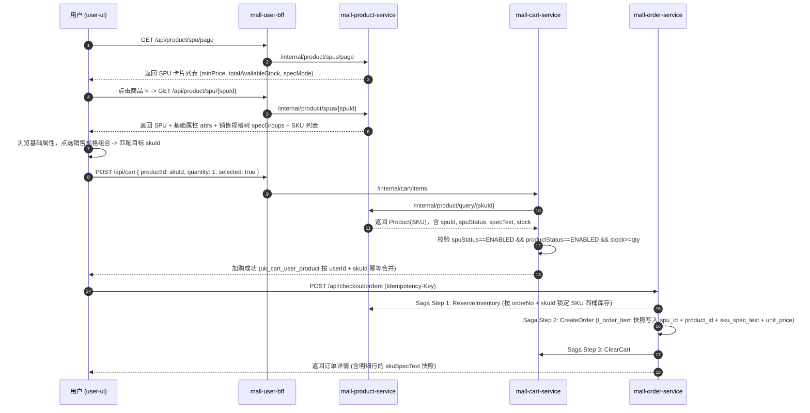

# SPU / SKU 与商品属性体系扩展实施规格（SPEC）

| 项目 | 内容 |
|---|---|
| 文档状态 | 实施规格（Spec），待评审后进入开发 |
| 上游计划 | [plan.md](plan.md)（架构决策与分阶段实施计划） |
| 适用模块 | `mall-api-product`、`mall-product-service`、`mall-api-cart`、`mall-cart-service`、`mall-api-order`、`mall-order-service`、`mall-refund-service`、`mall-core`、`mall-user-bff`、`mall-admin-bff`、`user-ui`、`admin-ui` |
| 数据权威 | `backend/env/sql/dm8/schema.sql` |
| 约束基线 | [AGENTS.md](../../AGENTS.md)、[README.md 第 15 章](../../README.md#15-代码导览) |

---

## 1. 术语与核心概念定义

| 术语 | 英文 / 代码标识 | 领域定义 |
|---|---|---|
| **SPU** | `ProductSpu` (`spu_id`) | **标准商品单元（Standard Product Unit）**：商品信息聚合与展示的最小单元（如「Java 架构师实战课」「iPhone 16 Pro」）。承载标题、副标题、主图、图文描述、基础展示属性与销售规格定义，**不直接持有库存桶**。 |
| **SKU** | `Product` / `ProductSku` (`product_id` / `sku_id`) | **最小库存与交易计价单元（Stock Keeping Unit）**：对应 SPU 下的一组具体销售规格组合（如「旗舰版 / 永久有效」「沙漠钛金属 / 256GB」）。**唯一持有价格（分）与四桶库存（`available / locked / sold / lost`）**，是加购、下单预占、支付结算、退款回补、Excel 导库的原子目标。 |
| **基础展示属性** | `ProductSpuAttr` (`t_product_spu_attr`) | **SPU 级非销售参数（General / Display Attributes）**：描述整款 SPU 的公共客观属性（如「品牌：Apple」「产地：中国」「讲师：张工」），一维键值对，不拆分 SKU，不影响价格与库存。 |
| **销售规格组** | `ProductSpecGroup` (`t_product_spec_group`) | **SPU 级销售规格维度（Sale Spec Dimension）**：用户购买时需选择的维度名称（如「颜色」「内存容量」「课程版本」）。同一多规格 SPU 支持 1～3 个销售规格组。 |
| **销售规格值** | `ProductSpecValue` (`t_product_spec_value`) | **销售规格维度下的可选值（Sale Spec Option）**：如「颜色」下的「黑色」「白色」。 |
| **规格组合键** | `spec_key` | SKU 绑定的销售规格值规范化签名：按 `group_id` 升序排列拼接为 `groupId1:valueId1;groupId2:valueId2`；单规格商品的默认 SKU 固定为 `'DEFAULT'`。同一 SPU 下 `(spu_id, spec_key)` 唯一。 |
| **规格可读文本** | `spec_text`（读时派生）/ `sku_spec_text`（持久快照） | 按 `spec_group.sort_order` 升序拼接的可读规格文本（如 `"沙漠钛金属 / 256GB"`）。`spec_text` 不落 `t_product`，由商品服务按 `spec_key` 解析装配；下单时由订单服务写入 `t_order_item.sku_spec_text`，形成不可变快照。 |
| **规格结构数组** | `specs`（读时派生） | 由 `spec_key` 解析出的有序 `[{groupName, specValue}]` 数组，供前端规格胶囊与详情展示；不落库。 |

---

## 2. 需求条目（Functional & Non-Functional Requirements）

### 2.1 功能需求

| 编号 | 需求描述 | 优先级 | 对应验收 |
|---|---|---|---|
| **FR-01** | 管理员可创建**单规格 SPU**（无销售规格组，系统自动生成 1 条 `spec_key='DEFAULT'` 的 SKU）及可选的基础展示属性 | P0 | AC-01 |
| **FR-02** | 管理员可创建**多规格 SPU**：配置基础展示属性、1～3 个销售规格组与规格值，并配置每个规格组合 SKU 的价格、初始库存、SKU 编码与状态 | P0 | AC-02 |
| **FR-03** | 管理员可编辑 SPU 基本信息、基础属性、增补新规格值/新 SKU，或修改已有 SKU 的价格与上下架状态（已存在 SKU 不做物理删除） | P0 | AC-03 |
| **FR-04** | SPU 上下架与 SKU 上下架双层控制：SPU 下架后其下所有 SKU 均不可加购/下单；SPU 上架时必须至少有 1 个 `ENABLED` 的 SKU | P0 | AC-04 |
| **FR-05** | 商城首页按 SPU 分页展示商品卡：显示 SPU 标题、最低价（多规格显示 `¥xx.xx 起`）、聚合可用库存与「选规格 / 加入购物车」入口 | P0 | AC-05 |
| **FR-06** | 用户点击商品卡片可打开商品详情/规格弹窗：查看**基础展示属性参数表**，点选**销售规格值组合**，实时联动对应 SKU 的售价与可用库存（缺货或下架组合置灰） | P0 | AC-06 |
| **FR-07** | 购物车以 SKU（`product_id`）为粒度存储与合并数量，购物车列表实时返回 `spuId`、商品标题、**规格文案 `specText`**、最新 SKU 单价、可用库存与可售状态（SPU 或 SKU 任一下架即标记不可用） | P0 | AC-07 |
| **FR-08** | 下单 Saga（`ReserveInventory → CreateOrder → ClearCart`）在預占前校验 SPU 与 SKU 均处于 `ENABLED`，落单时将 `spu_id` 与 `sku_spec_text` 写入 `t_order_item` 不可变快照 | P0 | AC-08 |
| **FR-09** | 订单列表、订单详情、退款申请列表与管理端退款审核页均展示订单明细行的 `skuSpecText` 规格标签；分项退款与退货回补精确作用到对应 SKU 的四桶库存 | P0 | AC-09 |
| **FR-10** | 管理端库存调整、库存流水、Excel 库存导入/导出支持按 SKU 执行，并在列表与导出模板中展示 `SPU 标题 + SKU 规格文案` | P0 | AC-10 |
| **FR-11** | 保留原有 `/api/product/page` 与 `POST /api/admin/products` 接口向后兼容 | P0 | AC-11 |

### 2.2 非功能与架构约束需求

| 编号 | 约束项 | 目标要求 |
|---|---|---|
| **NFR-01** | 库存四桶不变量 | 每个 SKU 严格满足 `available + locked + sold + lost = 入库总量`；SPU 层不建冗余库存桶 |
| **NFR-02** | 并发与防超卖 | 下单预占继续使用 `ProductMapper.reserveStock`（`WHERE id = #{skuId} AND available_stock >= #{qty}`），禁止 `SELECT ... FOR UPDATE` |
| **NFR-03** | DDD 架构边界 | `product.domain` 零 Spring / MyBatis-Plus 依赖；7 个领域服务的 14 条 ArchUnit 规则全部通过 |
| **NFR-04** | 查询性能（防 N+1） | SPU 分页查询与购物车批量查询严禁逐行 N+1 查 SKU/SPU，必须使用 `IN` 批量加载或冗余聚合列 |

---

## 3. 业务规则（Business Rules）

| 编号 | 规则定义 |
|---|---|
| **BR-01** | **属性分类规则**：基础展示属性（`t_product_spu_attr`）同一 SPU 下 `attr_name` 去重后不可重复，单 SPU 最多 30 项；销售规格组（`t_product_spec_group`）同一 SPU 下 `spec_name` 不可重复，单 SPU 最多 3 组，每组最多 20 个规格值（`t_product_spec_value`）。 |
| **BR-02** | **规格模式（`spec_mode`）规则**：`SINGLE`（单规格）SPU 不含任何销售规格组，有且仅有 1 条 `spec_key = 'DEFAULT'` 的 SKU；`MULTI`（多规格）SPU 至少包含 1 个销售规格组，其下每个 SKU 必须覆盖该 SPU 的全部销售规格组（不允许某个 SKU 漏选某个规格维度）。`spec_mode` 由"是否存在销售规格组"唯一决定，禁止出现 `SINGLE` 却有规格组、或 `MULTI` 却无规格组的不一致状态，服务端保存时必须校验。 |
| **BR-03** | **规范化 `spec_key` 规则**：多规格 SKU 的 `spec_key` 必须由服务端按 `group_id` 升序排列生成 `groupId1:valueId1;groupId2:valueId2`；前端传入的规格组合由服务端统一校验并解析为 `spec_key`。`spec_text` 与 `specs` 不落库，读取时按 `spec_key` 批量解析后装配到 VO（`spec_text` 按 `group.sort_order` 升序以 `" / "` 连接）。任何改变规格值的操作必须同事务重算受影响 SKU 的 `spec_key`（见 BR-07）。 |
| **BR-04** | **SPU 价格区间与默认 SKU 维护规则**：每次创建/编辑 SPU、修改 SKU 价格或切换 SKU 上下架状态时，服务端在同事务内重算该 SPU 下所有 `ENABLED` SKU（若全部下架则取全部 SKU）的 `min_price`、`max_price` 与 `default_sku_id`（优先取 `ENABLED` 且价格最低/排最前的 SKU）并更新回 `t_product_spu`。默认 SKU 仅由 `t_product_spu.default_sku_id` 表达，`t_product` 不设 `is_default` 列，避免双重事实源。 |
| **BR-05** | **可售性判定规则**：`Product.isEffectivelyEnabled()` 定义为 `CommonStatus.ENABLED.getType().equals(productStatus) && CommonStatus.ENABLED.getType().equals(spuStatus)`。只要 SPU 或 SKU 任一为 `DISABLED`，加购（`CartServiceImpl.put`）与下单（`CheckoutTxService.buildCheckoutContext`）均拒绝并提示 `"商品已下架"`。 |
| **BR-06** | **SKU 不可物理删除规则**：编辑 SPU 时，请求中的 SKU 若带有已存在的 `skuId`，则更新其 `price / skuCode / productStatus`，规格组合发生变化时按 BR-07 重算 `spec_key`（四桶库存仅通过库存调整接口或首次新建初始化，编辑 SPU 不覆盖已有 SKU 的四桶库存！）；若旧 SKU 未出现在本次编辑列表中，将其 `product_status` 置为 `DISABLED`，严禁执行 `DELETE FROM t_product`。 |
| **BR-07** | **规格定义引用完整性规则**：编辑 SPU 时，请求中的规格组与规格值必须携带已有 `id`；缺 `id` 视为新增，若名称与已有记录重复则拒绝。被任何 SKU 的 `spec_key` 引用的规格组/规格值**禁止删除**（只允许改名）；改名时服务端必须在同一事务内级联重算该 SPU 下所有受影响 SKU 的 `spec_key`，并校验重算后仍满足 `uk_product_spu_spec (spu_id, spec_key)`，否则整单拒绝。删除规格组/规格值前必须先禁用引用它的 SKU。 |
| **BR-08** | **标题权威规则**：`t_product_spu.title` 是商品标题的唯一权威来源；`t_product.title` 仅作为同步冗余列，由服务端在创建/编辑 SKU 时写入 SPU 标题，禁止单独编辑 SKU 标题；SPU 改名时同事务同步其下所有 SKU 的 `title`，保证首页、购物车、订单快照与库存导出标题一致，历史订单 `t_order_item.product_title` 不受影响。 |

---

## 4. 数据库设计（DM8 `schema.sql` 权威定义）

### 4.1 新增表 DDL

```sql
-- ----------------------------
-- t_product_spu 标准商品单元表（SPU）
-- ----------------------------
CREATE TABLE t_product_spu
(
    id             BIGINT IDENTITY(1, 1) NOT NULL,
    spu_code       VARCHAR(64),
    title          VARCHAR(256)                    NOT NULL,
    subtitle       VARCHAR(256),
    category_name  VARCHAR(64),
    brand_name     VARCHAR(64),
    main_image     VARCHAR(512),
    description    CLOB,
    spec_mode      VARCHAR(16) DEFAULT 'SINGLE'    NOT NULL,
    spu_status     VARCHAR(16) DEFAULT 'ENABLED'   NOT NULL,
    min_price      INT         DEFAULT 1           NOT NULL,
    max_price      INT         DEFAULT 1           NOT NULL,
    default_sku_id BIGINT,
    create_time    TIMESTAMP   DEFAULT CURRENT_TIMESTAMP,
    update_time    TIMESTAMP   DEFAULT CURRENT_TIMESTAMP,
    CONSTRAINT pk_product_spu PRIMARY KEY (id)
);
CREATE INDEX idx_product_spu_status_time ON t_product_spu (spu_status, create_time DESC);

COMMENT ON TABLE t_product_spu IS '标准商品单元表（SPU）：聚合商品公共展示信息、价格区间与默认SKU，不直接持有物理库存桶';
COMMENT ON COLUMN t_product_spu.spec_mode IS '规格模式：SINGLE-单规格，MULTI-多规格';
COMMENT ON COLUMN t_product_spu.spu_status IS 'SPU状态：ENABLED-上架，DISABLED-下架（下架后下属全部SKU不可售）';
COMMENT ON COLUMN t_product_spu.min_price IS '下属有效SKU最低售价(分)';
COMMENT ON COLUMN t_product_spu.max_price IS '下属有效SKU最高售价(分)';
COMMENT ON COLUMN t_product_spu.default_sku_id IS '默认选中的SKU ID（指向 t_product.id）';

-- ----------------------------
-- t_product_spu_attr 商品基础展示属性表（SPU参数，不拆SKU）
-- ----------------------------
CREATE TABLE t_product_spu_attr
(
    id          BIGINT IDENTITY(1, 1) NOT NULL,
    spu_id      BIGINT                NOT NULL,
    attr_name   VARCHAR(64)           NOT NULL,
    attr_value  VARCHAR(256)          NOT NULL,
    sort_order  INT       DEFAULT 0   NOT NULL,
    create_time TIMESTAMP DEFAULT CURRENT_TIMESTAMP,
    update_time TIMESTAMP DEFAULT CURRENT_TIMESTAMP,
    CONSTRAINT pk_product_spu_attr PRIMARY KEY (id),
    CONSTRAINT uk_product_spu_attr UNIQUE (spu_id, attr_name)
);
CREATE INDEX idx_spu_attr_spu_sort ON t_product_spu_attr (spu_id, sort_order, id);

COMMENT ON TABLE t_product_spu_attr IS '商品基础展示属性表：如品牌、产地、材质、讲师等SPU级公共参数，不参与SKU组合';

-- ----------------------------
-- t_product_spec_group 商品销售规格组表（决定SKU的维度，如颜色、容量）
-- ----------------------------
CREATE TABLE t_product_spec_group
(
    id          BIGINT IDENTITY(1, 1) NOT NULL,
    spu_id      BIGINT                NOT NULL,
    spec_name   VARCHAR(64)           NOT NULL,
    sort_order  INT       DEFAULT 0   NOT NULL,
    create_time TIMESTAMP DEFAULT CURRENT_TIMESTAMP,
    update_time TIMESTAMP DEFAULT CURRENT_TIMESTAMP,
    CONSTRAINT pk_product_spec_group PRIMARY KEY (id),
    CONSTRAINT uk_product_spec_group UNIQUE (spu_id, spec_name)
);
CREATE INDEX idx_spec_group_spu_sort ON t_product_spec_group (spu_id, sort_order, id);

-- ----------------------------
-- t_product_spec_value 商品销售规格值表（如黑色、256GB）
-- ----------------------------
CREATE TABLE t_product_spec_value
(
    id          BIGINT IDENTITY(1, 1) NOT NULL,
    spu_id      BIGINT                NOT NULL,
    group_id    BIGINT                NOT NULL,
    spec_value  VARCHAR(64)           NOT NULL,
    sort_order  INT       DEFAULT 0   NOT NULL,
    create_time TIMESTAMP DEFAULT CURRENT_TIMESTAMP,
    update_time TIMESTAMP DEFAULT CURRENT_TIMESTAMP,
    CONSTRAINT pk_product_spec_value PRIMARY KEY (id),
    CONSTRAINT uk_product_spec_value UNIQUE (group_id, spec_value)
);
CREATE INDEX idx_spec_value_spu_group ON t_product_spec_value (spu_id, group_id, sort_order, id);

-- 与既有表保持一致：每表一个 BEFORE UPDATE 触发器维护 update_time
CREATE
OR REPLACE TRIGGER trg_product_spu_uptime
BEFORE
UPDATE ON t_product_spu
    FOR EACH ROW
BEGIN
  :NEW
.update_time := CURRENT_TIMESTAMP;
END;
/

CREATE
OR REPLACE TRIGGER trg_product_spu_attr_uptime
BEFORE
UPDATE ON t_product_spu_attr
    FOR EACH ROW
BEGIN
  :NEW
.update_time := CURRENT_TIMESTAMP;
END;
/

CREATE
OR REPLACE TRIGGER trg_product_spec_group_uptime
BEFORE
UPDATE ON t_product_spec_group
    FOR EACH ROW
BEGIN
  :NEW
.update_time := CURRENT_TIMESTAMP;
END;
/

CREATE
OR REPLACE TRIGGER trg_product_spec_value_uptime
BEFORE
UPDATE ON t_product_spec_value
    FOR EACH ROW
BEGIN
  :NEW
.update_time := CURRENT_TIMESTAMP;
END;
/
```

### 4.2 既有表扩展列（`t_product` 与 `t_order_item`）

#### 1. `t_product`（作为 SKU 表扩展）

在现有 `id, title, price, available_stock, locked_stock, sold_stock, lost_stock, product_status, create_time, update_time` 基础上增加以下列与约束：

| 新增字段 | 类型 | 默认值/约束 | 说明 |
|---|---|---|---|
| `spu_id` | `BIGINT` | `NOT NULL` | 所属 SPU ID（关联 `t_product_spu.id`） |
| `sku_code` | `VARCHAR(64)` | 可空 | 商家 SKU 编码（如 `IP16P-TI-256`） |
| `spec_key` | `VARCHAR(256)` | `DEFAULT 'DEFAULT' NOT NULL` | 规范化规格组合签名（单规格为 `'DEFAULT'`，多规格为 `'g1:v1;g2:v2'`），是规格组合唯一性锚点 |

不新增 `spec_text` / `spec_json` / `is_default` 列：前两者读取时按 `spec_key` 派生，默认 SKU 唯一由 `t_product_spu.default_sku_id` 表达；`title` 保持为 `t_product_spu.title` 的同步冗余列（见 BR-08）。

新增约束与索引：
- `CONSTRAINT uk_product_spu_spec UNIQUE (spu_id, spec_key)`
- `CREATE INDEX idx_product_spu_status ON t_product (spu_id, product_status);`

#### 2. `t_order_item`（订单行增加 SPU 与规格成交快照）

| 新增字段 | 类型 | 默认值/约束 | 说明 |
|---|---|---|---|
| `spu_id` | `BIGINT` | 可空（兼容历史数据） | 下单时所属 SPU ID 快照 |
| `sku_spec_text` | `VARCHAR(256)` | 可空 | 下单时 SKU 规格文案快照（如 `'沙漠钛金属 / 256GB'`） |

---

## 5. API 契约规格

通用约定：统一返回 `R<T>` 信封（`{ "code": 0, "message": "...", "data": ... }`），金额单位统一为**分（Integer）**。

### 5.1 用户端公开接口（`mall-user-bff` → `/api/product/**`，GET 免登录）

#### 1. SPU 商品分页列表：`GET /api/product/spu/page`
- **Query 参数**：`page`（默认 1）、`size`（默认 12，上限 100）、`keyword`（可选，按 SPU `title` / `subtitle` 模糊过滤）。
- **响应 `PageVO<SpuSummaryVO>`**：
  ```json
  {
    "code": 0,
    "data": {
      "total": 5,
      "page": 1,
      "size": 12,
      "records": [
        {
          "spuId": 5,
          "spuCode": "SPU-ARCH-01",
          "title": "云原生微服务架构实战",
          "subtitle": "含源码、架构图解与一对一答疑",
          "brandName": "极客学堂",
          "categoryName": "架构课程",
          "specMode": "MULTI",
          "spuStatus": "ENABLED",
          "minPrice": 1,
          "maxPrice": 2,
          "totalAvailableStock": 180,
          "defaultSkuId": 5,
          "skuCount": 2,
          "attrSummary": ["讲师：张工", "技术栈：Spring Cloud + DM8"]
        }
      ]
    }
  }
  ```

#### 2. SPU 商品详情（含基础属性、销售规格树与 SKU 列表）：`GET /api/product/spu/{spuId}`
- **响应 `SpuDetailVO`**：
  ```json
  {
    "code": 0,
    "data": {
      "spu": {
        "id": 5,
        "spuCode": "SPU-ARCH-01",
        "title": "云原生微服务架构实战",
        "subtitle": "含源码、架构图解与一对一答疑",
        "brandName": "极客学堂",
        "categoryName": "架构课程",
        "description": "深入剖析分布式锁、Outbox、Seata Saga 与对账。",
        "specMode": "MULTI",
        "spuStatus": "ENABLED",
        "minPrice": 1,
        "maxPrice": 2,
        "defaultSkuId": 5
      },
      "attrs": [
        { "id": 1, "attrName": "品牌/出品方", "attrValue": "极客学堂", "sortOrder": 10 },
        { "id": 2, "attrName": "技术栈", "attrValue": "Spring Boot 3.5 + DM8 + Redis", "sortOrder": 20 }
      ],
      "specGroups": [
        {
          "id": 10,
          "specName": "版本",
          "sortOrder": 10,
          "values": [
            { "id": 101, "specValue": "标准版", "sortOrder": 10 },
            { "id": 102, "specValue": "旗舰答疑版", "sortOrder": 20 }
          ]
        },
        {
          "id": 20,
          "specName": "有效期",
          "sortOrder": 20,
          "values": [
            { "id": 201, "specValue": "一年期", "sortOrder": 10 },
            { "id": 202, "specValue": "永久有效", "sortOrder": 20 }
          ]
        }
      ],
      "skus": [
        {
          "id": 5,
          "spuId": 5,
          "skuCode": "ARCH-STD-1Y",
          "title": "云原生微服务架构实战",
          "price": 1,
          "stock": 100,
          "productStatus": "ENABLED",
          "specKey": "10:101;20:201",
          "specText": "标准版 / 一年期",
          "specs": [
            { "groupName": "版本", "specValue": "标准版" },
            { "groupName": "有效期", "specValue": "一年期" }
          ]
        }
      ]
    }
  }
  ```

---

### 5.2 管理端接口（`mall-admin-bff` → `/api/admin/products/**`，仅 `ROLE_ADMIN`）

| 方法与路径 | 说明 |
|---|---|
| `GET /api/admin/products/spu/page` | SPU 管理分页列表（返回全部状态 SPU 的汇总字段：`spuStatus`、`specMode`、`minPrice/maxPrice`、`totalAvailableStock`、`skuCount`、`attrSummary`；不返回明细，明细走下方详情接口，避免列表 payload 无上限与 N+1） |
| `GET /api/admin/products/spu/{spuId}` | 获取单个 SPU 完整管理详情（含下属所有状态 SKU 的四桶库存） |
| `POST /api/admin/products/spu` | 创建单规格或多规格 SPU（入参 `SpuSaveRequest`） |
| `PUT /api/admin/products/spu/{spuId}` | 编辑 SPU（更新基本信息、基础属性列表、规格组及下属 SKU 价格/状态，新增 SKU 初始化四桶） |
| `POST /api/admin/products/spu/{spuId}/status` | SPU 上下架（`{"productStatus": "ENABLED" \| "DISABLED"}`） |
| `GET /api/admin/products/page` | （既有保留）按 SKU 分页查询四桶库存列表，每个 `Product` 对象新增返回 `spuId`、`spuTitle`、`specText`、`skuCode` |
| `POST /api/admin/products/{skuId}/stock` | （既有保留）按 SKU ID 调整可用库存并写 `MANUAL_ADJUST` 流水，同步刷新所属 SPU 汇总 |

#### 创建/编辑 SPU 请求体 `SpuSaveRequest` 示例：

```json
{
  "spuCode": "SPU-PHONE-16",
  "title": "智能手机 Pro",
  "subtitle": "旗舰芯片 超长续航",
  "brandName": "TechBrand",
  "categoryName": "数码手机",
  "description": "旗舰级智能手机详情描述",
  "specMode": "MULTI",
  "attrs": [
    { "attrName": "品牌", "attrValue": "TechBrand", "sortOrder": 10 },
    { "attrName": "机身材质", "attrValue": "航空级钛金属", "sortOrder": 20 },
    { "attrName": "保修期", "attrValue": "全国联保1年", "sortOrder": 30 }
  ],
  "specGroups": [
    {
      "id": null,
      "specName": "颜色",
      "sortOrder": 10,
      "values": [
        { "id": null, "specValue": "沙漠金", "sortOrder": 10 },
        { "id": null, "specValue": "原色钛", "sortOrder": 20 }
      ]
    },
    {
      "id": null,
      "specName": "存储容量",
      "sortOrder": 20,
      "values": [
        { "id": null, "specValue": "256GB", "sortOrder": 10 },
        { "id": null, "specValue": "512GB", "sortOrder": 20 }
      ]
    }
  ],
  "skus": [
    {
      "skuId": null,
      "skuCode": "PHONE16-GOLD-256",
      "price": 1,
      "stock": 50,
      "productStatus": "ENABLED",
      "specs": [
        { "specName": "颜色", "specValue": "沙漠金" },
        { "specName": "存储容量", "specValue": "256GB" }
      ]
    },
    {
      "skuId": null,
      "skuCode": "PHONE16-TI-512",
      "price": 2,
      "stock": 30,
      "productStatus": "ENABLED",
      "specs": [
        { "specName": "颜色", "specValue": "原色钛" },
        { "specName": "存储容量", "specValue": "512GB" }
      ]
    }
  ]
}
```

> 编辑既有 SPU 时，规格组/规格值必须回填已有 `id`；缺 `id` 视为新增，名称与已有记录重复则拒绝。SKU 的 `specs` 仍按 `specName + specValue` 提交，由服务端在同一请求内解析为 `spec_key`（名称在同一 SPU 内唯一，见 BR-01 / BR-07）。

---

### 5.3 购物车、订单与退款契约扩展

1. **购物车 `CartItemVO`（`GET /api/cart`）**：
   - `productId`：保持为 SKU ID（`t_product.id`）；
   - 新增 `spuId`（`Long`）、`specText`（`String`，如 `"沙漠金 / 256GB"`，单规格为 `null`）；
   - `available`：当 `product.isEffectivelyEnabled() && availableStock > 0` 时为 `true`，若 SPU 下架则 `available = false` 且 `productStatus = "DISABLED"`。
2. **订单明细 `OrderItem`（`GET /api/checkout/orders`、`GET /api/admin/order/all`）**：
   - 新增 `spuId`（`Long`）、`skuSpecText`（`String`），从 `t_order_item.spu_id` 与 `t_order_item.sku_spec_text` 读取快照。
3. **退款申请 `RefundApplyVO.Item`（`GET /api/refund-applies`）**：
   - 新增 `skuSpecText`（`String`），由关联的 `OrderItem.getSkuSpecText()` 填充。

---

## 6. 核心交互与业务流转图



---

## 7. 验收标准与测试用例（Acceptance Criteria）

### 7.1 功能验收（与 FR 一一对应）

| 验收编号 | 对应需求 | 场景 | 给定（Given） | 当（When） | 则（Then） |
|---|---|---|---|---|---|
| **AC-01** | FR-01 | 单规格 SPU 创建与兼容 | 管理员提交单规格 SPU（或调用旧 `POST /api/admin/products`）及 2 项基础属性 | 保存成功 | `t_product_spu` 生成 1 条 `SINGLE` 记录，`t_product_spu_attr` 生成 2 条属性，`t_product` 生成 1 条 `spec_key='DEFAULT'` 的 SKU，`default_sku_id` 与 `min_price/max_price` 正确指向该 SKU |
| **AC-02** | FR-02 | 多规格 SPU 创建与规格唯一性 | 管理员创建含「颜色(2)×容量(2)」的 SPU 并提交 4 个 SKU；另提交两个相同「颜色+容量」组合的 SKU | 保存成功 / 重复提交 | 合法请求生成 4 条不同 `spec_key` 的 SKU，`min_price/max_price` 正确；重复规格组合被 `SpuSpecPolicy` 拒绝并提示 `"同一商品下不能存在重复的规格组合"` |
| **AC-03** | FR-03 | 编辑多规格 SPU 不丢失已有 SKU 历史 | 某多规格 SPU 下 SKU-A 已产生订单，管理员编辑该 SPU 修改 SKU-A 价格并新增 SKU-C，同时移除 SKU-B | 提交编辑 | SKU-A 的 `id` 与四桶库存保持不变、价格更新；SKU-B 状态置为 `DISABLED`（不物理删除）；SKU-C 新增入库；SPU 价格区间自动重算 |
| **AC-04** | FR-04 | SPU 上下架双层闸门 | SPU-1 下有 SKU-1（`product_status='ENABLED'`, `stock=50`） | 管理员将 SPU-1 设为 `DISABLED` 后用户加购/结算；再尝试在无 `ENABLED` SKU 时上架 SPU-1 | 加购与下单均被拒绝并提示 `"商品已下架"`，购物车条目 `available=false`；无可用 SKU 的上架请求被拒绝 |
| **AC-05** | FR-05 | 首页 SPU 卡片分页 | 库中存在单规格与多规格 SPU 各若干 | 调用 `GET /api/product/spu/page` | 每行返回标题、`minPrice`（多规格展示 `¥xx.xx 起`）、`totalAvailableStock`、`specMode`、`defaultSkuId`、`skuCount`；SQL 按 `IN` 批量装配，无逐行 N+1 |
| **AC-06** | FR-06 | 属性查看与规格联动 | 用户打开多规格商品规格弹窗 | 查看基础属性并切换规格组合 | 展示完整基础属性；切换时价格/库存实时联动，缺货或下架组合置灰；`specs` 数组顺序与 `specGroups.sortOrder` 一致 |
| **AC-07** | FR-07 | 购物车以 SKU 为粒度 | 同一 SPU 的两个 SKU 分别加购 | 查询 `GET /api/cart` | 生成两条独立记录（`uk_cart_user_product` 按 `userId + skuId` 幂等合并），返回 `spuId`、`specText`、最新价格与可售状态；SPU 或 SKU 任一下架则 `available=false` |
| **AC-08** | FR-08 | 结算校验与成交快照 | 多规格商品下单；下单后管理员改名/调价/改规格 | 提交 `POST /api/checkout/orders` | 预占前校验 SPU 与 SKU 均 `ENABLED`；`t_order_item` 固化 `spu_id`、`product_id`、`product_title`（SPU 标题）、`sku_spec_text`、`unit_price`，后续管理员修改不影响历史订单 |
| **AC-09** | FR-09 | 规格展示与 SKU 级退款回补 | 订单含同一 SPU 的 SKU-1（2 件）与 SKU-2（1 件） | 订单/退款页查看明细；对 SKU-1 退 1 件并完成回补 | 订单、退款申请、管理端退款审核均展示 `skuSpecText`；仅 SKU-1 四桶库存变化（`locked/sold -> available`），SKU-2 不受影响 |
| **AC-10** | FR-10 | 库存按 SKU 维护与导入导出 | 管理端执行库存调整、查看流水、Excel 导入/导出 | 提交操作 | 以 SKU 为原子目标，列表与导出模板展示 `SPU 标题 + specText`；只允许对已存在的 SKU 调整/导入，不新建 SPU |
| **AC-11** | FR-11 | 旧接口向后兼容 | 旧调用方使用 `GET /api/product/page` 与 `POST /api/admin/products` | 调用旧接口 | 返回结构不变；创建请求自动生成 1 个 `SINGLE` SPU + 1 个 `DEFAULT` SKU，无需前端改动 |
| **AC-12** | BR-07 | 规格引用完整性 | SPU 下已有 SKU 引用「颜色:沙漠金」 | 管理员尝试删除该规格值；改为将其重命名为「沙丘金」 | 删除被引用值被拒绝并提示先禁用相关 SKU；重命名成功且同事务级联重算受影响 SKU 的 `spec_key`，重算后仍满足 `uk_product_spu_spec` |
| **AC-13** | BR-08 | 标题权威与同步 | 多规格 SPU 及其 SKU 已存在且已有历史订单 | 管理员修改 SPU 标题 | `t_product_spu.title` 与其下所有 `t_product.title` 同事务更新；首页与购物车显示新标题，历史订单 `t_order_item.product_title` 保持不变 |

### 7.2 非功能与架构门禁

| 验收编号 | 覆盖约束 | 验证方式 |
|---|---|---|
| **AC-NFR-01** | NFR-01 / NFR-02 | `InventoryServiceImplTest` 全部通过；`ProductMapper.xml` 六条条件 UPDATE 未被改写，`reserveStock` 仍为 `WHERE id = #{skuId} AND available_stock >= #{quantity}` |
| **AC-NFR-02** | NFR-03 | `mvn clean test`：`SpuSpecPolicyTest`、7 个领域 `*DomainArchitectureTest` 全部通过 |
| **AC-NFR-03** | NFR-04 | SPU 分页与购物车批量装配使用 `IN` 批量查询；代码评审确认无逐行 `findById` |
| **AC-NFR-04** | 回归门禁 | `mvn clean test`、两个前端的 `npm run test:logic` 与 `npm run build` 均 0 错误 |
